# BUSINESS PROCESS MAPPING
## Advanced Wholesale Distribution & Supply Chain ERP Implementation

**Company:** PT Arunika Distribusi Nusantara  
**Project ID:** ADN-ERP-2026-001  
**ERP Platform:** Odoo 19 Enterprise  
**Deployment:** On-Premise | Ubuntu Linux | PostgreSQL  
**Document ID:** ADN-BPM-001  
**Version:** 1.0  
**Status:** Approved for Functional Design and Fit-Gap Validation  
**Date:** 18 November 2026  
**Source Documents:** BRD ADN-BRD-001 Version 1.1 and SOW ADN-SOW-001 Version 1.0  
**Classification:** Portfolio / Fictional Business Case

> **Portfolio Disclaimer**  
> PT Arunika Distribusi Nusantara, its stakeholders, operating policies, transaction values, targets, sample records, and implementation scenario are fictional. This document is a process-design artifact based on the supplied BRD and SOW. It is not evidence of an actual client implementation, actual stakeholder approval, or statutory tax advice.

---

## Document Control

| Attribute | Description |
|---|---|
| Document Title | Business Process Mapping |
| Document ID | ADN-BPM-001 |
| Project ID | ADN-ERP-2026-001 |
| BRD Reference | ADN-BRD-001, Version 1.1 |
| SOW Reference | ADN-SOW-001, Version 1.0 |
| ERP Platform | Odoo 19 Enterprise |
| Organization | PT Arunika Distribusi Nusantara |
| Process Coverage | Master Data, CRM/Sales, Credit, Procurement, Inventory, Warehouse, Supply Chain, Quality, Logistics, Returns, Accounting, Landed Cost, Vendor Performance, Reporting, Security |
| Currency | Indonesian Rupiah (IDR) |
| Business Model | B2B Wholesale Distribution |
| Warehouses | Jakarta, Bandung, Surabaya |

### Revision History

| Version | Date | Description | Author |
|---|---|---|---|
| 1.0 | 18-Nov-2026 | Initial business process mapping derived from BRD v1.1 and SOW v1.0 | ERP Business Analyst |

### Approval and Governance Note

The BRD and SOW are the source baselines for this mapping. The BRD's document control section records stakeholder approval status as pending, while the SOW describes its own portfolio baseline as accepted and contains simulated sign-off entries. Accordingly, this process map is presented as a working design baseline for functional validation. No real stakeholder approval is implied. Process decisions that require clarification are identified in Section 16.

---

# 1. Executive Summary

This document defines the current-state (AS-IS) process context and the proposed future-state (TO-BE) business processes for the Advanced Wholesale Distribution & Supply Chain ERP implementation at PT Arunika Distribusi Nusantara.

The target operating model centralizes distribution operations in Odoo 19 Enterprise and connects commercial, warehouse, inventory, procurement, quality, logistics, and financial activities through traceable business transactions.

The mapping is designed to:

- Standardize business workflows across Jakarta, Bandung, and Surabaya warehouses.
- Connect procurement and supplier settlement through Procure to Pay (P2P).
- Connect customer demand and collection through Order to Cash (O2C).
- Improve stock availability, replenishment, traceability, and inventory control.
- Enforce approval thresholds, credit policies, quality dispositions, and segregation of duties.
- Integrate stock movements with perpetual inventory valuation and accounting.
- Provide management reporting based on defined formulas and traceable source records.
- Establish a clear basis for Fit-Gap Analysis, Functional Specification Documents (FSD), Technical Design Documents (TDD), testing, and the Requirements Traceability Matrix (RTM).

The detailed implementation behavior, exact Odoo models/views, custom module design, API contracts, and accounting configuration remain subject to Fit-Gap Analysis, FSD, and TDD.

# 2. Business Context and Operating Model

## 2.1 Organization Profile

| Attribute | Baseline |
|---|---|
| Company | PT Arunika Distribusi Nusantara |
| Industry | FMCG and Consumer Goods Wholesale Distribution |
| Business Model | Business-to-Business (B2B) |
| Legal Entity | Single company |
| Primary Currency | IDR |
| Fiscal Year | January–December |
| Product Catalog | 500 SKUs |
| Active Customers | 250 |
| Active Suppliers | 40 |
| ERP Users | 20 |
| Warehouses | 3 |
| Internal Locations | 30+ |
| Sales Territories | 5 |

## 2.2 Warehouse Network

| Warehouse | Code | Primary Responsibility |
|---|---|---|
| Jakarta Central Warehouse | WH-JKT | Main supplier/import receiving point, central storage, and regional stock allocation |
| Bandung Regional Warehouse | WH-BDG | West Java fulfillment and regional replenishment |
| Surabaya Regional Warehouse | WH-SBY | East Java fulfillment and regional inventory control |

The detailed location hierarchy must support receiving/input, quality, storage zones, packing, output, damaged stock, returns, and other controlled locations. The Jakarta example includes `Input`, `Quality`, `Stock/Zone-A`, `Stock/Zone-B`, `Stock/Zone-C`, `Packing`, `Output`, `Damaged`, and `Returns`. Equivalent structures are to be established for Bandung and Surabaya.

## 2.3 End-to-End Operating Cycle

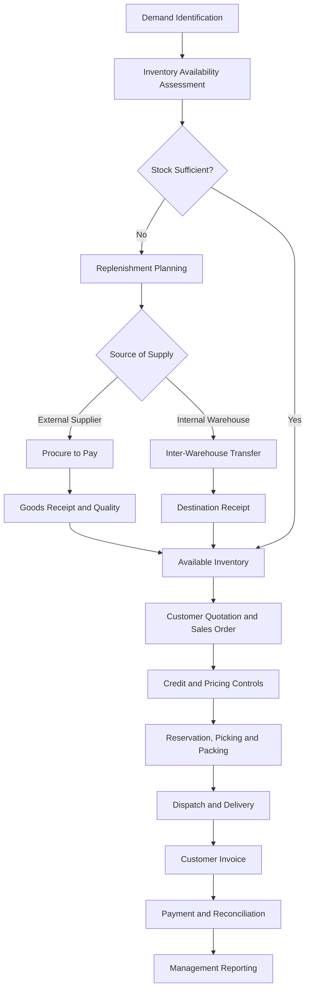

# 3. Process Mapping Methodology and Notation

## 3.1 Process States

- **AS-IS:** Existing operating context described in the BRD, including fragmented tools, spreadsheet-based records, manual approvals, separate accounting applications, and manual reporting.
- **TO-BE:** Proposed standardized process derived from BRD requirements and SOW implementation scope.
- **Exception Flow:** Alternative path for rejected, incomplete, blocked, discrepant, or approval-required transactions.
- **Control Point:** A business rule, approval, validation, or segregation-of-duties control that must be enforced and evidenced.

## 3.2 Process Map Interpretation

The flow diagrams represent business sequence and decision logic, not a final Odoo screen design. A box marked as an ERP activity indicates that the activity is expected to be recorded or controlled in the target ERP process. It does not assert that every requirement is available in standard Odoo without configuration or custom development.

## 3.3 Process Ownership

| Process Group | Primary Owner | Supporting Roles |
|---|---|---|
| Master Data | Relevant Data Owner | Department Manager, ERP Manager |
| CRM and Sales | Sales Manager | Sales Representative, Sales Supervisor |
| Credit Management | Finance Manager | Sales Representative, Accounts Receivable |
| Procurement | Procurement Manager | Procurement Officer, Procurement Supervisor |
| Inventory and Warehouse | Operations Manager | Warehouse Manager, Warehouse Supervisor, Inventory Controller |
| Quality | Operations Manager | Quality Inspector |
| Logistics | Operations Manager | Logistics Coordinator, Warehouse Team |
| Returns | Customer Service / Procurement | Quality Inspector, Warehouse, Finance |
| Accounting | Finance Manager | Accounts Receivable, Accounts Payable |
| Vendor Performance | Procurement Manager | Quality, Warehouse, ERP Reporting |
| ERP Security | ERP Manager / IT | Department Managers, System Administrator |

# 4. AS-IS Process Assessment

## 4.1 Current-State Summary

The BRD describes an operating environment using Microsoft Excel for inventory records, spreadsheet-based purchasing plans, manual sales order processing, separate accounting applications, manual warehouse reconciliation, email/messaging for supplier communication, and manually prepared reports.

The source documents do not define every detailed AS-IS task sequence. Therefore, the AS-IS map below is a high-level representation of the documented environment and should not be interpreted as a fully validated observation of actual operations.

## 4.2 AS-IS High-Level Flow

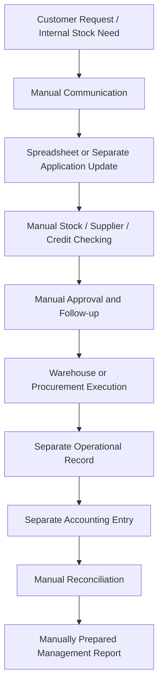

## 4.3 Documented Pain Points

| Challenge ID | Business Area | AS-IS Condition | Business Impact | TO-BE Response |
|---|---|---|---|---|
| CH-001 | Inventory | Inconsistent spreadsheet stock records | Stock discrepancies | Centralized inventory balances and movement history |
| CH-002 | Procurement | Manual replenishment planning | Overstock and stockouts | Warehouse-level replenishment rules and forecast review |
| CH-003 | Warehouse | Limited location visibility | Inefficient picking | Structured internal locations and putaway/picking flows |
| CH-004 | Sales | Manual stock confirmation | Delayed order processing | ERP availability check and reservation |
| CH-005 | Expiration | Limited expiration monitoring | Expiry losses | Lot/expiration tracking, alerts, FEFO and blocking |
| CH-006 | Purchasing | Inconsistent vendor evaluation | Weak supplier decisions | Vendor scorecard with defined KPI formulas |
| CH-007 | Logistics | Manual delivery coordination | Delivery delays | Delivery status, POD reference, discrepancy records |
| CH-008 | Finance | Separate operational and financial records | Reconciliation difficulty | Integrated AR/AP and perpetual valuation |
| CH-009 | Reporting | Manual report preparation | Delayed decisions | Transaction-based dashboards and reports |
| CH-010 | Multi-Warehouse | Limited cross-warehouse visibility | Unbalanced stock | Warehouse-specific stock visibility and transfers |
| CH-011 | Credit | Manual credit monitoring | Collection risk | Credit exposure calculation, warning and hold |
| CH-012 | Returns | Inconsistent return documentation | Difficult reconciliation | Authorized return and disposition workflow |

## 4.4 AS-IS to TO-BE Transformation Principles

1. Replace duplicate manual records with a centralized transaction record.
2. Establish one controlled source for product, customer, vendor, warehouse, and location master data.
3. Link operational documents to their upstream and downstream records.
4. Apply approval policies consistently and retain approval history.
5. Separate physical inventory status from financial valuation.
6. Maintain lot/serial traceability from receipt through delivery and returns.
7. Ensure reports derive from validated transactional or accounting data.
8. Use fit-gap analysis before approving custom development.

# 5. TO-BE Process Architecture

## 5.1 Process Landscape

| Level 1 Process | Level 2 Process | Primary Output |
|---|---|---|
| Governance and Foundation | Master Data, User Access, Approval Controls | Controlled master data and authorized access |
| Lead to Opportunity | Lead Registration, Opportunity, Activities, Segmentation | Qualified sales opportunity |
| Order to Cash | Quotation, Pricing, Credit, Sales Order, Fulfillment, Invoice, Collection | Paid and reconciled customer transaction |
| Procure to Pay | Replenishment, Requisition, RFQ, Vendor Selection, PO, Receipt, Bill, Payment | Paid and reconciled supplier transaction |
| Inventory and Warehouse | Receiving, Quality, Putaway, Reservation, Picking, Packing, Dispatch, Counting | Accurate stock and traceable movements |
| Supply Chain | Min/Max, Safety Stock, Forecast Review, Inter-Warehouse Replenishment | Balanced inventory availability |
| Quality Management | Incoming/Outgoing Inspection, Disposition | Accepted or controlled stock |
| Logistics | Shipment Preparation, Dispatch, POD, Delivery Status | Confirmed delivery |
| Reverse Logistics | Customer Return, Supplier Return, Inspection, Credit/Replacement | Resolved return case |
| Financial Management | AR, AP, Inventory Valuation, COGS, Landed Cost, Reconciliation | Reconciled financial records |
| Performance Management | Vendor KPIs, Operational Dashboards, Financial Dashboards | Traceable management insight |

## 5.2 Core End-to-End Process Relationships

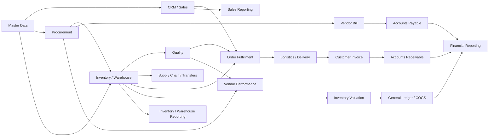

# 6. Detailed TO-BE Process Maps

## 6.1 BPM-001 — Master Data Management

**Objective:** Establish a centralized, consistent, and controlled repository for products, customers, vendors, warehouses, locations, and user-role records.

**Owner:** Relevant Department Data Owner  
**Supporting Roles:** ERP Manager, Inventory Controller, Sales Administration, Procurement Officer, Department Managers  
**Scope References:** BRD 5.1; SCOPE-001; P2; D-003

### Process Flow

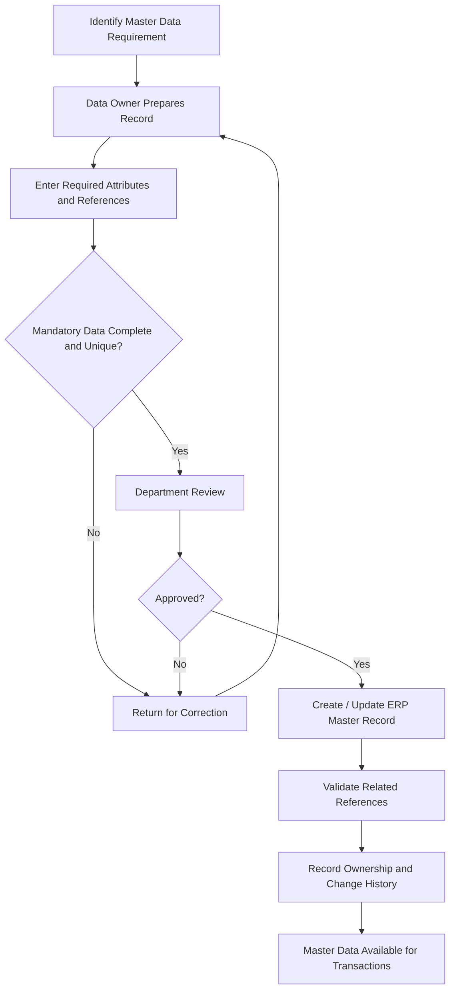

### Process Steps

| Step | Activity | Responsible | System / Record | Control / Output |
|---|---|---|---|---|
| 1 | Identify a new or changed master data requirement | Requesting Department | Master data request | Business reason recorded |
| 2 | Prepare required attributes | Data Owner | Master data template | Required fields populated |
| 3 | Validate unique identifier and references | Data Owner / ERP Manager | Validation log | Duplicate and invalid references rejected |
| 4 | Review data within department | Department Manager | Review record | Ownership and approval evidenced |
| 5 | Create or update master record | Authorized Master Data User | ERP master record | Controlled creation/update |
| 6 | Validate availability to relevant processes | ERP Manager / Key User | Test transaction | Record can be used by intended process |
| 7 | Retain change history | ERP / Audit Control | Audit trail | Traceable master data changes |

### Master Data Requirements

| Data Object | Key Attributes / Rules |
|---|---|
| Product | Unique internal reference, category, UoM, barcode, sales/purchase prices, vendor information, tracking, expiry, reorder rules |
| Customer | Unique code, customer type, address, payment terms, credit limit, salesperson, delivery address, tax identifier placeholder |
| Vendor | Unique code, country, payment terms, lead time, vendor product/prices, performance history |
| Warehouse / Location | Unique code, warehouse relationship, parent location, location type, operational purpose |
| User / Role | 20 fictional user-role staging records; actual credentials provisioned securely |

### Key Controls

- Product, customer, and vendor references must be unique.
- UoM and product categories must exist before dependent product records are imported.
- Warehouses and locations must exist before opening stock is imported.
- Tracked products must have valid lot/serial identifiers in opening inventory.
- Expiration-controlled products must have valid expiration dates.
- Historical transaction references must remain preserved after product archival.
- User permissions must follow least privilege.

### Data Migration Sequence

`UoM and Product Categories → Warehouses and Locations → Vendors and Customers → Products → Vendor Pricelists and Customer Pricelists → Opening Data`

### Exceptions

- Duplicate key: reject and return to Data Owner.
- Missing category/UoM/location: hold import row until dependency exists.
- Invalid lot/serial or expiration: reject affected opening stock row.
- Master data amendment affecting transactions: preserve historical references and apply controlled change.

---

## 6.2 BPM-002 — CRM and Lead-to-Opportunity

**Objective:** Record customer leads, opportunities, sales activities, and quotation follow-up.

**Owner:** Sales Manager  
**Supporting Roles:** Sales Representative, Sales Supervisor  
**Scope References:** BRD 5.13; CRM requirements; SOW functional scope as applicable

### Process Flow

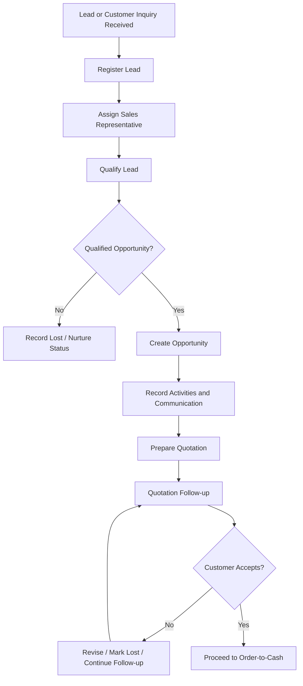

### Process Steps

| Step | Activity | Responsible | Output |
|---|---|---|---|
| 1 | Register customer lead or inquiry | Sales Representative | Lead record |
| 2 | Assign responsible salesperson | Sales Manager / Supervisor | Assigned lead |
| 3 | Qualify customer need and potential | Sales Representative | Qualification status |
| 4 | Create opportunity for qualified lead | Sales Representative | Opportunity record |
| 5 | Record activities and communication | Sales Representative | Customer interaction history |
| 6 | Prepare and follow up quotation | Sales Representative | Quotation and follow-up activities |
| 7 | Record won/lost outcome | Sales Representative | Opportunity status |
| 8 | Convert accepted commercial proposal into O2C flow | Sales Representative | Sales order process initiation |

### Customer Segmentation

| Segment | Annual Net Sales Threshold |
|---|---:|
| Platinum | At least IDR 2,000,000,000 |
| Gold | IDR 1,000,000,000–1,999,999,999 |
| Silver | IDR 250,000,000–999,999,999 |
| Standard | Below IDR 250,000,000 |

Segmentation is reviewed quarterly. A manual strategic classification requires a recorded reason and approver.

### Key Controls and Outputs

- Lead, opportunity, and communication history must be traceable.
- Sales pipeline and conversion reporting must use consistent definitions.
- Customer segmentation is based on annual net sales under the portfolio assumptions.
- CRM implementation detail must be confirmed in Fit-Gap because the SOW's explicit functional scope emphasizes sales management and does not separately list a CRM scope ID.

---

## 6.3 BPM-003 — Order to Cash (O2C)

**Objective:** Manage the complete customer sales lifecycle from quotation to payment reconciliation.

**Owner:** Sales Manager  
**Supporting Roles:** Sales Representative, Sales Supervisor, Warehouse, Logistics, Accounts Receivable, Finance Manager  
**Scope References:** BRD 5.2, 5.10, 5.14, 5.15; SCOPE-002/003/006/010/012/015; E2E-002

### Process Flow

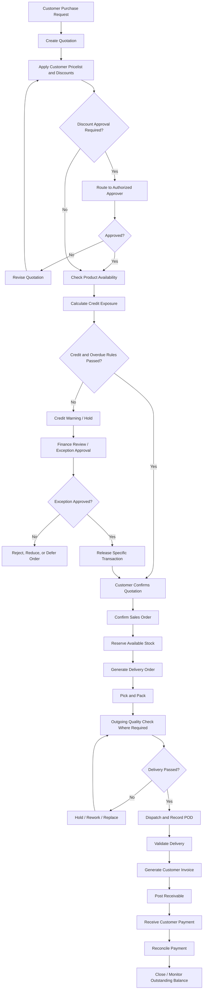

### Process Steps

| Step | Activity | Responsible | ERP Record / Output | Control |
|---|---|---|---|---|
| 1 | Receive customer purchase request | Sales Representative | Customer inquiry | Customer identified |
| 2 | Create quotation | Sales Representative | Quotation | Valid product and customer references |
| 3 | Apply customer-specific price and line discount | Sales Representative | Quotation lines | Pricelist and discount rules |
| 4 | Obtain discount approval where required | Applicable Sales Approver | Approval record | Highest applicable tier applies |
| 5 | Check product availability | Sales / ERP | Availability result | Available, reserved, and forecasted quantities distinguished |
| 6 | Calculate customer credit exposure | ERP / Finance | Credit exposure result | Avoid double-counting invoiced order commitments |
| 7 | Apply credit warning/hold rules | ERP / Finance | Warning or credit hold | Credit policy enforced |
| 8 | Obtain exception approval if required | Finance Manager / Managing Director | Credit exception | Specific transaction authorization only |
| 9 | Confirm customer order | Sales Representative | Confirmed Sales Order | Required approvals completed |
| 10 | Reserve available stock | ERP / Warehouse | Reservation | Eligible stock only |
| 11 | Generate delivery request | ERP / Warehouse | Delivery Order | Linked to Sales Order |
| 12 | Pick and pack goods | Warehouse Operator | Picking and package records | FEFO and barcode where applicable |
| 13 | Perform outgoing inspection where required | Quality Inspector | Quality check | Pass/fail and disposition recorded |
| 14 | Dispatch goods | Logistics / Warehouse | Dispatch confirmation | Shipment documentation |
| 15 | Capture proof of delivery | Logistics Coordinator | POD reference/status | Delivery evidence |
| 16 | Validate delivery | Authorized Warehouse User | Validated delivery | Actual delivered quantities recorded |
| 17 | Generate and post customer invoice | Accounts Receivable | Customer invoice | Invoicing policy and tax mapping |
| 18 | Receive and register payment | Accounts Receivable | Payment | Correct customer and amount |
| 19 | Reconcile payment | Accounts Receivable / Finance | Reconciliation | Residual balance updated |
| 20 | Monitor receivables | Finance | AR aging | Overdue monitoring |

### Sales Discount Approval Matrix

| Discount Per Sales Order Line | Required Approval |
|---|---|
| 0%–5% | Sales Representative |
| Above 5%–10% | Sales Supervisor |
| Above 10%–15% | Sales Manager |
| Above 15% | Sales Manager and Managing Director |

The highest applicable discount tier determines the required approval. Exceptional pricing requires a reason. Manual price changes must not conceal discounts.

### Customer Credit Policy

**Credit Exposure = Posted Outstanding Receivables + Open Confirmed Sales Orders Not Yet Invoiced**

**Available Credit = Approved Credit Limit − Credit Exposure**

| Condition | System / Process Action |
|---|---|
| Exposure ≤80% of credit limit | Normal processing |
| Exposure >80% and ≤100% | Warning to Sales Representative |
| Exposure >100% | Credit hold; approval required |
| Invoice overdue 1–30 calendar days | Warning and Finance review |
| Invoice overdue more than 30 calendar days | Credit hold |
| Customer blocked by Finance | No new credit order confirmation |

### Credit Exception Approval

| Condition | Approval |
|---|---|
| Exposure exceeds limit by up to IDR 25,000,000 | Finance Manager |
| Exposure exceeds limit by more than IDR 25,000,000 | Finance Manager and Managing Director |
| Customer overdue more than 30 days | Finance Manager |
| Credit limit increase above IDR 100,000,000 | Finance Manager and Managing Director |

An exception authorizes only the specified transaction unless a separate credit-limit amendment is approved.

### Fulfillment Variations

- **Partial delivery:** Validate delivered quantity and retain remaining quantity as outstanding/backorder.
- **Insufficient stock:** Backorder, defer, or evaluate replenishment/transfer according to business decision.
- **Expired or quarantined stock:** Must not be allocated for normal sales delivery.
- **Shelf-life restriction:** Designated products must have at least 90 days remaining shelf life at dispatch unless customer contract is stricter.
- **Delivery discrepancy:** Record product/quantity discrepancy and retain reference to delivery and sales order.

### Outputs

- Confirmed sales order.
- Stock reservation and delivery order.
- Picking/packing and dispatch evidence.
- Proof-of-delivery reference.
- Posted customer invoice and receivable.
- Payment and reconciliation.
- Sales, fulfillment, and receivable reporting records.

---

## 6.4 BPM-004 — Procure to Pay (P2P)

**Objective:** Manage procurement from stock requirement identification through supplier payment and reconciliation.

**Owner:** Procurement Manager  
**Supporting Roles:** Procurement Officer, Procurement Supervisor, Operations Manager, Managing Director, Warehouse, Quality, Accounts Payable, Finance Manager  
**Scope References:** BRD 5.3, 5.4, 5.10, 5.11, 5.12, 5.14; SCOPE-004/005/009/012/013/014; E2E-001

### Process Flow

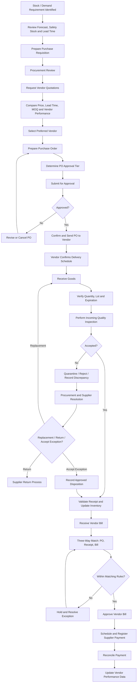

### Process Steps

| Step | Activity | Responsible | ERP Record / Output | Control |
|---|---|---|---|---|
| 1 | Identify shortage or demand | Inventory Controller / Planner | Replenishment requirement | Min/max, forecast, safety stock |
| 2 | Review demand, stock, incoming supply, lead time | Procurement / Inventory | Supply review | Avoid duplicate replenishment |
| 3 | Prepare purchase requisition | Requester / Procurement | Purchase requisition | Fit-Gap validation for requisition workflow |
| 4 | Review requirement | Procurement Supervisor | Reviewed requisition | Quantity and business justification |
| 5 | Request quotations | Procurement Officer | RFQs | Multiple vendor quotations where applicable |
| 6 | Compare vendor offers | Procurement Officer | Comparison record | Price, lead time, MOQ, availability, quality/performance |
| 7 | Select preferred supplier | Procurement Manager / Delegate | Selected vendor | Decision traceability |
| 8 | Prepare PO | Procurement Officer | Draft PO | Vendor, product, quantity, price, delivery date |
| 9 | Determine approval tier | ERP / Procurement | Approval route | PO value before tax, after line discounts |
| 10 | Approve PO | Authorized Approver | Approval history | Requester cannot approve own PO |
| 11 | Confirm PO and send to supplier | Procurement Officer | Confirmed PO | Approval completed before confirmation |
| 12 | Record supplier delivery confirmation | Procurement Officer | Confirmed delivery schedule | Promised date retained for KPI |
| 13 | Receive goods | Warehouse Operator | Receipt | PO linkage and actual quantity |
| 14 | Record lot/serial and expiration | Warehouse Operator | Lot/serial details | Required for designated products |
| 15 | Perform incoming quality inspection | Quality Inspector | Inspection record | Checklist, sample, pass/fail |
| 16 | Validate accepted receipt | Authorized Warehouse User | Validated receipt | Accepted quantity updates stock |
| 17 | Receive vendor bill | Accounts Payable | Vendor bill | Vendor and PO reference |
| 18 | Perform three-way match | AP / Finance | Match result | PO, receipt, bill |
| 19 | Resolve mismatch | AP / Procurement / Finance | Exception record | Hold, review, approval, or correction |
| 20 | Approve vendor bill | Finance / Authorized User | Posted vendor bill | Approval and accounting control |
| 21 | Register supplier payment | Accounts Payable | Payment | Due date and payment authorization |
| 22 | Reconcile payment | Finance | Reconciliation | Payable residual updated |
| 23 | Refresh supplier performance inputs | ERP / Procurement | KPI source transactions | Traceable validated receipts/inspections |

### Purchase Order Approval Matrix

Approval basis: PO value before tax, after line discounts, expressed in IDR.

| PO Value | Required Approval |
|---|---|
| IDR 0–10,000,000 | Procurement Supervisor |
| Above IDR 10,000,000–50,000,000 | Procurement Manager |
| Above IDR 50,000,000–150,000,000 | Operations Manager |
| Above IDR 150,000,000 | Managing Director |

**Approval controls:**

- PO cannot be confirmed before required approval.
- Changes to quantity, unit price, discount, or other value-affecting fields trigger approval re-evaluation.
- If an amendment enters a higher tier, the higher approver must approve.
- Requester cannot approve own PO.
- Cancelled POs retain approval history.
- Splitting POs to avoid thresholds is prohibited.
- Taxes and non-purchase ancillary costs are excluded from the threshold unless future policy changes specify otherwise.

### Three-Way Matching Rules

| Matching Dimension | Allowed Tolerance | Action if Exceeded |
|---|---|---|
| Invoiced quantity | Must not exceed received quantity | Hold for review |
| Unit price difference | 1% or IDR 50,000, whichever is lower | Finance review |
| Total invoice difference | 1% of matched PO value | Finance Manager approval |
| Unreceived quantity | No invoice matching beyond received quantity without exception | Hold for review |

A mismatch must create an exception record with reason, amount, responsible reviewer, and resolution. Vendor bills must not be automatically approved when invoiced quantity exceeds received quantity.

### Partial Receipt and Supplier Discrepancy

- Receipt of less than the PO quantity is recorded as a partial receipt.
- Remaining quantity remains outstanding.
- Rejected quantity is segregated and recorded.
- Procurement contacts the supplier and records the agreed resolution.
- Replacement or subsequent delivery is received against the appropriate outstanding commitment.
- Delivery and quality outcomes contribute to vendor performance according to KPI rules.

### Outputs

- Approved purchase order.
- Validated goods receipt and quality result.
- Updated stock and lot/serial records.
- Matched and approved vendor bill.
- Supplier payment and reconciliation.
- Vendor performance source data.

---

## 6.5 BPM-005 — Supply Chain Replenishment Planning

**Objective:** Maintain stock availability while controlling inventory investment through min/max rules, safety stock, forecast demand, lead time, and warehouse demand.

**Owner:** Operations Manager  
**Supporting Roles:** Inventory Controller, Procurement Manager, Warehouse Manager  
**Scope References:** BRD 5.6; SCOPE-007/008; E2E-001/E2E-003

### Process Flow

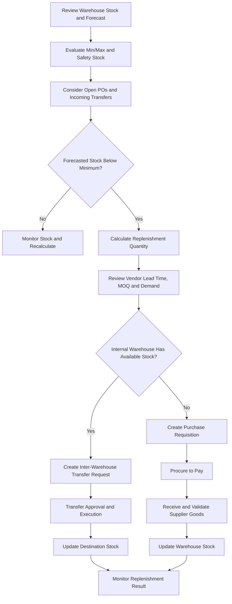

### Replenishment Rules

- Replenishment is configurable by warehouse.
- Min/max levels and safety stock are considered.
- Forecasted stock must account for relevant incoming supply and demand.
- Vendor lead time and minimum order quantity must be considered.
- Seasonal demand and confirmed customer orders may influence planning.
- Inter-warehouse supply is considered where suitable and available.
- Replenishment proposals must be reportable.

### Example Calculation

| Parameter | Value |
|---|---:|
| Product | Arunika Mineral Water 600ml |
| Warehouse | Jakarta |
| Minimum Stock | 1,000 units |
| Maximum Stock | 5,000 units |
| Forecasted Stock | 800 units |
| Vendor Lead Time | 7 days |
| Target Replenishment Quantity | 4,200 units |

`Target Replenishment Quantity = Maximum Stock − Forecasted Stock = 5,000 − 800 = 4,200 units`

This example assumes no additional purchase orders or incoming transfers change forecasted stock.

### Outputs

- Replenishment proposal.
- Purchase requisition or internal transfer request.
- Warehouse-specific replenishment report.

---

## 6.6 BPM-006 — Inter-Warehouse Transfer

**Objective:** Transfer stock between Jakarta, Bandung, and Surabaya with approval, in-transit traceability, partial receipt handling, and discrepancy control.

**Owner:** Operations Manager  
**Supporting Roles:** Inventory Controller, Sending Warehouse, Receiving Warehouse  
**Scope References:** BRD 5.6; SCOPE-005/008; E2E-003

### Process Flow

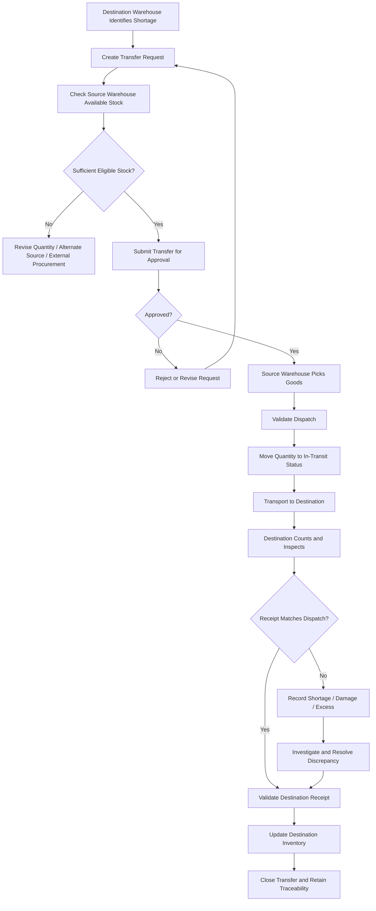

### Process Steps

| Step | Activity | Responsible | Output / Control |
|---|---|---|---|
| 1 | Identify destination shortage | Destination Inventory Controller | Replenishment requirement |
| 2 | Create transfer request | Destination Warehouse | Internal transfer request |
| 3 | Check source availability | Source Warehouse / ERP | Eligible available quantity |
| 4 | Review and approve transfer | Authorized Operations Role | Approval record |
| 5 | Pick and dispatch goods | Source Warehouse | Validated outgoing transfer |
| 6 | Track goods in transit | Logistics / Warehouse | In-transit status |
| 7 | Receive and count goods | Destination Warehouse | Actual received quantity |
| 8 | Record discrepancy where present | Destination Warehouse | Discrepancy record |
| 9 | Validate receipt | Authorized Destination User | Destination stock updated |
| 10 | Close transfer | Inventory Controller | End-to-end transfer traceability |

### Example

Bandung stock is 300 units against a minimum of 1,000 units. Jakarta has 5,000 units available. A proposed transfer of 1,500 units is created, subject to source availability and approval.

### Controls

- Source and destination must be valid warehouses.
- Dispatch and receipt quantities must be independently recorded.
- Partial dispatch and partial receipt must be supported.
- In-transit stock must remain distinguishable from available stock.
- Discrepancies must be recorded and investigated.
- All transfer movements must retain source/destination references.

---

## 6.7 BPM-007 — Inventory Management, Lot/Serial and Expiration

**Objective:** Maintain accurate inventory balances, stock status, valuation, traceability, and expiration controls.

**Owner:** Operations Manager  
**Supporting Roles:** Inventory Controller, Warehouse Manager, Warehouse Operator, Finance Manager  
**Scope References:** BRD 5.4; SCOPE-005/006; E2E-004/E2E-009

### Inventory Movement Flow

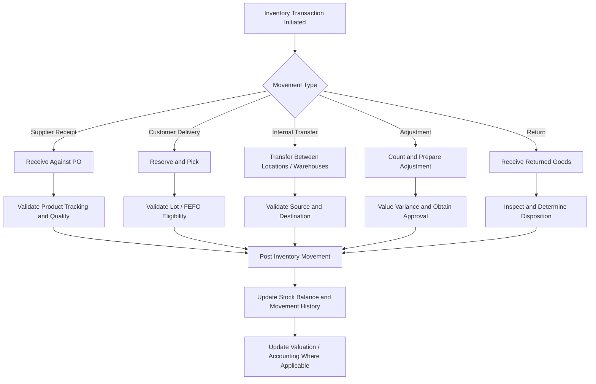

### Stock Status Rules

| Stock Status | Normal Sales Allocation |
|---|---|
| Available internal stock | Eligible, subject to reservation and product rules |
| Reserved stock | Not available for other orders |
| In-transit stock | Not available at destination until receipt |
| Quarantined stock | Not available |
| Damaged stock | Not available |
| Expired stock | Blocked from normal sales allocation |
| Below required shelf life | Restricted according to product/customer policy |

### Lot and Serial Traceability

- Designated products require lot or serial tracking.
- Expiration-controlled products require expiration dates.
- Lot/serial information must be captured at receipt.
- Lot/serial identity must remain linked to internal movements and customer deliveries.
- Recall simulation must identify affected stock and customer deliveries.
- Product archival must not remove historical transaction traceability.

### Expiration Alert Policy

| Remaining Shelf Life | Status | Required Action |
|---|---|---|
| More than 90 days | Normal | Standard inventory management |
| 61–90 days | Attention | Include in expiration monitoring report |
| 31–60 days | Warning | Notify Inventory Controller and Sales Manager |
| 1–30 days | Critical | Restrict allocation according to product policy and require review |
| Expired | Blocked | Quarantine/retain; prohibit normal sales allocation |

Designated products require at least 90 days remaining shelf life at dispatch unless a customer contract specifies a stricter requirement.

### FEFO and Costing Distinction

- FEFO is the physical allocation strategy for eligible expiration-controlled stock.
- FIFO and AVCO are financial inventory costing methods.
- FIFO valuation does not require FIFO physical picking where FEFO applies.
- The physical allocation strategy and financial valuation method must not be treated as interchangeable.

### Product Category Costing Matrix

| Category | Costing Method | Valuation |
|---|---|---|
| CAT-001 Food & Beverage | FIFO | Automated |
| CAT-002 Household Cleaning | AVCO | Automated |
| CAT-003 Personal Care | FIFO | Automated |
| CAT-004 Kitchen Supplies | AVCO | Automated |
| CAT-005 Consumer Goods | AVCO | Automated |

Costing method is assigned at category level. Changes require Finance Manager approval and documented valuation impact assessment.

---

## 6.8 BPM-008 — Warehouse Receiving and Putaway

**Objective:** Receive supplier goods accurately, inspect quantity and quality, record traceability data, and move accepted stock to appropriate storage locations.

**Owner:** Warehouse Manager  
**Supporting Roles:** Warehouse Operator, Quality Inspector, Procurement Officer  
**Scope References:** BRD 5.5; SCOPE-006/009; E2E-001/E2E-006

### Process Flow

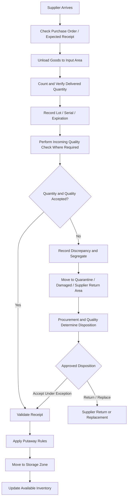

### Receiving Controls

- Incoming goods must be linked to a purchase order.
- Partial receipts are supported.
- Delivered quantity and discrepancies are recorded.
- Lot/serial and expiration data are captured where required.
- Quality inspection is performed where required.
- Rejected products are segregated from available stock.
- Goods receipt documentation must be available.
- Putaway must consider product category, storage requirements, capacity, compatibility, zone, and handling requirements.

### Putaway Preference

| Product Category / Condition | Preferred Location |
|---|---|
| Food & Beverage | Zone A |
| Household Cleaning | Zone B |
| Personal Care | Zone C |
| High-Value Goods | Secure Storage |
| Damaged Goods | Quarantine / Damaged |

### Warehouse Scenarios

| Scenario | Expected Result |
|---|---|
| Receive 1,000 units | Receipt recorded and stock updated |
| Receive 700 of 1,000 units | Remaining 300 units outstanding |
| Reject 20 of 500 units | Rejected quantity segregated |
| Receive two lots with different expiry dates | Earliest eligible expiry prioritized for allocation |
| Pick 80 of 100 ordered units | Short pick and backorder recorded |
| Identify 15 damaged units | Damaged stock segregated |

---

## 6.9 BPM-009 — Picking, Packing and Dispatch

**Objective:** Fulfill confirmed sales orders accurately and prepare traceable shipments.

**Owner:** Warehouse Manager  
**Supporting Roles:** Warehouse Operator, Quality Inspector, Logistics Coordinator  
**Scope References:** BRD 5.5 and 5.8; SCOPE-006/010; E2E-002

### Process Flow

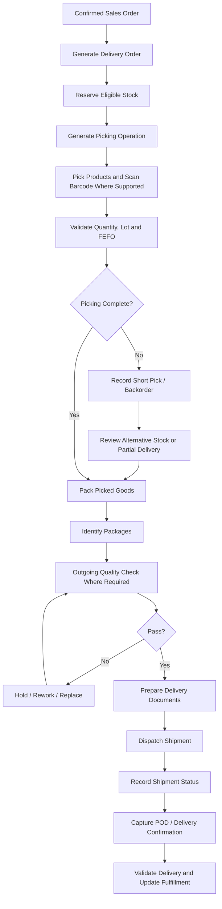

### Process Steps

| Step | Activity | Responsible | Output |
|---|---|---|---|
| 1 | Receive delivery request | Warehouse | Delivery order |
| 2 | Reserve eligible stock | ERP / Warehouse | Reservation |
| 3 | Generate picking operation | ERP / Warehouse | Picking assignment |
| 4 | Pick items | Warehouse Operator | Picked quantities and lot references |
| 5 | Verify barcode, quantity and FEFO | Warehouse Operator | Validated picking |
| 6 | Record short pick | Warehouse Operator | Backorder/partial fulfillment |
| 7 | Pack and identify packages | Warehouse Operator | Package records |
| 8 | Perform outgoing inspection if required | Quality Inspector | Quality outcome |
| 9 | Prepare delivery documentation | Warehouse / Logistics | Delivery documents |
| 10 | Dispatch shipment | Logistics Coordinator | Dispatch status |
| 11 | Record shipment tracking if available | Logistics Coordinator | Shipment reference/status |
| 12 | Capture POD | Logistics Coordinator | POD reference |
| 13 | Validate delivery | Authorized User | Fulfillment updated |

### Delivery Rules

- Picking is generated from confirmed sales orders.
- Reservations must use eligible stock.
- FEFO applies to eligible products.
- Barcode operations depend on licensed apps, supported devices, and deployment configuration.
- Partial deliveries and backorders must be supported.
- Package identification and dispatch confirmation must be recorded.
- Shipment tracking information is recorded where available.

---

## 6.10 BPM-010 — Quality Management

**Objective:** Ensure incoming and outgoing products meet defined quality requirements and rejected goods are controlled.

**Owner:** Operations Manager  
**Supporting Roles:** Quality Inspector, Warehouse, Procurement, Customer Service  
**Scope References:** BRD 5.7; SCOPE-009; E2E-001/E2E-006/E2E-007

### Process Flow

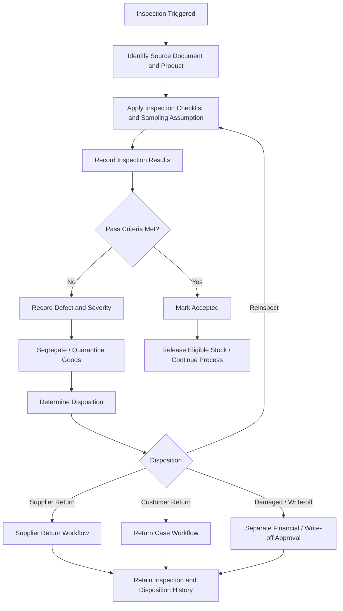

### Inspection Process

1. Identify incoming or outgoing inspection trigger.
2. Link inspection to the source document and product.
3. Apply approved checklist and sampling assumptions.
4. Record measured results and observations.
5. Determine pass/fail against measurable criteria.
6. Record defect severity for failures.
7. Segregate rejected goods.
8. Record disposition and approval history.
9. Release accepted stock or route failed stock to return, rework, quarantine, damaged, or write-off process as authorized.

### Quality Controls

- Inspection records must reference source documents.
- Pass/fail decisions must use defined criteria.
- Defect severity and disposition must be recorded.
- Inspector, date, and approval history must be retained.
- A Quality Inspector cannot independently approve commercial or financial write-off of rejected goods.
- Rejected products must not be made available for normal sales allocation until authorized disposition permits it.

### Outputs

- Inspection checklist and result.
- Accepted/rejected quantities.
- Defect and severity record.
- Quarantine/disposition record.
- Quality KPI source data.

---

## 6.11 BPM-011 — Logistics and Delivery Management

**Objective:** Control shipment preparation, dispatch, delivery status, and proof-of-delivery capture.

**Owner:** Operations Manager  
**Supporting Roles:** Logistics Coordinator, Warehouse Team, Customer Service  
**Scope References:** BRD 5.8; SCOPE-010

### Process Flow

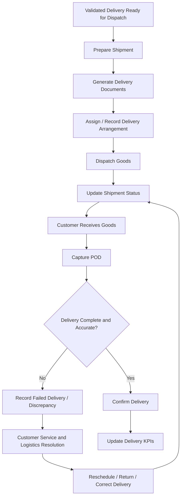

### Delivery Data and KPIs

| KPI | Definition |
|---|---|
| On-Time Delivery Rate | Eligible deliveries completed on or before promised delivery date |
| Order Fulfillment Rate | Delivered quantity as a percentage of ordered quantity |
| Delivery Accuracy | Deliveries completed without product or quantity discrepancy |
| Average Delivery Lead Time | Elapsed time from dispatch to delivery confirmation |
| Partial Delivery Rate | Orders requiring more than one shipment |
| Failed Delivery Rate | Dispatched deliveries that fail to reach the customer |

### Scope Boundary

The implementation includes delivery orders, shipment status, POD capture/reference, discrepancy recording, shipping cost recording, and delivery KPI source data. Full TMS, advanced route optimization, fleet maintenance, live vehicle tracking, and carrier marketplace integration are excluded.

---

## 6.12 BPM-012 — Customer Returns and Refunds

**Objective:** Process customer complaints and returns with authorization, inspection, inventory disposition, and financial resolution.

**Owner:** Customer Service  
**Supporting Roles:** Sales, Warehouse, Quality Inspector, Finance Manager  
**Scope References:** BRD 5.9 and 5.14; SCOPE-011/012/015; E2E-007

### Process Flow

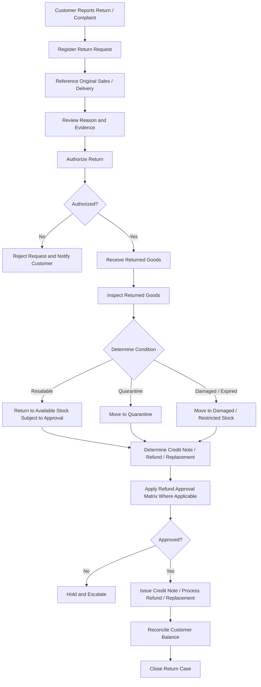

### Process Steps

| Step | Activity | Responsible | Output / Control |
|---|---|---|---|
| 1 | Receive customer complaint | Customer Service | Return request |
| 2 | Categorize reason | Customer Service | Return reason |
| 3 | Reference original sale/delivery | Customer Service | Source transaction link |
| 4 | Review and authorize return | Authorized Business Role | Return authorization |
| 5 | Receive returned goods | Warehouse | Return receipt |
| 6 | Inspect condition | Quality Inspector | Inspection result |
| 7 | Determine stock disposition | Quality / Operations | Available, quarantine, damaged |
| 8 | Determine commercial resolution | Sales / Customer Service / Finance | Credit note, refund, replacement |
| 9 | Obtain financial approval | Applicable Approver | Refund approval |
| 10 | Process credit/refund/replacement | Finance / Warehouse | Financial or stock transaction |
| 11 | Reconcile and close | Finance / Customer Service | Closed return case |

### Customer Refund Approval Matrix

| Refund Value | Required Approval |
|---|---|
| Up to IDR 5,000,000 | Customer Service Supervisor and Finance review |
| Above IDR 5,000,000–25,000,000 | Finance Manager |
| Above IDR 25,000,000–100,000,000 | Finance Manager and Operations Manager |
| Above IDR 100,000,000 | Managing Director and Finance Manager |

### Return Controls

- Return request and reason must be documented.
- Return must reference original transaction where applicable.
- Returned quantity must be traceable.
- Returned goods must be inspected.
- Stock disposition must be recorded.
- Credit notes and refunds must be supported.
- Refund approval must follow the matrix and segregation of duties.
- Return reporting must be available by reason and status.

---

## 6.13 BPM-013 — Supplier Returns

**Objective:** Return defective or incorrect goods to suppliers and record supplier credit or replacement.

**Owner:** Procurement Manager  
**Supporting Roles:** Warehouse, Quality Inspector, Accounts Payable, Finance Manager  
**Scope References:** BRD 5.3, 5.7, 5.9, 5.14; SCOPE-004/009/011/012

### Process Flow

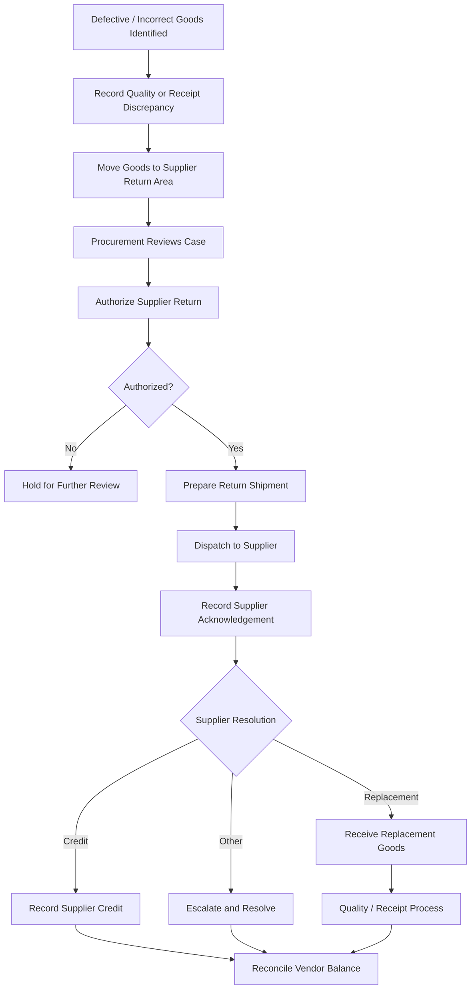

### Controls

- Return quantity and reason must be documented.
- Return must be linked to original PO/receipt/inspection.
- Estimated return value determines applicable delegated approval.
- Supplier credit or replacement must be traceable.
- Vendor performance source records must reflect eligible receipt/quality outcomes.

---

## 6.14 BPM-014 — Accounting and Financial Management

**Objective:** Integrate sales, procurement, inventory, and logistics transactions with financial accounting and provide reconciled financial reporting.

**Owner:** Finance Manager  
**Supporting Roles:** Accounts Receivable, Accounts Payable, Inventory Controller, Procurement, Sales  
**Scope References:** BRD 5.10; SCOPE-012; E2E-001/E2E-002/E2E-008/E2E-009

### A. Sales to Accounting

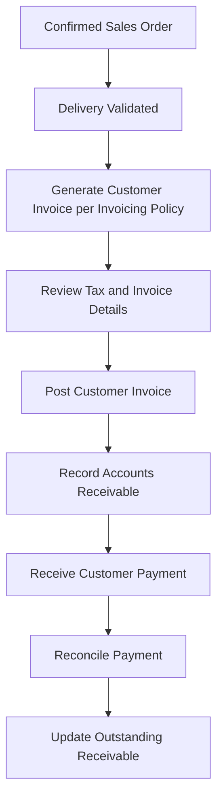

### B. Purchase to Accounting

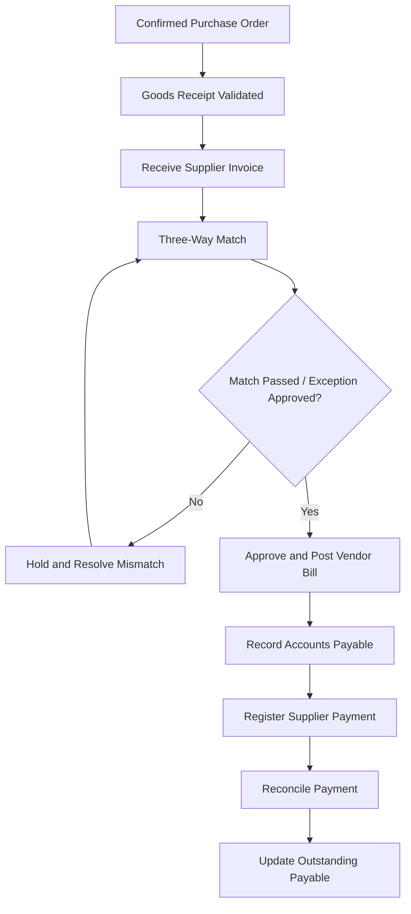

### C. Inventory to Accounting

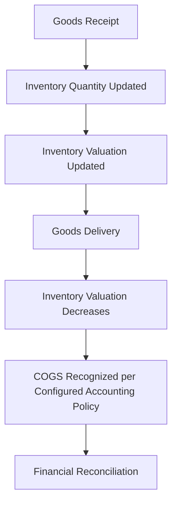

### Financial Scope

- Customer invoicing and receivables.
- Vendor bills and payables.
- Customer and supplier payments.
- Cash and bank transactions.
- Inventory valuation and COGS.
- Tax management and journals.
- General Ledger and Trial Balance.
- Profit and Loss, Balance Sheet, and Cash Flow.
- AR and AP aging.
- Inventory valuation and sales/vendor analysis.

### Three-Way Matching

The required match is between Purchase Order, Goods Receipt, and Vendor Bill. Tolerances and exception actions are defined in BPM-004. Mismatches require a recorded reason, amount, reviewer, and resolution.

### Tax Configuration Boundary

The BRD includes illustrative 11% tax assumptions for portfolio testing only. Tax rates, tax bases, exemptions, documentation, and accounting treatment must be validated against current Indonesian regulations by a qualified tax professional before any real deployment. Tax percentages must be configurable, not hard-coded into custom business logic.

### Financial Controls

- Opening stock values and opening AR/AP must reconcile before financial go-live simulation.
- Financial reports must be based on validated accounting entries.
- Inventory valuation must use valuation records, not sales prices.
- Costing changes require Finance Manager approval.
- Payments and reconciliations must retain traceable source documents.
- Draft/cancelled invoices must be excluded from posted financial KPI calculations as defined by the BRD.

---

## 6.15 BPM-015 — Imported Goods and Landed Cost

**Objective:** Allocate eligible additional acquisition costs to imported inventory and reconcile the resulting valuation.

**Owner:** Finance Manager  
**Supporting Roles:** Procurement, Accounts Payable, Inventory Controller  
**Scope References:** BRD 5.11; SCOPE-013; E2E-008

### Process Flow

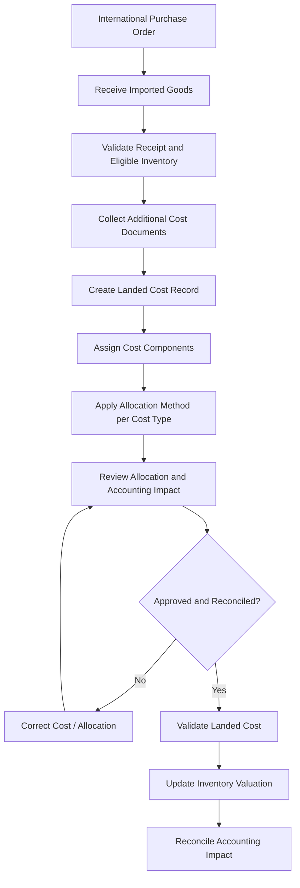

### Cost Components and Allocation

| Cost Type | Default Allocation Method |
|---|---|
| International Freight | By weight |
| Insurance | By current cost |
| Customs-related charges | By current cost |
| Port Handling | By quantity |
| Domestic Transportation | By weight |

Potential cost components include international freight, insurance, customs-related charges, port handling, customs brokerage, domestic transportation, and other eligible acquisition costs.

### Controls

- Only eligible inventory may receive landed cost allocation.
- Allocation method must be assigned by cost type.
- Allocation must be traceable to cost documents and inventory records.
- Finance must validate accounting treatment.
- Resulting inventory valuation must reconcile to the approved acquisition-cost policy.

---

## 6.16 BPM-016 — Inventory Adjustment and Cycle Counting

**Objective:** Detect inventory discrepancies, quantify their value, obtain approval, update stock, and record financial impact.

**Owner:** Operations Manager  
**Supporting Roles:** Warehouse Supervisor, Warehouse Manager, Inventory Controller, Finance Manager  
**Scope References:** BRD 5.4.5 and 5.14; SCOPE-005/006/012/015; E2E-009

### Process Flow

```mermaid
flowchart TD
    A[Cycle Count Scheduled or Discrepancy Identified] --> B[Assign Physical Count]
    B --> C[Count Physical Stock]
    C --> D[Compare Physical and System Quantity]
    D --> E{Variance Exists?}
    E -- No --> F[Confirm Count and Close]
    E -- Yes --> G[Calculate Variance Quantity and Valuation]
    G --> H[Prepare Adjustment Request]
    H --> I[Determine Approval Tier]
    I --> J[Submit for Approval]
    J --> K{Approved?}
    K -- No --> L[Investigate / Recount / Revise]
    L --> C
    K -- Yes --> M[Validate Inventory Adjustment]
    M --> N[Update Stock Quantity]
    N --> O[Record Valuation / Accounting Impact]
    O --> P[Retain Audit Trail and Close]
```

### Inventory Adjustment Approval Matrix

Approval is based on the absolute value of the inventory difference using inventory valuation cost, not sales price.

| Absolute Difference Value | Required Approval |
|---|---|
| Up to IDR 1,000,000 | Warehouse Supervisor |
| Above IDR 1,000,000–10,000,000 | Warehouse Manager |
| Above IDR 10,000,000–50,000,000 | Operations Manager and Finance Manager |
| Above IDR 50,000,000 | Managing Director and Finance Manager |

### Controls

- Physical count and system quantity must be retained.
- Difference value uses inventory valuation cost.
- Approval tier is determined from absolute difference value.
- User cannot approve own adjustment.
- Financial impact must be recorded where applicable.
- Adjustment history must remain auditable.

---

## 6.17 BPM-017 — Vendor Performance Management

**Objective:** Evaluate suppliers using consistent, traceable operational KPIs to support procurement decisions.

**Owner:** Procurement Manager  
**Supporting Roles:** Quality, Warehouse, ERP Reporting  
**Scope References:** BRD 5.12 and 5.15; SCOPE-014/015; E2E-010

### Process Flow

```mermaid
flowchart TD
    A[Collect Eligible PO and Receipt Records] --> B[Collect Quality Inspection Records]
    B --> C[Determine Evaluation Period]
    C --> D[Apply KPI Eligibility and Data Rules]
    D --> E[Calculate OTD, Fulfillment, Quality and Lead Time]
    E --> F[Calculate Weighted Vendor Score]
    F --> G[Check Minimum Sample Size]
    G --> H{At Least Five Eligible Receipts?}
    H -- No --> I[Mark Insufficient Data]
    H -- Yes --> J[Assign Performance Classification]
    I --> K[Publish Scorecard with Source Drill-Down]
    J --> K
    K --> L[Procurement Reviews Supplier Performance]
    L --> M[Use Evidence in Future Sourcing Decisions]
```

### KPI Definitions

| KPI | Formula / Measurement Rule |
|---|---|
| On-Time Delivery Rate | On-time eligible receipts ÷ total eligible receipts × 100 |
| Order Fulfillment Rate | Accepted quantity received ÷ quantity due in evaluation period × 100 |
| Quality Acceptance Rate | Accepted quantity ÷ inspected quantity × 100 |
| Lead Time Reliability | Receipts within planned lead time + 1 calendar day ÷ eligible receipts × 100 |
| Purchase Price Variance | (Actual unit price − reference unit price) ÷ reference unit price × 100 |

### Weighted Score

| KPI | Weight |
|---|---:|
| On-Time Delivery Rate | 30% |
| Order Fulfillment Rate | 25% |
| Quality Acceptance Rate | 30% |
| Lead Time Reliability | 15% |
| Total | 100% |

`Vendor Score = (OTD × 30%) + (Fulfillment × 25%) + (Quality Acceptance × 30%) + (Lead Time Reliability × 15%)`

Purchase Price Variance is displayed separately and is not included in the weighted score.

### Performance Classification

| Score | Classification |
|---|---|
| 95%–100% | Excellent |
| 90%–94.99% | Good |
| 80%–89.99% | Needs Improvement |
| Below 80% | Poor |

A vendor with fewer than five eligible receipts in the evaluation period must be marked **Insufficient Data**, not assigned a definitive performance classification.

### Measurement Controls

- Monthly evaluation and rolling three-month management view.
- Promised date uses confirmed vendor delivery date on PO.
- Actual date uses physical receipt date when receipt is validated.
- Cancelled orders are excluded.
- Rejected quantities do not count as accepted fulfillment.
- Uninspected items are excluded from Quality Acceptance Rate and reported separately.
- KPI calculations must drill down to source records.
- Manual changes to calculated KPI results are restricted and audited.

---

## 6.18 BPM-018 — Management Reporting and Business Intelligence

**Objective:** Provide consistent operational and financial insight using traceable transactional and accounting data.

**Owner:** Relevant Functional Manager / Finance Manager  
**Supporting Roles:** ERP Manager, Data Owners, Key Users  
**Scope References:** BRD 5.15; SCOPE-015

### Reporting Process

```mermaid
flowchart TD
    A[Operational / Financial Transactions Recorded] --> B[Validate Source Transaction Status]
    B --> C[Apply Approved KPI Definition]
    C --> D[Apply Date and Business Filters]
    D --> E[Calculate Dashboard / Report]
    E --> F[Check Data Completeness and Reconciliation]
    F --> G{Data Reliable?}
    G -- No --> H[Display Insufficient Data / Pending Reconciliation]
    G -- Yes --> I[Publish KPI / Report]
    I --> J[Restrict Access by User Role]
    J --> K[Management Review and Drill-Down]
```

### Dashboard Domains

| Dashboard | Main Indicators |
|---|---|
| Inventory | On-hand, valuation, available stock, below-minimum, overstock, near-expiry, expired, aging, warehouse comparison |
| Sales | Net sales, sales by customer/product/territory/salesperson, fulfillment, AR, returns |
| Procurement | Purchasing value, PO by vendor/status, vendor delivery performance, price trend, outstanding PO, procurement lead time |
| Warehouse | Incoming/outgoing volume, picking/packing activity, discrepancies, transfer performance, return volume |
| Financial | AR, AP, overdue receivables, cash/bank, gross profit, inventory valuation, P&L |

### Refresh Expectations

| Report Type | Expected Refresh |
|---|---|
| Operational stock indicators | Near real-time after validated stock transactions |
| Sales and procurement transaction reports | On demand |
| Vendor scorecard | Monthly calculation |
| Financial statements | Based on posted accounting entries |
| Management KPI summary | Daily refresh for portfolio dashboard |

### Reporting Controls

- Date, warehouse, product category, customer, and vendor filters as appropriate.
- Export capability where appropriate.
- Financial reports based on validated accounting data.
- KPI definitions consistent across reports.
- Drill-down to underlying records.
- Role-based access.
- Incomplete or unavailable data must be labeled **Insufficient Data**, **Not Available**, or **Pending Reconciliation** rather than presented as actual performance.
- Where time data is not captured, warehouse productivity is shown as transaction volume only, not units per hour.

# 7. Cross-Functional End-to-End Scenarios

The following ten scenarios are mandatory portfolio demonstration scenarios and should be executed across functional, integration, and UAT cycles.

| Scenario ID | Scenario | Process Maps | Expected Business Outcome |
|---|---|---|---|
| E2E-001 | Procure to Pay | BPM-004, 005, 008, 010, 014 | Procurement traceability from shortage through supplier settlement |
| E2E-002 | Order to Cash | BPM-003, 007, 009, 011, 014 | Sales traceability from quotation through customer payment |
| E2E-003 | Multi-Warehouse Replenishment | BPM-005, 006, 007 | Traceable stock redistribution and destination receipt |
| E2E-004 | Lot and Expiration Management | BPM-007, 008, 009, 010 | End-to-end lot traceability, FEFO, expiry control, recall simulation |
| E2E-005 | Customer Credit Limit Violation | BPM-003, 014 | Warning/hold, exception approval, auditable transaction release |
| E2E-006 | Supplier Delivery Discrepancy | BPM-004, 008, 010, 017 | Partial receipt, quantity/quality discrepancy, vendor KPI impact |
| E2E-007 | Customer Return and Refund | BPM-012, 010, 014 | Authorized return, disposition, credit note/refund and reconciliation |
| E2E-008 | Imported Goods and Landed Costs | BPM-004, 015, 014 | Additional acquisition costs allocated and reconciled |
| E2E-009 | Inventory Adjustment and Cycle Counting | BPM-016, 007, 014 | Approved adjustment with inventory and accounting impact |
| E2E-010 | Vendor Performance Evaluation | BPM-017, 010, 018 | KPI scorecard reconciled to eligible source transactions |

# 8. Approval Matrix and Control Catalogue

## 8.1 Consolidated Approval Matrix

| Control ID | Transaction | Approval Basis | Approval Route |
|---|---|---|---|
| CTRL-PO | Purchase Order | PO value before tax, after line discounts | ≤IDR 10m: Procurement Supervisor; >10m–50m: Procurement Manager; >50m–150m: Operations Manager; >150m: Managing Director |
| CTRL-DISC | Sales Discount | Discount per sales order line | 0–5%: Sales Representative; >5–10%: Sales Supervisor; >10–15%: Sales Manager; >15%: Sales Manager + Managing Director |
| CTRL-CREDIT | Credit Exception | Exposure and overdue status | Up to IDR 25m above limit: Finance Manager; >IDR 25m: Finance Manager + Managing Director; overdue >30 days: Finance Manager |
| CTRL-INV | Inventory Adjustment | Absolute variance at inventory valuation cost | ≤IDR 1m: Warehouse Supervisor; >1m–10m: Warehouse Manager; >10m–50m: Operations + Finance; >50m: Managing Director + Finance |
| CTRL-REFUND | Customer Refund | Refund value | ≤IDR 5m: Customer Service Supervisor + Finance review; >5m–25m: Finance Manager; >25m–100m: Finance + Operations; >100m: Managing Director + Finance |
| CTRL-COST | Costing Configuration | Change to category costing | Finance Manager |
| CTRL-SUPRET | Supplier Return | Estimated return value | Purchase Approval Matrix or delegated authority |
| CTRL-CREDIT-LIMIT | Credit Limit Amendment | Requested credit limit change | Finance Manager; Managing Director for increases above IDR 100m |

## 8.2 Mandatory Control Principles

1. Requester and approver must be separated where policy prohibits self-approval.
2. Approval tier must be recalculated when value-affecting fields change.
3. Higher-tier approval is required when an amendment crosses a threshold.
4. Cancelled transactions retain approval history.
5. Credit exception approval does not permanently increase the customer credit limit.
6. Approval reasons and approver identity/date must be retained.
7. Financial or stock write-off cannot be authorized solely by a Quality Inspector.
8. Least-privilege access applies to all roles.

# 9. Roles and Responsibilities (RACI)

**R = Responsible; A = Accountable; C = Consulted; I = Informed.**  
The table is a process-level proposal aligned to the role definitions in the BRD and SOW. Final role-to-user assignment is subject to the approved security matrix.

| Process / Activity | Sales | Procurement | Warehouse / Inventory | Quality | Logistics | Finance | Operations Manager | Managing Director | ERP / IT |
|---|---|---|---|---|---|---|---|---|---|
| Product master | I | C | R | C | I | C | A | I | C |
| Customer master | R | I | I | I | I | C | I | I | C |
| Vendor master | I | R | I | I | I | C | C | I | C |
| CRM and opportunity | R | I | I | I | I | I | I | I | C |
| Quotation and sales order | R | I | C | I | I | C | I | I | C |
| Discount approval | R | I | I | I | I | I | C | A for highest tier | C |
| Credit exception | R | I | I | I | I | A/R | I | A for applicable tier | C |
| Replenishment planning | I | R | R | I | I | C | A | I | C |
| Purchase requisition / RFQ | I | R | C | I | I | I | C | I | C |
| Purchase order approval | I | R | C | I | I | C | A for applicable tier | A for highest tier | C |
| Goods receipt / putaway | I | C | R | C | I | I | A | I | C |
| Quality inspection | I | C | C | R | I | I | A | I | C |
| Picking / packing | I | I | R | C | C | I | A | I | C |
| Dispatch / POD | I | I | R | I | R | I | A | I | C |
| Inventory adjustment | I | I | R | C | I | C | A for applicable tier | A for highest tier | C |
| Customer return | C | I | R | R | C | C | A | I | C |
| Supplier return | I | R | R | C | C | C | A | I | C |
| Vendor bill / payment | I | C | I | I | I | R | I | A where delegated | C |
| Landed cost | I | R | C | I | C | R | C | I | C |
| Vendor KPI | I | R | C | C | I | C | A | I | C |
| Reporting and access | C | C | C | C | C | C | A | I | R |

# 10. Data and Document Traceability

## 10.1 Key Transaction Linkages

| Business Object | Upstream Reference | Downstream Reference |
|---|---|---|
| Quotation | Lead / Customer Inquiry | Sales Order |
| Sales Order | Customer / Pricelist / Credit Check | Reservation / Delivery Order |
| Delivery Order | Sales Order | Picking / Packing / Dispatch / POD |
| Customer Invoice | Sales Order / Delivery Policy | Receivable / Payment / Reconciliation |
| Purchase Requisition | Replenishment Requirement | RFQ |
| RFQ | Purchase Requisition | Vendor Selection / Purchase Order |
| Purchase Order | RFQ / Vendor / Product | Receipt / Vendor Bill |
| Goods Receipt | Purchase Order | Quality / Stock / Three-Way Match |
| Vendor Bill | Purchase Order / Receipt | Payable / Payment / Reconciliation |
| Internal Transfer | Replenishment Requirement | Dispatch / In-Transit / Destination Receipt |
| Quality Inspection | Receipt / Delivery / Return | Accepted/Rejected Disposition |
| Customer Return | Original Sales / Delivery | Return Receipt / Credit Note / Refund |
| Supplier Return | Original PO / Receipt / Inspection | Return Shipment / Vendor Credit or Replacement |
| Inventory Adjustment | Physical Count | Stock Valuation / Accounting Impact |
| Landed Cost | Eligible Receipt / Cost Documents | Updated Inventory Valuation |
| Vendor Scorecard | PO / Receipt / Inspection | Vendor Performance Report |

## 10.2 Data Migration Scope

| Dataset | Target Volume | Treatment |
|---|---:|---|
| Products | 500 | Master data |
| Customers | 250 | Master data |
| Vendors | 40 | Master data |
| Warehouses | 3 | Configuration master |
| Internal Locations | 30+ | Configuration master |
| ERP Users | 20 | Fictional user-role staging; credentials provisioned securely |
| Historical Sales Orders | 1,000 | Separate historical transaction dataset |
| Historical Purchase Orders | 300 | Separate historical transaction dataset |
| Opening Lots | 100 | Separate traceability/opening dataset |
| Opening Stock Records | 500+ | Separate opening inventory dataset |
| Opening Customer Balances | ≤250 | Separate AR opening dataset |
| Opening Vendor Balances | ≤40 | Separate AP opening dataset |

Historical transactions must remain clearly historical and must not be imported as open operational commitments unless explicitly required.

## 10.3 Migration Validation

| Validation ID | Rule | Acceptance Criteria |
|---|---|---|
| MIG-001 | Unique master references | No duplicate internal references |
| MIG-002 | Product category mapping | 100% mapped to valid categories |
| MIG-003 | UoM mapping | 100% mapped to valid UoMs |
| MIG-004 | Customer/vendor references | No duplicate partner codes |
| MIG-005 | Warehouse mapping | All stock records reference valid warehouses |
| MIG-006 | Location mapping | All stock records reference valid locations |
| MIG-007 | Lot/serial tracking | All tracked opening stock has valid identification |
| MIG-008 | Expiration dates | Designated perishable lots have valid dates |
| MIG-009 | Opening quantity | Matches approved opening inventory file |
| MIG-010 | Opening valuation | Reconciles to approved opening value |
| MIG-011 | Opening AR/AP | Reconciles to dummy opening accounting data |
| MIG-012 | Import error handling | Rejected rows logged and correctable |

# 11. Business Rules and Key Decision Points

| Rule ID | Business Rule | Process Impact |
|---|---|---|
| BR-01 | Customer credit exposure includes posted outstanding receivables and open confirmed sales orders not yet invoiced | O2C / Credit |
| BR-02 | Invoiced order commitment must not be double-counted against the same receivable | O2C / Credit |
| BR-03 | Exposure above 80% triggers warning; above 100% triggers hold | O2C / Credit |
| BR-04 | Invoice overdue 1–30 days triggers warning and Finance review; >30 days triggers hold | O2C / Credit |
| BR-05 | Discount approval is evaluated per sales order line | O2C |
| BR-06 | PO approval is based on total PO value before tax after line discounts | P2P |
| BR-07 | PO changes affecting value trigger approval re-evaluation | P2P |
| BR-08 | Requester cannot approve own PO | P2P |
| BR-09 | Inventory adjustment approval uses absolute variance value at inventory cost | Inventory |
| BR-10 | Expired goods are blocked from normal sales allocation | Inventory / O2C |
| BR-11 | FEFO applies to eligible expiration-controlled products | Inventory / Warehouse |
| BR-12 | Designated products require 90 days remaining shelf life at dispatch unless stricter customer terms apply | O2C / Warehouse |
| BR-13 | FIFO/AVCO is a financial costing policy; FEFO is physical allocation | Inventory / Finance |
| BR-14 | Vendor invoice quantity must not exceed received quantity without an approved exception | P2P / AP |
| BR-15 | Rejected goods are segregated and disposition is traceable | Quality / Warehouse |
| BR-16 | Quality Inspector cannot independently approve commercial/financial write-off | Quality / Finance |
| BR-17 | Vendor scorecard requires at least five eligible receipts for definitive classification | Vendor Performance |
| BR-18 | Dashboard KPIs must be traceable and must not present incomplete data as actual performance | Reporting |
| BR-19 | Where time data is absent, productivity is transaction volume only | Warehouse Reporting |
| BR-20 | Tax assumptions are illustrative and require professional validation before real deployment | Accounting |

# 12. Scope Boundary and Fit-Gap Considerations

## 12.1 Included in the SOW

- Master data configuration and dataset preparation.
- Quotations, sales orders, customer-specific pricing, discounts, partial deliveries, backorders, invoicing flow, and sales reporting.
- Customer credit exposure, warning/hold, overdue rules, exceptions, and auditable credit-limit changes.
- Purchase requisitions subject to fit-gap, RFQs, vendor comparison, purchase approvals, partial receipts, and purchase history.
- Multi-warehouse inventory, locations, lot/serial, expiry, FEFO, costing policy, adjustment, cycle count, stock aging and valuation.
- Receiving, putaway, barcode-enabled operations where supported, picking, packing, dispatch, damaged/quarantine segregation.
- Min/max and safety stock, forecast-based replenishment, vendor lead times, and warehouse-specific replenishment.
- Inter-warehouse transfers, including partial dispatch/receipt and discrepancy handling.
- Incoming/outgoing quality checks, sampling assumptions, pass/fail, defect severity, quarantine, and disposition.
- Delivery status, POD reference, discrepancy records, and delivery KPI source data.
- Customer/supplier returns, inspection/disposition, replacement/credit-note flow, and return reporting.
- AR/AP, invoices, payments, reconciliation, perpetual valuation, COGS, financial reports, and landed costs.
- Vendor performance scorecard, KPI formulas, insufficient-data rule, source traceability, and price variance display.
- Dashboards, role-based access, approval segregation, auditability, and least privilege.

## 12.2 Explicitly Out of Scope

- Manufacturing, MRP, and production planning.
- HR, payroll, and employee lifecycle management.
- Full Transportation Management System, fleet maintenance, advanced route optimization, live vehicle tracking, and carrier marketplace integration.
- Customer-facing mobile application.
- Direct integration with every Indonesian marketplace.
- AI-based demand forecasting.
- Full customs brokerage integration.
- Automated bank statement connections.
- Warehouse robotics.
- Real payment gateway, real bank connectivity, live carrier API, or third-party production integration unless separately approved.
- Legal/tax advisory or statutory tax certification.
- Any capability not explicitly listed as in-scope unless accepted through formal change control.

## 12.3 Fit-Gap and Design Confirmation

The following require detailed validation in Fit-Gap/FSD/TDD rather than assumptions in this process map:

- Purchase requisition implementation approach.
- Approval workflow implementation and audit model.
- Credit exposure computation and prevention of double-counting.
- Discount approval behavior and line-level evaluation.
- Inventory adjustment valuation and approval behavior.
- FIFO/AVCO accounting configuration by product category.
- Indonesian localization and tax configuration.
- Quality checklist and sampling implementation.
- Vendor KPI data sources, date logic, and sample-size rule.
- Dashboard calculation and refresh approach.
- Refund approval and segregation of duties.
- Landed cost accounting and allocation behavior.
- Barcode hardware/app licensing and supported workflows.
- Approved internal API/job scope and failure handling.

# 13. Reporting and KPI Catalogue

| KPI | Formula / Definition | Primary Source | Refresh / Notes |
|---|---|---|---|
| Inventory Accuracy | Correct counted quantity ÷ total counted quantity × 100 | Physical counts and inventory | Portfolio target ≥98% |
| On-Time Delivery | On-time deliveries ÷ eligible deliveries × 100 | Delivery/POD records | Portfolio target ≥95% |
| Order Fulfillment | Delivered quantity ÷ ordered quantity × 100 | Sales order and delivery | Portfolio target ≥97% |
| Supplier On-Time Delivery | On-time receipts ÷ eligible receipts × 100 | PO and validated receipts | Portfolio target ≥95% |
| Quality Acceptance | Accepted inspected quantity ÷ total inspected quantity × 100 | Quality inspections | Portfolio target ≥99% |
| Product Traceability | Tracked movements with valid lot/serial references ÷ tracked movements × 100 | Stock movements | Portfolio target 100% |
| Expired Product Sales | Count of validated deliveries containing expired products | Delivery/lot data | Portfolio target 0 |
| Data Migration Accuracy | Validated imported records ÷ total imported records × 100 | Migration logs | Portfolio target ≥99.5% |
| Critical Defects at UAT | Open critical defects | Defect register | Portfolio target 0 |
| Credit Control Compliance | Transactions following credit approval policy ÷ applicable transactions × 100 | Sales/credit audit records | Portfolio target 100% |

These are portfolio targets, not achieved performance claims. Additional formulas and source details are defined in BRD Sections 5.8, 5.12, and 5.15.

# 14. Non-Functional and Operational Process Considerations

| Area | Process Requirement |
|---|---|
| Performance | Standard form operations target approximately 3 seconds under agreed test conditions; validate with documented infrastructure and workload |
| Security | Authentication, role-based access, restricted financial information, warehouse authorization, approval segregation, and traceable activity |
| Availability | Normal business-hour support, documented backup/recovery, service restart and failure logging |
| Data Integrity | Unique references, valid document relationships, traceable inventory, accounting integrity, and preserved cancelled/deleted history |
| Scalability | Accommodate additional warehouses, customers, suppliers, products, users, and transaction volumes |
| Usability | Clear interfaces, consistent naming, meaningful validation, understandable reports, and user training |
| Auditability | Retain creation/modification, approval, status, stock movement, financial, credit exception, and quality disposition history |

# 15. Implementation, Testing and Acceptance Alignment

## 15.1 Delivery Phase Alignment

| SOW Phase | Process Mapping Usage | Expected Output |
|---|---|---|
| P1 — Initiation & Business Analysis | Validate AS-IS/TO-BE maps and close decision log | Approved process maps, fit-gap, decision log |
| P2 — Master Data Preparation | Validate BPM-001 and migration dependencies | Master data workbook, templates, validation log |
| P3 — Core ERP Configuration | Configure core sales, purchase, inventory, accounting and access foundations | Configured core Odoo baseline |
| P4 — Advanced Warehouse & Supply Chain | Configure BPM-005 through BPM-013 as applicable | Warehouse/supply chain configuration and scenario evidence |
| P5 — Financial Integration | Configure BPM-014 and BPM-015 | Accounting configuration and reconciliation evidence |
| P6 — Custom Development | Implement approved gaps only | Custom addons, tests, documentation |
| P7 — Integration & Automation | Implement approved APIs/jobs and refresh automation | API/job specification, logs, integration tests |
| P8 — Testing & UAT | Execute process maps and ten E2E scenarios | Test results, defect log, UAT evidence |
| P9 — Deployment & Handover | Operationalize approved processes | Deployment guide, SOPs, training and handover |

## 15.2 Acceptance Criteria Mapping

| SOW Acceptance ID | Process Mapping Evidence |
|---|---|
| AC-001 Scope Traceability | Process-to-BRD/SOW traceability in Sections 5–12 |
| AC-002 Master Data Integrity | BPM-001 and Section 10 migration dataset |
| AC-003 Core Process Execution | BPM-003 O2C and BPM-004 P2P |
| AC-004 Inventory Control | BPM-006, BPM-007, BPM-016 |
| AC-005 Financial Control | BPM-003, BPM-004, BPM-014, BPM-015 |
| AC-006 Quality and Supplier KPIs | BPM-010 and BPM-017 |
| AC-007 Security | Sections 8 and 14; role/segregation test cases |
| AC-008 Technical Readiness | Approved FSD/TDD, module tests, API/job and backup/restore evidence |
| AC-009 Operational Readiness | SOPs, training, E2E execution and zero open critical defects at simulated UAT sign-off |
| AC-010 Migration Quality | Section 10 MIG-001 to MIG-012 and ≥99.5% validated sample accuracy target |

## 15.3 Minimum Test Coverage

- Unit tests for custom business logic and KPI calculations.
- Functional tests for each process and every approval threshold boundary.
- Integration tests across P2P, O2C, warehouse, quality, accounting, and returns.
- Migration tests with pre-import validation, rejected-row logs, post-import counts, and reconciliation.
- Security tests for role access, approval segregation, and record rules.
- Regression tests after custom module/configuration changes.
- Performance tests under documented data, hardware, and concurrency conditions.
- Backup and restore tests with evidence.
- UAT execution of all ten BRD end-to-end scenarios.

# 16. Open Decisions and Items Requiring Confirmation

The BRD identifies DEC-001 through DEC-012 as policies defined in the portfolio baseline with remaining implementation validation, as summarized below.

| Decision ID | Topic | Defined Baseline / Open Validation |
|---|---|---|
| DEC-001 | Purchase Approval | Thresholds defined in BRD Section 5.3.5; validate approval routing in Odoo |
| DEC-002 | Sales Discounts | Discount tiers defined in BRD Section 5.2.6; validate approval behavior |
| DEC-003 | Inventory Adjustments | Value-based approval tiers defined in BRD Section 5.4.5; validate valuation calculation and approval flow |
| DEC-004 | Costing | FIFO/AVCO defined per product category; validate accounting configuration and valuation behavior |
| DEC-005 | Indonesian Tax | Illustrative 11% dummy tax assumptions; validate before any real deployment |
| DEC-006 | Credit Management | Exposure formula and hold rules defined; validate data sources and avoid double-counting |
| DEC-007 | Quality | Measurable inspection criteria defined; confirm checklist implementation and disposition |
| DEC-008 | Vendor Performance | KPI formulas and weights defined; validate source fields and sample-size rules |
| DEC-009 | Reporting | KPI formulas and sources defined; validate dashboard reconciliation |
| DEC-010 | Data Migration | Data volumes and templates defined; generate, cleanse, and validate actual dummy datasets |
| DEC-011 | Refund Approval | Value-based approval matrix defined; validate workflow and segregation of duties |
| DEC-012 | Landed Cost | Allocation method assigned by cost type; validate accounting treatment and allocation behavior |

### Additional Design Clarifications

1. Confirm whether CRM lead/opportunity management is included in the committed functional configuration or treated as an optional adjacent capability; BRD includes CRM requirements, while SOW scope IDs do not separately name CRM.
2. Confirm detailed approval routing for supplier returns when delegated authority differs from the PO matrix.
3. Confirm exact inspection sampling plans and measurable quality criteria in the relevant quality design.
4. Confirm customer-specific shelf-life exceptions and product-category eligibility.
5. Confirm barcode devices, licensed Odoo applications, and warehouse connectivity.
6. Confirm invoice timing and invoicing policy for partial deliveries.
7. Confirm whether delivery KPI promised dates are stored at order, shipment, or delivery level.
8. Confirm accounting treatment for rejected goods, write-offs, refunds, supplier credits, and landed costs.
9. Confirm whether any external system integration is approved; no external provider or production integration is assumed by the SOW.
10. Confirm report access rules and refresh scheduling for each management role.

# 17. Risks and Mitigation

| Risk ID | Risk | Process Impact | Mitigation |
|---|---|---|---|
| RSK-001 | Poor master data quality | Invalid transactions and reporting | Unique keys, validation, owner review, import rehearsal |
| RSK-002 | Opening stock/financial mismatch | Inventory and financial discrepancy | Separate opening data preparation and reconciliation sign-off |
| RSK-003 | Incorrect accounting/tax configuration | Financial misstatement | Finance review; tax assumptions clearly illustrative; validate before real use |
| RSK-004 | Custom workflow defects | Approval or transaction errors | FSD/TDD, automated tests, threshold boundary tests, regression |
| RSK-005 | Excessive customization | Higher complexity and maintenance | Fit-gap first; prefer standard Odoo; document justified gaps |
| RSK-006 | Security/SoD gaps | Unauthorized actions | Least privilege, role matrix, negative access tests, audit trail |
| RSK-007 | Incorrect KPI results | Misleading management decisions | Document formulas, date logic, source models, and reconcile to raw records |
| RSK-008 | Infrastructure/backup failure | Service disruption or data loss | Deployment checklist, monitored backup, restore rehearsal |
| RSK-009 | Incorrect lot/expiry data | Traceability and expiry control failure | Import validation and receiving checks |
| RSK-010 | Incorrect landed cost allocation | Inventory valuation error | Finance review and allocation reconciliation |
| RSK-011 | Incorrect credit exposure | Excessive credit risk | Reconcile exposure against AR and open order commitments |
| RSK-012 | Poor user adoption | Process workarounds | SOPs, role-based training, key-user UAT |

# 18. Glossary

| Term | Definition |
|---|---|
| ERP | Enterprise Resource Planning |
| BRD | Business Requirements Document |
| SOW | Scope of Work |
| BPM | Business Process Mapping |
| FSD | Functional Specification Document |
| TDD | Technical Design Document |
| SKU | Stock Keeping Unit |
| UoM | Unit of Measure |
| RFQ | Request for Quotation |
| PO | Purchase Order |
| SO | Sales Order |
| P2P | Procure to Pay |
| O2C | Order to Cash |
| FEFO | First Expired, First Out |
| FIFO | First In, First Out |
| AVCO | Average Cost |
| MOQ | Minimum Order Quantity |
| KPI | Key Performance Indicator |
| UAT | User Acceptance Testing |
| RTM | Requirements Traceability Matrix |
| COGS | Cost of Goods Sold |
| GRN | Goods Received Note |
| POD | Proof of Delivery |
| PPN | Pajak Pertambahan Nilai |
| AR | Accounts Receivable |
| AP | Accounts Payable |
| TMS | Transportation Management System |
| CRM | Customer Relationship Management |

# 19. Source References

1. **Business Requirements Document:** ADN-BRD-001, Version 1.1, *Advanced Wholesale Distribution & Supply Chain ERP*, dated 16 November 2026.
2. **Scope of Work:** ADN-SOW-001, Version 1.0, *Advanced Wholesale Distribution & Supply Chain ERP Implementation*, dated 16 November 2026.

This document is derived from the above sources. Where detailed implementation behavior is not explicitly specified, it is identified as a design clarification, Fit-Gap item, or FSD/TDD decision rather than asserted as a confirmed system capability.

---

**END OF DOCUMENT**
