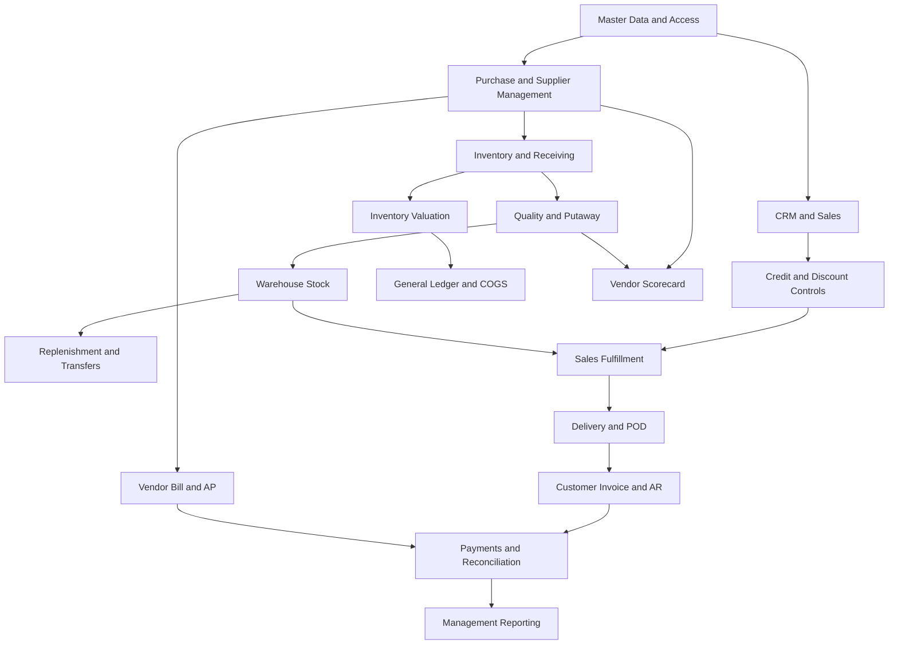
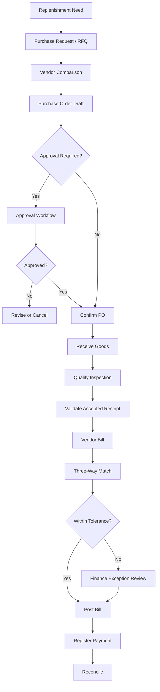
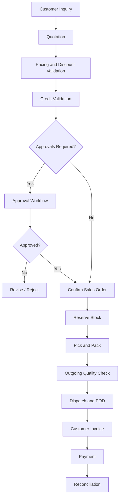

# FUNCTIONAL SPECIFICATION DOCUMENT (FSD)
## Advanced Wholesale Distribution & Supply Chain ERP Implementation

**Company:** PT Arunika Distribusi Nusantara  
**Project ID:** ADN-ERP-2026-001  
**Document ID:** ADN-FSD-001  
**Version:** 1.0  
**Date:** 18 November 2026  
**Status:** Approved for Functional Validation and Fit-Gap Confirmation  
**ERP Platform:** Odoo 19 Enterprise  
**Deployment:** On-Premise | Ubuntu Linux | PostgreSQL  
**Currency:** Indonesian Rupiah (IDR)  
**Source Baselines:** BRD ADN-BRD-001 v1.1; SOW ADN-SOW-001 v1.0; Business Process Mapping ADN-BPM-001 v1.0  
**Classification:** Portfolio / Fictional Business Case

> **Portfolio Disclaimer**  
> PT Arunika Distribusi Nusantara, its stakeholders, business policies, thresholds, transaction values, sample records, and implementation scenario are fictional. This document is a functional design artifact and does not evidence an actual client implementation, production configuration, stakeholder approval, or statutory tax advice.

---

# 1. Document Purpose and Objectives

## 1.1 Purpose

This Functional Specification Document (FSD) describes how the business requirements and target processes are intended to be implemented using Odoo 19 Enterprise applications, configuration, workflow controls, reporting, and approved custom extensions.

The document translates the business requirements into functional behavior that can be configured, developed, tested, and accepted. It is the functional reference for:

- Odoo application and feature mapping.
- Functional configuration and workflow design.
- Approved customization requirements.
- User roles, access, and segregation of duties.
- Functional validation and end-to-end testing.
- Requirements traceability and acceptance evidence.

## 1.2 Objectives

1. Define the expected Odoo behavior for every in-scope business domain.
2. Identify which requirements are expected to use standard Odoo functionality.
3. Identify configuration, automation, customization, and integration needs.
4. Specify business rules, validations, statuses, exceptions, and outputs.
5. Define functional acceptance criteria and test coverage.
6. Preserve traceability to the BRD, SOW, and BPM.

## 1.3 Design Principles

- Prefer standard Odoo 19 Enterprise functionality where it satisfies the approved requirement.
- Use configuration before custom development.
- Implement custom modules only for confirmed functional gaps.
- Keep business policy separate from technical implementation details.
- Preserve transaction traceability from source document to downstream stock and accounting records.
- Apply least-privilege access and segregation of duties.
- Avoid duplicating standard Odoo records or creating parallel transaction ledgers.
- Do not treat an approval policy as implemented until its workflow, security, and boundary tests pass.
- Treat tax rates and tax treatments in the BRD as illustrative test assumptions only.

## 1.4 Document Audience

| Audience | Usage |
|---|---|
| Business Owners / Department Managers | Validate functional behavior and policy interpretation |
| ERP Business Analyst | Maintain requirement traceability and resolve functional questions |
| Odoo Functional Consultant | Configure applications, master data, routes, and workflows |
| Odoo Developer | Implement approved custom modules and automated logic |
| Finance Team | Validate accounting, valuation, tax assumptions, and reconciliation |
| Key Users | Execute functional tests and UAT scenarios |
| ERP Project Manager | Control scope, decisions, change requests, and acceptance |

---

# 2. Document Control

## 2.1 Related Documents

| Document | Reference | Version | Purpose |
|---|---|---:|---|
| Business Requirements Document | ADN-BRD-001 | 1.1 | Defines business needs, rules, priorities, and expected outcomes |
| Scope of Work | ADN-SOW-001 | 1.0 | Defines implementation scope, work packages, boundaries, and acceptance |
| Business Process Mapping | ADN-BPM-001 | 1.0 | Defines AS-IS and TO-BE processes |
| Functional Specification Document | ADN-FSD-001 | 1.0 | Defines Odoo functional implementation behavior |
| Fit-Gap Analysis | TBD | TBD | Confirms standard/configuration/customization/integration decisions |
| Technical Design Document | TBD | TBD | Defines module architecture and technical implementation |
| Test Strategy and Test Cases | TBD | TBD | Defines test execution and evidence |

## 2.2 Revision History

| Version | Date | Description | Author |
|---|---|---|---|
| 1.0 | 18-Nov-2026 | Initial functional specification based on BRD v1.1, SOW v1.0, and BPM v1.0 | ERP Business Analyst |

## 2.3 Approval Status

This document is Approved for functional validation. Names and roles in the source documents are fictional portfolio stakeholders. No real approval or signature is implied.

| Role | Review Responsibility | Status |
|---|---|---|
| Project Sponsor / Managing Director | Business policy and scope | Approved |
| Operations Manager | Inventory, warehouse, quality, logistics, returns | Approved |
| Procurement Manager | Purchasing and vendor performance | Approved |
| Sales Manager | CRM, sales, pricing, discounts | Approved |
| Finance Manager | Credit, accounting, costing, tax assumptions, landed cost | Approved |
| ERP Project Manager | Baseline, scope, dependencies, acceptance | Approved |
| ERP Technical Lead | Technical feasibility and architecture hand-off | Approved |

---

# 3. Solution Overview

## 3.1 Organization and Operating Context

PT Arunika Distribusi Nusantara is a fictional B2B wholesale distributor of FMCG, household products, and consumer goods. The target environment is one legal entity with IDR as its primary currency and three warehouses:

| Warehouse | Code | Primary Role |
|---|---|---|
| Jakarta Central Warehouse | WH-JKT | Main supplier/import receiving and central allocation |
| Bandung Regional Warehouse | WH-BDG | West Java fulfillment and replenishment |
| Surabaya Regional Warehouse | WH-SBY | East Java fulfillment and regional inventory control |

The planning baseline includes 500 SKUs, 250 customers, 40 vendors, 20 ERP user-role staging records, and 30+ internal locations.

## 3.2 Odoo Application Landscape

| Business Capability | Odoo Application / Feature | Functional Usage |
|---|---|---|
| Master Data | Contacts, Products, Units of Measure, Product Categories | Customer, vendor, product, category, and UoM records |
| CRM | CRM | Leads, opportunities, pipeline, activities, customer follow-up |
| Sales | Sales | Quotations, sales orders, pricelists, delivery creation, invoicing policy |
| Purchase | Purchase | RFQs, vendor comparison, purchase orders, vendor pricing |
| Inventory | Inventory | Warehouses, locations, receipts, deliveries, internal transfers, lots, serials, reservations, reordering |
| Barcode | Barcode, subject to licensed apps/devices | Warehouse scanning and operational validation |
| Quality | Quality | Quality control points, checks, alerts, inspection records, disposition workflow |
| Accounting | Accounting / Invoicing | Customer invoices, vendor bills, payments, reconciliation, journals, financial reporting |
| Landed Costs | Inventory Landed Costs | Additional acquisition cost allocation to eligible receipts |
| Documents / Chatter | Documents where licensed; chatter and attachments | Supporting documents, discussion, approval evidence, POD references |
| Dashboards / Reporting | Standard reports, list/pivot/graph views; approved custom dashboards | Operational and financial KPIs |
| Access Control | Users, Groups, ACLs, Record Rules | Role-based access and segregation of duties |
| Custom Workflows | Approved ADN custom addons | Purchase/discount/credit/adjustment/refund approvals, vendor scorecard, selected KPI enhancements |

**Application availability note:** The final installed application set, edition entitlements, and exact Odoo 19 screen behavior must be verified in the target environment. The table identifies the intended functional application areas, not evidence that they are already installed or configured.

## 3.3 Functional Solution Pattern

## 3.4 Standard, Configuration, Customization, and Integration Classification

| Classification | Meaning | Design Rule |
|---|---|---|
| STD | Standard Odoo functionality | Use without changing core behavior |
| CFG | Standard feature requiring configuration | Configure master data, settings, routes, rules, journals, taxes, or security |
| CUS | Custom module or extension | Build only where an approved requirement cannot be met by standard configuration |
| INT | System-to-system integration or approved scheduled job | Implement only for an explicitly approved interface |
| MAN | Controlled manual activity recorded in Odoo | Use where the process requires a human decision or physical operation |
| TBD | Functional decision still open | Resolve in Fit-Gap / design review before build |

---

# 4. Functional Scope

## 4.1 In-Scope Functional Domains

| Domain | BPM Reference | BRD Reference | SOW Scope |
|---|---|---|---|
| Master Data Management | BPM-001 | 5.1, 7, 9 | SCOPE-001 |
| CRM and Lead Management | BPM-002 | 5.13 | CRM requirements, subject to SOW scope confirmation |
| Order to Cash | BPM-003 | 5.2, 5.14 | SCOPE-002, SCOPE-003 |
| Procure to Pay | BPM-004 | 5.3, 5.10, 5.14 | SCOPE-004 |
| Replenishment Planning | BPM-005 | 5.6 | SCOPE-006 |
| Inter-Warehouse Transfer | BPM-006 | 5.6 | SCOPE-007 |
| Inventory / Lot / Expiry / Costing | BPM-007 | 5.4 | SCOPE-005 |
| Receiving and Putaway | BPM-008 | 5.5, 5.7 | SCOPE-008, SCOPE-009 |
| Picking, Packing, Dispatch | BPM-009 | 5.5, 5.8 | SCOPE-008, SCOPE-010 |
| Quality Management | BPM-010 | 5.7 | SCOPE-009 |
| Logistics and Delivery | BPM-011 | 5.8 | SCOPE-010 |
| Customer Returns and Refunds | BPM-012 | 5.9, 5.14 | SCOPE-011 |
| Supplier Returns | BPM-013 | 5.9 | SCOPE-011 |
| Accounting and Financial Management | BPM-014 | 5.10 | SCOPE-012 |
| Imported Goods and Landed Cost | BPM-015 | 5.11 | SCOPE-013 |
| Inventory Adjustment and Cycle Count | BPM-016 | 5.4, 5.14 | SCOPE-005 |
| Vendor Performance | BPM-017 | 5.12 | SCOPE-014 |
| Reporting and Business Intelligence | BPM-018 | 5.15 | SCOPE-015 |
| Security and Internal Controls | Cross-domain | 5.14, 8, 9 | SCOPE-015 |

## 4.2 Out of Scope

The following remain excluded unless approved through formal change control:

- Manufacturing, MRP, production planning, HR, payroll, and employee lifecycle management.
- Full Transportation Management System, fleet maintenance, advanced route optimization, live vehicle tracking, and carrier marketplace integration.
- Customer-facing mobile application and direct integration with every Indonesian marketplace.
- AI-based demand forecasting, full customs brokerage integration, automated bank statement connections, and warehouse robotics.
- Real payment gateway, real bank connectivity, live carrier API, or third-party production integration.
- Legal/tax advisory, statutory tax certification, and guarantee of compliance for a real company.
- Genuine company identities, valid NPWP/NIK, real customer/vendor contact details, or actual signatures.

---

# 5. Functional Design Conventions

## 5.1 Requirement Identification

Functional requirements in this document use the following prefixes:

- `FSD-MD`: Master Data
- `FSD-CRM`: CRM
- `FSD-SAL`: Sales and O2C
- `FSD-CRD`: Credit Management
- `FSD-PUR`: Procurement and P2P
- `FSD-INV`: Inventory
- `FSD-WH`: Warehouse
- `FSD-SUP`: Supply Chain
- `FSD-QUA`: Quality
- `FSD-LOG`: Logistics
- `FSD-RET`: Returns
- `FSD-ACC`: Accounting
- `FSD-LC`: Landed Cost
- `FSD-VPM`: Vendor Performance
- `FSD-RPT`: Reporting
- `FSD-SEC`: Security
- `FSD-MIG`: Data Migration

## 5.2 Functional Status Model

Where a workflow requires additional approval states, the custom design must preserve standard Odoo document states and add explicit workflow status fields rather than silently changing standard semantics.

Suggested custom approval states:

`Draft → Submitted → Pending Approval → Approved / Rejected → Released`

A transaction in `Pending Approval` must not be allowed to perform the business action that the approval is intended to control (for example, confirming a purchase order or validating an inventory adjustment).

## 5.3 Common Audit Fields

Custom workflow records must retain, as applicable:

- Source document model and record reference.
- Requester and request timestamp.
- Approval tier and approval rule version.
- Assigned approver(s).
- Decision, decision timestamp, and comments/reason.
- Rejection or resubmission history.
- Before/after values for value-affecting amendments.
- Final execution reference and execution timestamp.

The exact technical data model is defined in the TDD.

---

# 6. Detailed Functional Specifications

## 6.1 FSD-MD — Master Data Management

**BRD Reference:** 5.1, 7, 9  
**BPM Reference:** BPM-001  
**Odoo Applications:** Contacts, Sales, Purchase, Inventory, Accounting  
**Implementation Type:** STD + CFG; controlled import utilities as required

### 6.1.1 Functional Objective

Maintain one controlled set of product, customer, vendor, warehouse, location, UoM, category, and user records used by all downstream transactions.

### 6.1.2 Functional Requirements

| ID | Functional Requirement | Odoo Implementation | Type |
|---|---|---|---|
| FSD-MD-001 | Maintain unique product records | Product form with internal reference, barcode, category, UoM, purchase UoM, tracking, sales/purchase settings | CFG |
| FSD-MD-002 | Maintain product category hierarchy and costing policy | Product Categories with inventory valuation and costing settings | CFG |
| FSD-MD-003 | Maintain customer and vendor records | Contacts with customer/vendor roles, addresses, payment terms, tax placeholders, salesperson, and credit attributes | CFG/CUS |
| FSD-MD-004 | Maintain multiple delivery and invoice addresses | Contact child addresses and address types | STD |
| FSD-MD-005 | Maintain vendor lead time and product/vendor prices | Vendor pricelist / vendor product information on product purchasing configuration | CFG |
| FSD-MD-006 | Maintain three warehouses and internal location hierarchy | Inventory warehouse and location configuration | CFG |
| FSD-MD-007 | Control master creation and amendment | Group-based create/write rights, approval procedure where required, chatter/audit tracking | CFG/CUS |
| FSD-MD-008 | Validate unique external identifiers and import references | Import templates, pre-import validation, duplicate checks, rejected-row report | CFG/CUS |
| FSD-MD-009 | Maintain product lot/serial and expiration settings | Product tracking configuration and expiration-date features | CFG |
| FSD-MD-010 | Stage 20 user-role records | Odoo users and groups; credentials provisioned securely, not imported as plaintext | CFG/MAN |

### 6.1.3 Required Master Data Attributes

**Product**
- Internal reference (unique).
- Product name and product type.
- Product category.
- Sales UoM and purchase UoM with valid conversion.
- Barcode where applicable.
- Sales and purchase eligibility.
- Vendor references and vendor prices.
- Tracking policy: none, by lot, or by unique serial.
- Expiration-date controls for designated products.
- Customer-facing and internal descriptions as required.

**Customer**
- Unique customer code.
- Customer type / segment.
- Invoice and delivery addresses.
- Payment terms.
- Assigned salesperson and territory.
- Approved credit limit and credit status (custom credit control attributes where standard fields are insufficient).
- Tax identifier placeholder; fictional data only.

**Vendor**
- Unique vendor code.
- Country and addresses.
- Payment terms.
- Product/vendor references and prices.
- Agreed lead time and promised delivery date handling.
- Vendor performance source transactions.

**Warehouse / Location**
- Warehouse code and name.
- Parent/child location hierarchy.
- Location usage and operational purpose.
- Receiving, quality, storage, packing, output, damaged, returns, and transit locations as applicable.

### 6.1.4 Validation Rules

1. Product internal references, customer codes, and vendor codes must be unique.
2. UoM and product categories must exist before dependent product records are loaded.
3. Warehouses and locations must exist before opening stock is loaded.
4. Tracked opening stock must reference valid lot/serial records.
5. Expiration-controlled opening stock must include valid expiration dates.
6. Archived master records remain referenced by historical transactions.
7. User access must be assigned through groups, not ad hoc broad permissions.

### 6.1.5 Data Migration Sequence

`UoM and Product Categories → Warehouses and Locations → Vendors and Customers → Products → Vendor Pricelists and Customer Pricelists → Opening Data`

### 6.1.6 Exceptions

| Condition | System Response |
|---|---|
| Duplicate unique key | Reject import row and include reason in exception log |
| Missing category/UoM/location | Hold dependent row until reference exists |
| Invalid lot/serial or expiry | Reject affected opening stock row |
| Invalid user-role mapping | Reject or stage for ERP Manager correction |
| Master data used by historical transactions | Archive or amend under controlled procedure; do not delete referenced history |

### 6.1.7 Acceptance Criteria

- 500 products, 250 customers, 40 vendors, 3 warehouses, at least 30 locations, and 20 user-role staging records are loaded or staged.
- Unique identifiers and foreign-key references pass validation.
- Import exception log is available.
- Designated tracked products support lot/serial and expiration settings.

---

## 6.2 FSD-CRM — CRM and Lead-to-Opportunity

**BRD Reference:** 5.13  
**BPM Reference:** BPM-002  
**Odoo Application:** CRM, Sales, Contacts  
**Implementation Type:** STD + CFG; CUS only for additional segmentation or reporting

### 6.2.1 Functional Objective

Capture customer inquiries, qualify leads, manage opportunities, record activities, and convert accepted opportunities into quotations.

### 6.2.2 Functional Requirements

| ID | Functional Requirement | Odoo Implementation | Type |
|---|---|---|---|
| FSD-CRM-001 | Register leads and inquiries | CRM Lead form and pipeline | STD |
| FSD-CRM-002 | Assign salesperson and sales team | Salesperson/team assignment | CFG |
| FSD-CRM-003 | Qualify lead and create opportunity | CRM qualification and conversion flow | STD |
| FSD-CRM-004 | Record calls, meetings, tasks, and follow-ups | Activities and chatter | STD |
| FSD-CRM-005 | Track won/lost status and reasons | CRM stages and lost reasons | CFG |
| FSD-CRM-006 | Create quotation from opportunity | CRM-to-Sales quotation action | STD |
| FSD-CRM-007 | Classify customer segment by annual net sales | Scheduled calculation/reporting based on posted net sales | CUS/TBD |
| FSD-CRM-008 | Allow strategic manual segment override with reason and approver | Controlled custom override fields and approval log | CUS |

### 6.2.3 Customer Segmentation

| Segment | Annual Net Sales |
|---|---:|
| Platinum | At least IDR 2,000,000,000 |
| Gold | IDR 1,000,000,000–1,999,999,999 |
| Silver | IDR 250,000,000–999,999,999 |
| Standard | Below IDR 250,000,000 |

Functional behavior:
1. Calculate segment using annual net sales and the approved reporting period.
2. Review segmentation quarterly.
3. Record any manual strategic classification with reason, approver, and effective date.
4. Do not silently overwrite calculated segmentation with a manual override.

**Open clarification:** Confirm whether the segmentation period is calendar year, rolling 12 months, or another business-defined fiscal period. The BRD states annual net sales and quarterly review but does not fully define the annual window.

### 6.2.4 Acceptance Criteria

- A lead can be assigned, qualified, converted, and linked to an opportunity.
- Activities and customer interactions are traceable.
- Accepted opportunities can generate quotations.
- Won/lost reporting uses consistent stage and reason definitions.

---

## 6.3 FSD-SAL — Sales Order to Cash (O2C)

**BRD Reference:** 5.2, 5.8, 5.10, 5.14  
**BPM Reference:** BPM-003, BPM-009, BPM-011, BPM-014  
**Odoo Applications:** Sales, Inventory, Accounting, CRM  
**Implementation Type:** STD + CFG + CUS for discount and credit controls

### 6.3.1 Functional Objective

Manage quotation, customer-specific pricing, discount approval, credit validation, sales order confirmation, stock reservation, fulfillment, delivery, invoicing, collection, and reconciliation.

### 6.3.2 Functional Requirements

| ID | Functional Requirement | Odoo Implementation | Type |
|---|---|---|---|
| FSD-SAL-001 | Create quotations and sales orders | Sales quotations and sales orders | STD |
| FSD-SAL-002 | Apply customer/category-specific pricing | Pricelists and customer-specific commercial terms | CFG |
| FSD-SAL-003 | Evaluate discount approval per order line | Custom approval workflow based on line discount percentage | CUS |
| FSD-SAL-004 | Require reason for exceptional pricing | Mandatory reason field when configured threshold is exceeded | CUS |
| FSD-SAL-005 | Run credit validation before order confirmation | Custom credit exposure service and blocking workflow | CUS |
| FSD-SAL-006 | Reserve stock based on configured routes and availability | Inventory reservation and delivery operations | CFG |
| FSD-SAL-007 | Support partial deliveries | Backorders and partial picking validation | STD |
| FSD-SAL-008 | Support lot/serial and FEFO allocation | Product tracking, removal strategy and expiration controls | CFG |
| FSD-SAL-009 | Create customer invoice | Sales invoicing workflow and accounting | STD/CFG |
| FSD-SAL-010 | Register and reconcile customer payments | Accounting payments and reconciliation | STD |
| FSD-SAL-011 | Trace order, delivery, invoice, credit note, and payment | Standard document links and references | STD |

### 6.3.3 Pricing Policy

| Customer Category | Pricing Policy |
|---|---|
| Retail Store | Standard pricing |
| Wholesaler | Volume-based discount |
| Supermarket | Contract pricing |
| Corporate Customer | Negotiated pricing |

Pricelists must be configured with clear precedence and validity rules. The final precedence between customer-specific, segment, product, and volume pricing must be confirmed during Fit-Gap.

### 6.3.4 Sales Discount Approval Matrix

Discount is evaluated per sales order line. The highest applicable tier determines approval.

| Line Discount | Required Approval |
|---|---|
| 0%–5% | Sales Representative |
| Above 5%–10% | Sales Supervisor |
| Above 10%–15% | Sales Manager |
| Above 15% | Sales Manager and Managing Director |

Functional workflow:
1. Sales user prepares quotation/order lines.
2. System calculates discount percentage against the approved reference price.
3. If the line discount falls within the user's authority, the order can proceed subject to other controls.
4. If approval is required, the order enters `Pending Approval`.
5. The designated approver reviews line, reference price, discount, reason, customer, and order value.
6. Rejection returns the document for correction or cancellation.
7. Approval is recorded with approver, timestamp, decision, and reason.
8. Any value-affecting amendment triggers re-evaluation and invalidates prior approval if the applicable tier changes.
9. The order cannot be confirmed while a required approval is pending.

**Design clarification:** The BRD defines approval bands but does not explicitly define the reference price used to calculate discount percentage. Confirm whether it is the pricelist unit price before discount, a contract price, or another approved baseline.

### 6.3.5 Order Confirmation and Fulfillment

- Confirmed sales orders create or trigger delivery operations according to product routes and warehouse configuration.
- Reservation behavior must follow configured availability and reservation policy.
- Products with lot/serial tracking must carry valid traceability identifiers.
- Eligible products must use FEFO for physical stock allocation.
- Expired, quarantined, damaged, or shelf-life-ineligible quantities must not be allocated to normal delivery.
- Partial delivery must create a backorder or other approved outstanding quantity handling.
- Outgoing quality inspection must be completed before dispatch where required.

### 6.3.6 Sales Invoice and Payment

- Customer invoices are generated according to the configured invoicing policy.
- Only posted invoices contribute to posted AR and sales reporting.
- Draft/cancelled invoices are excluded from posted revenue and outstanding receivables.
- Posted credit notes reduce net sales and customer balances.
- Customer payment is registered and reconciled against receivable entries.
- Invoice date is the default period basis for net sales reporting unless another date basis is explicitly requested.

### 6.3.7 Exceptions

| Condition | Functional Response |
|---|---|
| Discount approval pending | Prevent order confirmation |
| Discount rejected | Return for revision or cancel |
| Stock unavailable | Show availability; allow backorder or replenishment path according to policy |
| Credit hold | Prevent normal confirmation; route exception |
| Lot expired / shelf life insufficient | Exclude from eligible allocation |
| Quality inspection pending/fail | Hold affected delivery quantity |
| Partial delivery | Retain outstanding quantity through backorder |
| Invoice mismatch or posting error | Hold posting and route to Finance |

### 6.3.8 Acceptance Criteria

- Quotation-to-order flow works.
- Customer pricing is applied according to configured rules.
- Discount approvals are tested at all boundaries.
- Credit control blocks orders as specified.
- Reservation, partial delivery, lot traceability, invoicing, payment, and reconciliation work end-to-end.

---

## 6.4 FSD-CRD — Customer Credit Management

**BRD Reference:** 5.2.5, 5.14  
**BPM Reference:** BPM-003  
**Odoo Applications:** Sales, Accounting, Contacts  
**Implementation Type:** CUS, integrated with standard receivable and sales order records

### 6.4.1 Functional Objective

Calculate customer exposure from defined source transactions, warn or block sales orders, and route credit exceptions to authorized approvers.

### 6.4.2 Credit Calculation

**Credit Exposure = Posted Outstanding Receivables + Open Confirmed Sales Orders Not Yet Invoiced**

**Available Credit = Approved Credit Limit − Credit Exposure**

Include:
- Posted unpaid customer invoices.
- Remaining balance of partially paid invoices.
- Open confirmed sales orders not yet invoiced.

Exclude:
- Draft quotations.
- Cancelled sales orders.
- Fully paid invoices.
- Unallocated customer credit notes until reconciled or allocated.

Avoid double-counting: when an order is invoiced, the corresponding open order commitment must no longer be counted separately if the invoice receivable represents the same obligation.

### 6.4.3 Credit Control Rules

| Rule | Condition | System Action |
|---|---|---|
| CR-001 | Exposure ≤ 80% of limit | Normal processing |
| CR-002 | Exposure > 80% and ≤ 100% | Warning to Sales Representative |
| CR-003 | Exposure > 100% | Credit hold; approval required |
| CR-004 | Invoice overdue > 30 calendar days | Credit hold |
| CR-005 | Invoice overdue 1–30 calendar days | Warning and Finance review |
| CR-006 | Customer blocked by Finance | No new credit order confirmation |

### 6.4.4 Exception Approval

| Condition | Approval |
|---|---|
| Exposure exceeds limit by up to IDR 25,000,000 | Finance Manager |
| Exposure exceeds limit by more than IDR 25,000,000 | Finance Manager and Managing Director |
| Customer overdue more than 30 days | Finance Manager |
| Credit limit change | Finance Manager |
| Credit limit increase above IDR 100,000,000 | Finance Manager and Managing Director |

An exception approval applies only to the specific transaction or exception. It does not permanently increase the credit limit unless a separate amendment is approved.

### 6.4.5 Functional Workflow

1. Sales order reaches credit validation.
2. Credit service reads the approved limit, posted receivable balances, overdue status, and open uninvoiced confirmed orders.
3. System calculates exposure, available credit, and utilization.
4. If within policy, continue.
5. If warning threshold is reached, show warning and log the evaluation.
6. If a hold condition exists, block confirmation and create/route an exception request.
7. Approver reviews customer, exposure components, order amount, overdue invoices, and reason.
8. Approver approves or rejects the specific exception.
9. Approval is linked to the affected order and has a defined scope; no permanent limit change is implied.
10. Recalculate exposure before release to prevent stale approval from bypassing current risk.

### 6.4.6 Acceptance Criteria

- Exposure components reconcile to AR and open confirmed orders.
- The same order is not counted twice after invoicing.
- Warning and hold thresholds work at boundary values.
- Overdue and blocked-customer rules work.
- Exception approval records approver, date, reason, and affected transaction.
- Credit-limit changes are audited.

---

## 6.5 FSD-PUR — Procurement and Procure-to-Pay

**BRD Reference:** 5.3, 5.10, 5.12, 5.14  
**BPM Reference:** BPM-004, BPM-008, BPM-010, BPM-014, BPM-017  
**Odoo Applications:** Purchase, Inventory, Quality, Accounting  
**Implementation Type:** STD + CFG + CUS for PO approval

### 6.5.1 Functional Objective

Manage replenishment demand, purchase requisition/request, RFQ issuance, vendor comparison, PO approval, receipt, quality inspection, vendor bill matching, payment, and reconciliation.

### 6.5.2 Functional Requirements

| ID | Functional Requirement | Odoo Implementation | Type |
|---|---|---|---|
| FSD-PUR-001 | Generate purchasing demand from replenishment | Reordering rules and replenishment report | CFG |
| FSD-PUR-002 | Prepare internal purchase request | Purchase agreements/requisition approach or controlled custom request, subject to installed apps and fit-gap | CFG/TBD |
| FSD-PUR-003 | Create and send RFQs | Purchase RFQ | STD |
| FSD-PUR-004 | Compare vendor offers | Alternative RFQs / purchase comparison capability, subject to environment validation | CFG |
| FSD-PUR-005 | Maintain vendor prices and lead times | Vendor product/pricelist data | CFG |
| FSD-PUR-006 | Calculate PO approval tier | Custom approval rule on untaxed PO total after line discounts | CUS |
| FSD-PUR-007 | Prevent PO confirmation before approval | Approval state and server-side validation | CUS |
| FSD-PUR-008 | Re-evaluate approval after amendments | Recalculate tier when quantity, price, discount, or value field changes | CUS |
| FSD-PUR-009 | Receive full or partial quantities | Purchase-linked receipts and backorders | STD |
| FSD-PUR-010 | Perform incoming quality checks | Quality control points and quality checks | CFG |
| FSD-PUR-011 | Match PO, receipt, and vendor bill | Three-way match controls and exception report | CFG/CUS |
| FSD-PUR-012 | Register vendor payment and reconcile | Accounting payments and reconciliation | STD |

### 6.5.3 Purchase Approval Matrix

Approval value is total PO value before tax, after line discounts, in IDR.

| PO Value | Required Approval |
|---|---|
| IDR 0–10,000,000 | Procurement Supervisor |
| Above IDR 10,000,000–50,000,000 | Procurement Manager |
| Above IDR 50,000,000–150,000,000 | Operations Manager |
| Above IDR 150,000,000 | Managing Director |

Functional rules:
1. Calculate approval tier from the final untaxed PO value after line discounts.
2. Exclude taxes and non-purchase ancillary costs unless policy changes.
3. Block PO confirmation until required approval is complete.
4. Re-evaluate after quantity, unit price, discount, or other value-affecting amendments.
5. Route to the higher tier if amended value crosses a threshold.
6. Requester cannot approve own PO.
7. Preserve approval history for cancelled POs.
8. Detect or report suspicious PO splitting for threshold avoidance; the policy prohibits splitting, but automated detection criteria require business definition.

### 6.5.4 Three-Way Matching

| Matching Element | Validation |
|---|---|
| Purchase Order | Ordered product, quantity, unit price, terms |
| Goods Receipt | Validated received and accepted quantity |
| Vendor Bill | Billed product, quantity, unit price, taxes, total |

BRD tolerances:
- Quantity variance: maximum 2%.
- Price variance: maximum 1%.

Functional behavior:
- Matching is performed at line level where possible.
- Quantity and price variances outside tolerance create a bill exception.
- Bill posting/payment release follows the configured Finance approval process.
- Partial receipts and partial bills must be supported.
- The matching basis for taxes, UoM conversions, freight, and landed costs must be validated in Fit-Gap.

### 6.5.5 Partial Receipt and Supplier Discrepancy

- A receipt may be validated for the physically received quantity.
- Outstanding quantities remain open for later receipt or formal cancellation.
- Quality-rejected quantities must be distinguished from accepted quantities.
- Supplier discrepancy reason and communication reference must be recorded.
- Vendor performance calculations use accepted and validated receipt/inspection data as defined in Section 6.16.

### 6.5.6 Acceptance Criteria

- RFQ-to-PO lifecycle works.
- PO approvals route correctly at all threshold boundaries.
- Amendments trigger re-evaluation.
- Self-approval is prevented.
- Partial receipt and backorder behavior work.
- Three-way matching detects out-of-tolerance cases.
- Vendor bill, payment, and reconciliation are traceable.

---

## 6.6 FSD-SUP — Replenishment and Inter-Warehouse Supply

**BRD Reference:** 5.6  
**BPM Reference:** BPM-005, BPM-006  
**Odoo Application:** Inventory  
**Implementation Type:** CFG; CUS for additional transfer approval if not met by standard configuration

### 6.6.1 Functional Objective

Maintain warehouse-specific stock availability and generate replenishment proposals based on minimum/maximum levels, safety stock, forecasted stock, lead time, and internal supply availability.

### 6.6.2 Replenishment Rules

- Configure reordering rules by product and warehouse/location.
- Maintain minimum and maximum quantities.
- Consider forecasted stock, including confirmed incoming supply and outgoing demand.
- Maintain vendor lead times and relevant purchase constraints.
- Use inter-warehouse transfer where an internal source warehouse is selected.
- Use external procurement where replenishment is assigned to a vendor.
- Review seasonal or exceptional demand manually unless a separately approved forecasting scope is defined.

### 6.6.3 Quantity Calculation

Portfolio example:

`Target Replenishment Quantity = Maximum Stock − Forecasted Stock`

For maximum stock 5,000 and forecasted stock 800:

`5,000 − 800 = 4,200 units`

The example assumes no additional incoming PO or transfer changes forecasted stock.

### 6.6.4 Inter-Warehouse Transfer Workflow

1. Destination warehouse falls below its reorder threshold.
2. System/user identifies replenishment need.
3. Source warehouse availability is checked.
4. Transfer request is created.
5. Approval is obtained where required by the approved transfer authority policy.
6. Source warehouse picks and dispatches goods.
7. Stock is represented in transit according to the configured route.
8. Destination warehouse receives and validates goods.
9. Discrepancy or partial receipt is recorded.
10. Destination on-hand and forecasted balances are updated.

### 6.6.5 Functional Controls

- Transfer must reference source and destination warehouses.
- Stock must not become available at destination before receipt validation.
- Partial dispatch and receipt must be supported.
- Lot/serial identity must be preserved across transfer.
- Transit location and ownership/accounting treatment must be confirmed in configuration.
- Transfer discrepancies must be reportable.

### 6.6.6 Acceptance Criteria

- Reordering rules work independently by warehouse.
- Forecasted stock calculation includes relevant incoming/outgoing movements.
- Internal transfer route is traceable from request through destination receipt.
- Partial transfer and lot/serial traceability work.

---

## 6.7 FSD-INV — Inventory, Lot/Serial, Expiration, FEFO, and Costing

**BRD Reference:** 5.4  
**BPM Reference:** BPM-007, BPM-016  
**Odoo Application:** Inventory, Accounting  
**Implementation Type:** CFG + CUS for additional shelf-life restrictions and approval controls

### 6.7.1 Functional Objective

Provide real-time stock balances across warehouses, controlled internal locations, traceability, expiration alerts, FEFO allocation, valuation, and adjustment history.

### 6.7.2 Inventory Functional Requirements

| ID | Requirement | Odoo Implementation | Type |
|---|---|---|---|
| FSD-INV-001 | Real-time inventory balances | Stock quants and move history | STD |
| FSD-INV-002 | Multiple warehouses | Warehouse configuration | CFG |
| FSD-INV-003 | Hierarchical locations | Internal location hierarchy | CFG |
| FSD-INV-004 | Lot tracking | Product tracking by lots | CFG |
| FSD-INV-005 | Serial tracking | Product tracking by unique serial | CFG |
| FSD-INV-006 | Expiration tracking | Lot/serial expiration fields and alerts | CFG |
| FSD-INV-007 | FEFO allocation | Removal strategy configured for eligible locations/products | CFG |
| FSD-INV-008 | FIFO/AVCO category costing | Product category costing and automated valuation | CFG |
| FSD-INV-009 | Inventory adjustment | Inventory count and adjustment workflow | STD/CUS |
| FSD-INV-010 | Cycle counting | Scheduled inventory counts / count assignments | CFG |
| FSD-INV-011 | Stock reservations | Reservation operations and availability | STD |
| FSD-INV-012 | Damaged stock segregation | Dedicated damaged/quarantine locations | CFG |
| FSD-INV-013 | Movement history | Stock moves, move lines, lot traceability | STD |
| FSD-INV-014 | Stock aging | Report based on receipt/valuation history | CFG/CUS |
| FSD-INV-015 | Inventory valuation report | Stock valuation reporting and accounting | STD/CFG |

### 6.7.3 Stock Status and Eligibility

The functional design distinguishes physical on-hand stock from allocatable stock.

| Stock Condition | Available for Normal Sales? | Required Handling |
|---|---|---|
| Available, quality passed, within shelf life | Yes | Normal reservation |
| Reserved | Only for the linked demand | Prevent double allocation |
| Quality pending | No | Remain in quality location/status |
| Quarantined | No | Controlled review and disposition |
| Damaged | No | Damaged location and write-off/return review |
| Expired | No | Block from normal allocation |
| Below customer minimum shelf life | No for affected customer/order | Exclude from allocation or require approved exception |

### 6.7.4 Expiration Alert Policy

| Remaining Shelf Life | Status | Action |
|---|---|---|
| More than 90 days | Normal | Standard inventory management |
| 61–90 days | Attention | Include in monitoring report |
| 31–60 days | Warning | Notify Inventory Controller and Sales Manager |
| 1–30 days | Critical | Restrict allocation according to product policy and require review |
| Expired | Blocked | Quarantine and prohibit normal sales allocation |

- Alert calculation uses lot expiration date against system date.
- Designated products have an initial minimum 90-day remaining shelf life at dispatch unless customer contract is stricter.
- The exact notification schedule, recipient groups, and automated blocking behavior require configuration/custom workflow confirmation.

### 6.7.5 FEFO and Costing Distinction

- FEFO is the physical stock removal strategy based on expiration date.
- FIFO and AVCO are financial inventory valuation methods.
- FEFO must not be treated as a replacement for the category's costing method.
- A product may use FIFO valuation and FEFO picking simultaneously.

### 6.7.6 Product Category Costing Matrix

| Product Category | Costing Method | Valuation |
|---|---|---|
| CAT-001 – Food & Beverage | FIFO | Automated |
| CAT-002 – Household Cleaning | AVCO | Automated |
| CAT-003 – Personal Care | FIFO | Automated |
| CAT-004 – Kitchen Supplies | AVCO | Automated |
| CAT-005 – Consumer Goods | AVCO | Automated |

Functional rules:
1. Assign costing method at product category level.
2. Product inherits its category's valuation configuration unless an approved exception exists.
3. Costing changes require Finance Manager approval and impact assessment.
4. Inventory adjustments create traceable valuation effects.
5. Eligible landed costs are included in acquisition cost.
6. Opening stock value must reconcile before financial go-live simulation.

**Important Odoo configuration dependency:** The selected costing method, automated valuation, accounts, and category behavior must be verified against the actual Odoo 19 database and localization. Do not change a live category costing method without a controlled migration and Finance approval.

### 6.7.7 Inventory Adjustment Approval

Approval basis is the absolute value of the inventory difference using inventory valuation cost, not sales price.

| Absolute Difference Value | Required Approval |
|---|---|
| Up to IDR 1,000,000 | Warehouse Supervisor |
| Above IDR 1,000,000–10,000,000 | Warehouse Manager |
| Above IDR 10,000,000–50,000,000 | Operations Manager and Finance Manager |
| Above IDR 50,000,000 | Managing Director and Finance Manager |

Workflow:
1. Warehouse performs count.
2. System compares counted and recorded quantity.
3. Difference quantity and estimated valuation are calculated.
4. Adjustment is submitted for approval.
5. Approval tier is assigned.
6. Approver reviews evidence and reason.
7. On approval, authorized user validates the inventory adjustment.
8. Inventory and valuation are updated.
9. Audit history is retained.

No user may approve their own adjustment.

### 6.7.8 Acceptance Criteria

- On-hand, reserved, and forecasted quantities are distinguishable.
- Lot/serial traceability works across receipt, transfer, delivery, and return.
- FEFO allocation is demonstrated.
- Expired and quarantined stock cannot be allocated normally.
- Category costing and automated valuation produce reconciled results.
- Inventory adjustment approval works at every boundary.

---

## 6.8 FSD-WH — Receiving, Putaway, Picking, Packing, and Dispatch

**BRD Reference:** 5.5, 5.7, 5.8  
**BPM Reference:** BPM-008, BPM-009  
**Odoo Applications:** Inventory, Barcode, Quality  
**Implementation Type:** STD + CFG; CUS only for custom validations

### 6.8.1 Receiving

- Purchase order confirmation creates the expected receipt operation.
- Warehouse receives goods against the purchase order.
- Actual quantity, product, UoM, lot/serial, and expiration are captured.
- Quality-controlled products are directed through the quality inspection process.
- Accepted quantities are moved to eligible storage locations.
- Rejected or pending quantities remain in quarantine/quality locations or are returned according to disposition.
- Partial receipts remain open for later receipt or cancellation.

### 6.8.2 Putaway

Configure warehouse-specific putaway rules for:
- Product category.
- Storage zone.
- Product handling requirements.
- Quality status.
- Expiration or special handling where supported by configuration.

Initial Jakarta location pattern includes Input, Quality, Stock/Zone-A, Stock/Zone-B, Stock/Zone-C, Packing, Output, Damaged, and Returns. Equivalent structures must be designed for Bandung and Surabaya.

### 6.8.3 Picking

- Confirmed sales demand generates delivery operations.
- Reservation follows configured reservation method and availability.
- FEFO is applied to eligible products.
- Lot/serial identity is captured on stock move lines.
- Picking quantities and discrepancies are recorded.
- Partial picking is handled through backorder or approved exception.

### 6.8.4 Packing and Dispatch

- Picked goods move to packing/output staging.
- Packing and dispatch checks confirm product, quantity, lot/serial, packaging, and order reference.
- Outgoing quality inspection is completed where required.
- Delivery is validated only after the required operational checks pass.
- Dispatch evidence and POD reference are attached to the delivery record.

### 6.8.5 Acceptance Criteria

- Receipt-to-putaway and sales picking-to-dispatch flows work in all three warehouses.
- Partial receipts and deliveries work.
- Lot/serial data is preserved.
- Quality-pending stock is not made available for normal picking.
- Dispatch validation is prevented when mandatory outgoing inspection is incomplete or failed.

---

## 6.9 FSD-QUA — Quality Management

**BRD Reference:** 5.7  
**BPM Reference:** BPM-008, BPM-010, BPM-011  
**Odoo Application:** Quality, Inventory  
**Implementation Type:** CFG + CUS for custom checklist sampling/disposition where standard controls are insufficient

### 6.9.1 Functional Objective

Record measurable incoming and outgoing inspections, associate inspection evidence with source documents and lots, and control stock disposition.

### 6.9.2 Inspection Applicability

Mandatory incoming inspection applies to:
- Food & Beverage.
- Personal Care.
- Selected Household Cleaning products.
- High-value serialized goods.

Mandatory outgoing inspection applies to:
- Lot-tracked products with customer-specific shelf-life requirements.
- High-value goods.
- Products with previous quality complaints.
- Orders selected for additional quality sampling.

### 6.9.3 Incoming Checklist

| Check ID | Parameter | Acceptance Criteria |
|---|---|---|
| IQ-001 | Product identity | Matches PO and product specification |
| IQ-002 | Quantity | Physical quantity matches accepted recorded quantity |
| IQ-003 | Packaging | No visible tears, leaks, deformation, or contamination |
| IQ-004 | Appearance | No visible damage, contamination, or abnormal appearance |
| IQ-005 | Lot identification | Present and readable for tracked products |
| IQ-006 | Expiration date | Present and valid |
| IQ-007 | Remaining shelf life | At least 90 days for designated products |
| IQ-008 | Serial identification | Present and unique for serialized products |

Sampling assumption:
- Up to 100 units: inspect at least 5 units.
- 101–1,000 units: inspect at least 10 units.
- Above 1,000 units: inspect at least 20 units.
- Quantity verification and packaging checks apply to the full shipment where operationally possible.
- Any critical sample defect places the affected lot on hold until disposition.

### 6.9.4 Outgoing Checklist

| Check ID | Parameter | Acceptance Criteria |
|---|---|---|
| OQ-001 | Product identity | Matches sales order |
| OQ-002 | Quantity | Matches picking and delivery quantity |
| OQ-003 | Lot selection | Valid and eligible lot |
| OQ-004 | Expiration date | Not expired |
| OQ-005 | Remaining shelf life | Meets customer requirement |
| OQ-006 | Packaging | No visible damage or leakage |
| OQ-007 | Customer specification | Mandatory order-specific requirements met |

All mandatory outgoing checks must pass before dispatch for orders subject to inspection.

### 6.9.5 Defect Severity and Disposition

| Severity | Example | Action |
|---|---|---|
| Critical | Expired product, contamination, incorrect identity | Reject or quarantine affected goods |
| Major | Damaged protective packaging, missing lot identity | Hold and investigate |
| Minor | Cosmetic defect without product impact | Record and obtain authorized disposition |

| Result | Inventory Disposition |
|---|---|
| Pass | Release to available stock |
| Fail – Critical | Quarantine or reject |
| Fail – Major | Quarantine pending review |
| Fail – Minor | Release only after authorized disposition |
| Pending | Remain in quality location |

Quality Inspector may record inspection and recommend disposition. Commercial/financial write-off approval remains with the applicable approval authority.

### 6.9.6 Functional Requirements

- Quality check must link to receipt/delivery, product, lot/serial where relevant, inspector, date, and source document.
- Checklist result must be pass/fail and retain comments/evidence where required.
- Defect severity and disposition must be recorded.
- Failed or pending stock must not be available for normal sales.
- Quality KPI source data must be available for vendor scorecard calculations.

### 6.9.7 Acceptance Criteria

- Incoming and outgoing checks are generated for applicable products/orders.
- All checklist criteria can be recorded.
- Critical defects place affected lot/quantity on hold.
- Quality disposition and inspector history are traceable.
- Vendor quality acceptance calculations reconcile to inspection data.

---

## 6.10 FSD-LOG — Logistics and Delivery Management

**BRD Reference:** 5.8  
**BPM Reference:** BPM-011  
**Odoo Applications:** Inventory, Sales, Documents/Chatter  
**Implementation Type:** STD + CFG; CUS for delivery KPI extensions as needed

### 6.10.1 Functional Objective

Track delivery preparation, dispatch status, proof-of-delivery reference, delivery discrepancy, and operational delivery performance.

### 6.10.2 Functional Requirements

| ID | Requirement | Odoo Implementation | Type |
|---|---|---|---|
| FSD-LOG-001 | Create delivery from sales order | Delivery transfer linked to sales order | STD |
| FSD-LOG-002 | Record planned and actual delivery dates | Scheduled date and validation timestamp; custom actual delivery date if required | CFG/CUS |
| FSD-LOG-003 | Track dispatch status | Delivery workflow/status fields | CFG |
| FSD-LOG-004 | Capture POD document/reference | Attachment or document linked to delivery | STD/CFG |
| FSD-LOG-005 | Record delivery discrepancy | Reason, quantity, evidence, and resolution fields | CUS/CFG |
| FSD-LOG-006 | Report delivery performance | Report from sales/delivery records | CFG/CUS |

### 6.10.3 Delivery KPIs

- On-Time Delivery Rate = On-time deliveries ÷ total completed deliveries × 100.
- Delivery Fulfillment Rate = Delivered quantity ÷ ordered quantity × 100.
- Delivery Discrepancy Rate = Deliveries with discrepancy ÷ total completed deliveries × 100.

The exact promised date definition and treatment of partial deliveries must be confirmed. Full TMS, route optimization, fleet tracking, and live carrier integrations are out of scope.

### 6.10.4 Acceptance Criteria

- Delivery record is linked to sales order and customer.
- Dispatch and completion dates are captured.
- POD reference can be attached and retrieved.
- Delivery discrepancies are traceable and reportable.
- Delivery KPI calculations reconcile to source delivery records.

---

## 6.11 FSD-RET — Customer Returns, Refunds, and Supplier Returns

**BRD Reference:** 5.9, 5.14  
**BPM Reference:** BPM-012, BPM-013  
**Odoo Applications:** Inventory, Sales, Purchase, Accounting  
**Implementation Type:** STD + CFG + CUS for return/refund approvals

### 6.11.1 Customer Return Workflow

1. Customer reports issue and Customer Service creates return request.
2. Request references original sales order/delivery/invoice where applicable.
3. Authorized role reviews and approves return.
4. Warehouse receives returned goods into a returns/quarantine location.
5. Quality Inspector checks returned goods.
6. Disposition is selected: restock, damaged, quarantine, or other approved status.
7. Finance creates credit note, refund, or other approved financial adjustment.
8. Refund approval is completed according to the matrix.
9. Payment/refund is registered and reconciled where applicable.
10. Return reason, quantity, value, quality result, and source documents remain linked.

### 6.11.2 Customer Refund Approval Matrix

| Refund Value | Required Approval |
|---|---|
| Up to IDR 5,000,000 | Customer Service Supervisor and Finance review |
| Above IDR 5,000,000–25,000,000 | Finance Manager |
| Above IDR 25,000,000–100,000,000 | Finance Manager and Operations Manager |
| Above IDR 100,000,000 | Managing Director and Finance Manager |

### 6.11.3 Supplier Return Workflow

1. Identify defective, excess, or incorrect supplier goods.
2. Create supplier return request referencing original receipt/PO.
3. Obtain authorization under purchase approval/delegated authority.
4. Move goods to returns/quarantine location.
5. Create and validate return delivery to vendor.
6. Record supplier replacement, credit, or vendor bill adjustment.
7. Reconcile financial impact.
8. Preserve reason, quantity, quality evidence, and source references.

### 6.11.4 Functional Controls

- Return must reference original transaction where available.
- Returned stock is not available for resale until inspected and released.
- Credit note/refund must not be generated without the required authorization.
- Refund approval is distinct from physical return authorization.
- Supplier return approval follows Purchase Approval Matrix or delegated authority.
- Return reason codes must be standardized for reporting.

### 6.11.5 Acceptance Criteria

- Customer and supplier returns are linked to original transactions.
- Return receipt and disposition are traceable.
- Refund approval works at all thresholds.
- Credit note/refund and supplier credit adjustments reconcile.

---

## 6.12 FSD-ACC — Accounting and Financial Management

**BRD Reference:** 5.10, 5.4, 5.11  
**BPM Reference:** BPM-014, BPM-015  
**Odoo Application:** Accounting / Invoicing  
**Implementation Type:** CFG; custom matching/control only where fit-gap requires

### 6.12.1 Functional Objective

Integrate sales, procurement, inventory valuation, AR, AP, payment, reconciliation, landed cost, and financial reporting in one accounting ledger.

### 6.12.2 Functional Requirements

| ID | Requirement | Odoo Implementation | Type |
|---|---|---|---|
| FSD-ACC-001 | Configure company accounting foundation | Company, fiscal settings, chart of accounts, journals, currencies | CFG |
| FSD-ACC-002 | Manage customer invoices and credit notes | Customer invoices/credit notes | STD |
| FSD-ACC-003 | Manage vendor bills and vendor credits | Vendor bills/credit notes | STD |
| FSD-ACC-004 | Manage AR/AP | Receivable/payable accounts and aging | STD/CFG |
| FSD-ACC-005 | Register payments | Payment registration and journals | STD |
| FSD-ACC-006 | Reconcile payments and statements | Reconciliation tools | STD |
| FSD-ACC-007 | Integrate inventory valuation | Automated inventory valuation and stock interim/valuation accounts | CFG |
| FSD-ACC-008 | Recognize COGS | Accounting entries generated from inventory valuation/delivery policy | CFG |
| FSD-ACC-009 | Validate PO/receipt/bill matching | Three-way matching controls | CFG/CUS |
| FSD-ACC-010 | Produce financial statements | General ledger, trial balance, P&L, balance sheet, cash/bank, AR/AP aging | STD/CFG |

### 6.12.3 Sales-to-Accounting

- Sales order confirmation creates delivery demand.
- Delivery validation updates inventory and may generate valuation entries under automated valuation.
- Customer invoice is created according to invoicing policy.
- Invoice posting generates receivable, revenue, and tax entries.
- Payment registration and reconciliation reduce outstanding receivable.
- Posted credit notes reduce revenue/receivable according to accounting configuration.

### 6.12.4 Purchase-to-Accounting

- Purchase order confirmation creates expected receipt.
- Receipt validation updates inventory and valuation under configured policy.
- Vendor bill posting creates payable and expense/stock interim/tax entries as configured.
- Three-way match checks PO, accepted receipt, and bill.
- Vendor payment and reconciliation settle payable.

### 6.12.5 Inventory-to-Accounting

- Product category defines costing and valuation policy.
- Automated valuation is used for designated categories.
- Stock receipts, deliveries, returns, and adjustments create accounting effects according to configured accounts and valuation.
- Inventory valuation must reconcile to relevant general ledger accounts.
- COGS must be recognized consistently with delivery and accounting configuration.

### 6.12.6 Three-Way Matching

- Quantity tolerance: maximum 2%.
- Price tolerance: maximum 1%.
- Out-of-tolerance bills are flagged for review.
- Partial receipts and partial billing must be supported.
- Matching rules must be tested for UoM conversion, taxes, discounts, and landed costs.

### 6.12.7 Indonesian Tax Configuration Assumptions

The BRD includes illustrative dummy assumptions, including an 11% tax assumption. These values are for portfolio testing only. They are not current legal advice or a statement of statutory tax treatment.

Functional requirements:
- Configure tax records only in a non-production portfolio/test environment.
- Map tax accounts and tax grids only after Finance review.
- Validate tax calculation, invoice display, journal entries, and tax reports.
- Do not deploy illustrative tax rates to a real business without current professional validation.

### 6.12.8 Acceptance Criteria

- Customer/vendor invoices, credit notes, payments, and reconciliation work.
- AR/AP balances reconcile to the general ledger.
- Inventory valuation reconciles to stock valuation and accounting records.
- COGS is generated consistently.
- Three-way matching identifies variance beyond tolerances.
- Tax calculations use approved test configuration and are clearly marked illustrative.

---

## 6.13 FSD-LC — Landed Cost Management

**BRD Reference:** 5.11, 5.10  
**BPM Reference:** BPM-015  
**Odoo Application:** Inventory Landed Costs, Accounting  
**Implementation Type:** CFG; custom allocation only if standard methods do not meet approved policy

### 6.13.1 Functional Objective

Allocate eligible acquisition costs to imported inventory and retain auditable linkage to the related receipt and accounting entries.

### 6.13.2 Eligible Cost Components

- International freight.
- Insurance.
- Customs-related charges.
- Port handling.
- Customs brokerage.
- Domestic transportation.
- Other eligible acquisition costs approved by Finance.

### 6.13.3 Allocation Policy

| Cost Component | Allocation Method |
|---|---|
| International Freight | By weight |
| Insurance | By current cost |
| Customs-related charges | By current cost |
| Port Handling | By quantity |
| Domestic Transportation | By weight |

### 6.13.4 Functional Workflow

1. Validate receipt of eligible imported products.
2. Record vendor bill or landed-cost charge information.
3. Create landed cost record linked to eligible transfer(s).
4. Add cost lines and select approved allocation method.
5. Compute allocation.
6. Review distribution across eligible products/moves.
7. Validate landed cost.
8. Update inventory valuation and accounting entries.
9. Reconcile landed-cost totals to source charges.

### 6.13.5 Controls

- Only eligible receipts/products may be selected.
- Allocation method must match approved cost type.
- Finance reviews source amount and allocation result.
- Duplicate allocation of the same charge must be prevented or detected.
- Landed cost must remain traceable to source bill, receipt, and valuation.
- Accounting treatment for already-sold quantities or closed periods must be confirmed.

### 6.13.6 Acceptance Criteria

- Eligible cost types and methods are configured.
- Allocation totals equal source charge totals, subject to rounding.
- Inventory valuation changes reconcile.
- Landed-cost record links to source receipt and accounting evidence.

---

## 6.14 FSD-VPM — Vendor Performance Management

**BRD Reference:** 5.12  
**BPM Reference:** BPM-017  
**Odoo Applications:** Purchase, Inventory, Quality, Reporting  
**Implementation Type:** CUS for KPI calculation and scorecard

### 6.14.1 Functional Objective

Calculate monthly and rolling-three-month supplier KPIs from validated purchase, receipt, and quality records and provide drill-down to source transactions.

### 6.14.2 KPI Definitions

| KPI | Formula |
|---|---|
| On-Time Delivery (OTD) | On-time eligible receipts ÷ total eligible receipts × 100 |
| Order Fulfillment | Accepted quantity received ÷ quantity due in period × 100 |
| Quality Acceptance | Accepted quantity ÷ inspected quantity × 100 |
| Lead Time Reliability | Receipts within lead-time tolerance ÷ eligible receipts × 100 |
| Purchase Price Variance | (Actual unit price − reference unit price) ÷ reference unit price × 100 |

Measurement rules:
- Promised date is the confirmed vendor delivery date on the PO.
- Actual date is physical receipt date when receipt is validated.
- Receipt is on time if actual receipt date is on or before promised date.
- Cancelled orders are excluded.
- Fulfillment denominator is quantity due in period; accepted receipt quantity is numerator.
- Rejected quantity does not count as accepted fulfillment.
- Unreceived quantity remains unfulfilled until received or formally cancelled.
- Quality acceptance numerator is accepted quantity; denominator is inspected quantity.
- Uninspected items are excluded and reported separately.
- Planned lead time is calendar days from PO confirmation to promised receipt.
- Actual lead time is calendar days from PO confirmation to validated receipt.
- Within tolerance means actual lead time is no more than planned lead time plus one calendar day.
- Reference unit price is the latest approved reference price for the same product and purchase UoM at period start.
- Purchase Price Variance is displayed separately, not included in weighted score.

### 6.14.3 Weighted Score

`Vendor Score = (OTD × 30%) + (Fulfillment × 25%) + (Quality Acceptance × 30%) + (Lead Time Reliability × 15%)`

| Score | Classification |
|---|---|
| 95%–100% | Excellent |
| 90%–94.99% | Good |
| 80%–89.99% | Needs Improvement |
| Below 80% | Poor |

If fewer than five eligible receipts exist in the evaluation period, display `Insufficient Data` and do not assign a definitive classification.

### 6.14.4 Functional Requirements

- Monthly calculation and rolling three-month view.
- KPI values and weighted score by vendor.
- Purchase Price Variance displayed separately.
- Insufficient Data handling.
- Drill-down from KPI to source PO, receipt, and quality check.
- Calculation date, period, formula version, and refresh timestamp retained.
- Scheduled refresh with failure logging.

### 6.14.5 Acceptance Criteria

- KPI calculations reconcile to source transactions.
- Sample size rule is enforced.
- Weighted score and classification are correct at boundaries.
- Purchase Price Variance is not included in weighted score.
- Monthly and rolling three-month views are available.

---

## 6.15 FSD-RPT — Management Reporting and Business Intelligence

**BRD Reference:** 5.15  
**BPM Reference:** BPM-018  
**Odoo Applications:** Inventory, Sales, Purchase, Accounting, Reporting  
**Implementation Type:** STD + CFG + CUS for consolidated dashboard enhancements

### 6.15.1 Functional Objective

Provide consistent, filterable, traceable operational and financial reporting using transactional and accounting source data.

### 6.15.2 Dashboard Catalogue

**Inventory Dashboard**

| KPI | Formula / Definition | Source |
|---|---|---|
| Total Inventory Quantity | Sum of on-hand quantity for selected internal locations | Inventory quants |
| Total Inventory Valuation | Sum of inventory valuation for selected scope | Stock valuation records |
| Available Stock | On-hand less reserved quantity | Inventory quants/reservations |
| Below-Minimum Stock | Count of product-warehouse combinations with forecast below minimum | Reordering rules/forecast |
| Overstocked Products | Count of product-warehouse combinations with forecast above maximum | Reordering rules/forecast |
| Near-Expiration Quantity | Quantity in lots expiring within 90 days | Lots and stock |
| Expired Quantity | Quantity in lots expired before report date | Lots and stock |
| Inventory Aging | Quantity/value grouped by time since receipt | Stock movement/valuation history |
| Warehouse Stock Comparison | On-hand quantity/value by warehouse | Inventory records |

Inventory scope:
- Include internal warehouse locations.
- Exclude supplier, customer, transit, and virtual adjustment locations unless explicitly requested.
- Display quarantined and damaged stock separately from available stock.
- Use accounting valuation, not sales price.

**Sales Dashboard**

| KPI | Formula / Definition | Source |
|---|---|---|
| Net Sales Revenue | Posted sales invoice untaxed amount less posted sales credit note untaxed amount | Customer invoices/credit notes |
| Sales by Customer | Net sales by customer | Customer invoices |
| Sales by Product | Net sales by invoice product line | Invoice lines |
| Sales by Territory | Net sales by customer territory | Customer and invoice lines |
| Sales by Salesperson | Net sales by responsible salesperson | Sales orders/invoice lines |
| Sales Order Fulfillment | Delivered quantity ÷ ordered quantity × 100 | SO lines/deliveries |
| Outstanding Receivables | Posted receivable balances not fully reconciled | Accounting lines |
| Sales Return Analysis | Return quantity/value by reason | Returns/credit notes |

Sales rules:
- Exclude draft and cancelled invoices.
- Posted credit notes reduce net sales.
- Exclude tax from net sales.
- Default period basis is invoice date unless the report explicitly uses order or delivery date.

**Procurement Dashboard**

| KPI | Formula / Definition | Source |
|---|---|---|
| Total Purchasing Value | Confirmed PO untaxed value for period | Purchase orders |
| PO by Vendor | PO count/value by vendor | Purchase orders |
| PO by Status | PO count by status | Purchase orders |
| Vendor Delivery Performance | Vendor KPI formulas in Section 6.14 | PO/receipts |
| Purchase Price Trend | Weighted average purchase unit price by product/period | PO lines |
| Outstanding PO Value | Confirmed PO value not fully received or cancelled | POs/receipts |
| Procurement Lead Time | Average days from PO confirmation to validated receipt | Purchase/stock records |

**Warehouse Dashboard**

| KPI | Formula / Definition | Source |
|---|---|---|
| Incoming Goods Volume | Quantity received during period | Validated receipts |
| Outgoing Goods Volume | Quantity dispatched during period | Validated deliveries |
| Picking Productivity | Picked lines/units divided by recorded picking hours | Picking/time records where available |
| Packing Productivity | Packed packages divided by recorded packing hours | Packing/time records where available |
| Inventory Discrepancies | Count/value of approved adjustments | Adjustment records |
| Stock Transfer Performance | Completed transfer quantity ÷ requested transfer quantity × 100 | Internal transfers |
| Return Processing Volume | Number/quantity of processed returns | Return records |

If time data is not captured, show transaction volume only; do not label it units per hour.

**Financial Dashboard**

| KPI | Formula / Definition | Source |
|---|---|---|
| Accounts Receivable | Outstanding posted receivable balances | General ledger |
| Accounts Payable | Outstanding posted payable balances | General ledger |
| Overdue Receivables | Receivable balances past due date | Receivable aging |
| Cash and Bank Balances | Posted cash and bank balances | General ledger |
| Gross Profit | Net sales revenue less recognized COGS | Accounting entries |
| Inventory Valuation | Posted inventory valuation | Stock valuation |
| Profit and Loss | Standard financial statement calculation | General ledger |

### 6.15.3 Refresh and Data Governance

| Report Type | Expected Refresh |
|---|---|
| Operational stock indicators | Near real-time after validated stock transactions |
| Sales and procurement reports | On-demand from transactions |
| Vendor scorecard | Monthly |
| Financial statements | Based on posted accounting entries |
| Management KPI summary | Daily portfolio refresh |

- Every KPI must have an agreed formula, date basis, scope, and source.
- Every dashboard figure must be traceable to source records.
- If source data is incomplete, show `Insufficient Data`, `Not Available`, or `Pending Reconciliation`.
- Access must follow user roles.
- Reports must support date and relevant warehouse/product/customer/vendor filters.
- Export capability must be available where appropriate.

### 6.15.4 Acceptance Criteria

- KPI formulas reconcile to raw transactions or posted accounting data.
- Filters operate consistently.
- Incomplete data is not presented as actual performance.
- Dashboard access respects role permissions.
- Refresh timestamp and source lineage are available for custom calculations.

---

## 6.16 FSD-SEC — Security, Approval, and Internal Controls

**BRD Reference:** 5.14, 8, 9  
**BPM Reference:** BPM-001 and all controlled workflows  
**Odoo Features:** Users, Groups, ACLs, Record Rules, chatter, approved custom approval engine  
**Implementation Type:** CFG + CUS

### 6.16.1 Role Model

| Role | Primary Functional Access |
|---|---|
| Managing Director | Executive approvals and authorized management visibility |
| Operations Manager | Warehouse, inventory, quality, logistics, operational approvals |
| Procurement Manager | Supplier, purchasing, PO approvals, vendor performance |
| Sales Manager | CRM, sales, pricing, discount approvals |
| Finance Manager | Accounting, AR/AP, credit, valuation, tax setup review, refund approvals |
| Warehouse Manager | Warehouse execution, stock review, adjustment approvals within authority |
| Warehouse Supervisor | Receiving, picking, counting, low-tier adjustment approvals |
| Inventory Controller | Stock monitoring, lot/expiry monitoring, inventory reports |
| Sales Representative | Leads, quotations, sales orders, customer follow-up |
| Sales Supervisor | Sales review and discount approval within authority |
| Procurement Officer | RFQs, vendor comparison, purchase orders |
| Procurement Supervisor | Purchase review and low-tier PO approval |
| Quality Inspector | Inspection checks, defects, and disposition recommendations |
| Logistics Coordinator | Dispatch, POD, delivery discrepancy |
| Accounts Receivable | Customer invoices, receipts, AR follow-up |
| Accounts Payable | Vendor bills, payments preparation |
| ERP Manager / IT | Technical administration and controlled configuration |
| System Administrator | Platform administration; business approval rights must not be implied |

### 6.16.2 Segregation of Duties

| Process | Requester / Executor | Approver |
|---|---|---|
| Purchase Requisition | Procurement Staff | Procurement Supervisor |
| Purchase Order | Procurement Officer | Applicable Purchase Approver |
| Inventory Adjustment | Warehouse Staff | Applicable Inventory Approver |
| Credit Exception | Sales Staff | Finance Manager / Managing Director |
| Customer Refund | Customer Service | Applicable refund approver; Finance review as defined |
| Vendor Payment | Accounts Payable | Finance Manager |

A user must not approve their own transaction where the relevant SoD policy prohibits it.

### 6.16.3 Approval Policy Summary

- Purchase orders: PO untaxed value after discounts.
- Sales discounts: discount percentage per order line.
- Credit exceptions: exposure and overdue status.
- Inventory adjustments: absolute inventory difference value at valuation cost.
- Customer refunds: refund amount.
- Supplier returns: purchase approval matrix or delegated authority.

### 6.16.4 Functional Security Requirements

1. Assign users to role-based groups.
2. Restrict create/read/write/delete operations through ACLs.
3. Apply record rules where access must be limited by company, warehouse, team, or assigned records.
4. Restrict approval actions to designated approver groups.
5. Prevent requester self-approval in applicable workflows.
6. Preserve approval and status history.
7. Separate technical administration from business approval.
8. Test both permitted and denied access paths.
9. Avoid broad administrator access for routine business users.

### 6.16.5 Audit Trail

Retain, as applicable:
- Document creation and modification.
- Approval history and status changes.
- Inventory movements and adjustment history.
- Financial transaction references.
- Credit exception history.
- Quality inspection and disposition history.
- User and timestamp information.

### 6.16.6 Acceptance Criteria

- Each role can perform only authorized functions.
- Unauthorized users cannot approve controlled transactions.
- Self-approval is prevented where required.
- Warehouse/company/team record restrictions work as designed.
- Audit trail is available for controlled transactions.

---

## 6.17 FSD-MIG — Data Migration and Opening Data

**BRD Reference:** 7  
**SOW Reference:** Section 8, AC-002, AC-010  
**BPM Reference:** BPM-001, Section 10  
**Odoo Features:** Import tools, staging templates, validation scripts, controlled opening entries  
**Implementation Type:** CFG + controlled scripts as approved

### 6.17.1 Dataset Scope

| Dataset | Target Volume | Treatment |
|---|---:|---|
| Products | 500 | Master data |
| Customers | 250 | Master data |
| Vendors | 40 | Master data |
| Warehouses | 3 | Configuration master |
| Internal Locations | 30+ | Configuration master |
| ERP Users | 20 | User-role staging; secure account provisioning |
| Historical Sales Orders | 1,000 | Separate historical transaction dataset |
| Historical Purchase Orders | 300 | Separate historical transaction dataset |
| Opening Lots | 100 | Opening traceability data |
| Opening Stock Records | 500+ | Opening inventory |
| Opening Customer Balances | Up to 250 | Opening AR |
| Opening Vendor Balances | Up to 40 | Opening AP |

### 6.17.2 Import Sequence

`UoM and Categories → Warehouses and Locations → Vendors and Customers → Products → Vendor/Customer Pricelists → Lots/Serials → Opening Stock → Opening AR/AP and Trial Balance`

### 6.17.3 Validation Rules

- Unique identifiers for all master data.
- Valid foreign-key references.
- Valid UoM conversions.
- Valid warehouse/location hierarchy.
- Valid lot/serial and expiration values.
- Opening quantity and valuation reconciliation.
- AR/AP reconciliation to control totals.
- Historical transactions remain clearly historical and are not treated as open operational commitments unless explicitly approved.
- Rejected rows are logged with reason and source row reference.

### 6.17.4 Migration Acceptance

- MIG-001 to MIG-012 must be evidenced as defined in the BRD.
- Validated import sample accuracy target is at least 99.5%.
- Counts before and after import are reconciled.
- Opening stock, AR, AP, and trial balance reconcile before financial go-live simulation.
- Data owners review exceptions and confirm data quality.

---

# 7. Cross-Functional Workflow Specifications

## 7.1 E2E-001 — Procure to Pay

**Expected result:** Procurement transaction is traceable from demand through supplier settlement.

## 7.2 E2E-002 — Order to Cash

**Expected result:** Customer transaction is traceable from quotation through payment.

## 7.3 E2E-003 — Multi-Warehouse Replenishment

1. Identify destination warehouse shortage.
2. Review forecasted stock and reorder policy.
3. Check source warehouse available stock.
4. Create internal transfer.
5. Obtain approval if policy requires.
6. Pick and dispatch from source.
7. Record in-transit movement.
8. Receive and validate at destination.
9. Record discrepancy or partial receipt.
10. Reconcile source/destination quantities.

## 7.4 E2E-004 — Lot and Expiration

1. Receive tracked product.
2. Capture lot/serial and expiration.
3. Complete incoming quality check.
4. Put away to eligible stock.
5. Apply FEFO during reservation/picking.
6. Verify customer minimum shelf life.
7. Deliver and retain lot traceability.
8. Run recall simulation using lot history.

## 7.5 E2E-005 — Credit Limit Violation

1. Create customer quotation/order.
2. Calculate exposure from posted AR and open confirmed uninvoiced orders.
3. Identify threshold/overdue condition.
4. Block normal confirmation where policy requires.
5. Route exception to authorized approver.
6. Approve/reject specific order exception.
7. Recalculate exposure and log release.

## 7.6 E2E-006 — Supplier Delivery Discrepancy

1. Confirm PO.
2. Receive actual delivered quantity.
3. Record shortage, damage, or quality discrepancy.
4. Validate accepted quantity only.
5. Keep outstanding quantity open.
6. Record vendor communication and resolution.
7. Update vendor KPI source data.

## 7.7 E2E-007 — Customer Return and Refund

1. Register return request.
2. Reference original delivery/invoice.
3. Authorize return.
4. Receive into returns/quarantine location.
5. Inspect and record disposition.
6. Route refund approval by amount.
7. Create credit note/refund.
8. Reconcile financial balance.

## 7.8 E2E-008 — Imported Goods and Landed Costs

1. Create international PO.
2. Receive imported goods.
3. Record eligible freight/insurance/customs/handling charges.
4. Create landed cost against eligible receipt.
5. Apply approved allocation method.
6. Validate allocation.
7. Reconcile valuation and accounting.

## 7.9 E2E-009 — Inventory Adjustment and Cycle Counting

1. Schedule count.
2. Assign count to authorized warehouse user.
3. Record physical quantity.
4. Calculate variance quantity and valuation.
5. Determine approval tier.
6. Obtain approval from separate authorized user.
7. Validate adjustment.
8. Reconcile inventory valuation.

## 7.10 E2E-010 — Vendor Performance

1. Collect eligible PO, receipt, and inspection transactions.
2. Calculate monthly and rolling-three-month KPI values.
3. Apply minimum sample rule.
4. Calculate weighted score and classification.
5. Display purchase price variance separately.
6. Drill down to source records.

---

# 8. Functional Reports and Outputs

| Report ID | Report | Key Filters | Main Output |
|---|---|---|---|
| RPT-001 | Inventory On-Hand | Warehouse, location, product, category | Quantity by location/product |
| RPT-002 | Inventory Valuation | Warehouse, category, date | Valuation and accounting value |
| RPT-003 | Lot and Expiration | Warehouse, product, expiry range, status | Lot balances and expiry alerts |
| RPT-004 | Replenishment | Warehouse, product, below/above min-max | Reorder proposals |
| RPT-005 | Stock Transfer | Source, destination, status, date | Transfer status and discrepancies |
| RPT-006 | Sales Performance | Date, customer, territory, salesperson, product | Net sales and fulfillment |
| RPT-007 | Credit Exposure | Customer, utilization, overdue status | Credit limit, exposure, available credit |
| RPT-008 | Purchase Analysis | Date, vendor, product, status | PO value, lead time, outstanding |
| RPT-009 | Three-Way Match Exceptions | Vendor, PO, bill, variance status | Quantity/price mismatch |
| RPT-010 | Quality Inspection | Product, lot, vendor, result, severity | Pass/fail, defects, disposition |
| RPT-011 | Delivery Performance | Date, warehouse, customer, status | On-time and fulfillment KPIs |
| RPT-012 | Returns Analysis | Return reason, customer/vendor, date | Return quantity and value |
| RPT-013 | AR/AP Aging | Partner, due date, status | Outstanding and overdue balances |
| RPT-014 | Landed Cost Analysis | Receipt, cost type, vendor, date | Allocated cost and valuation impact |
| RPT-015 | Vendor Scorecard | Vendor, month, rolling period | KPI score and classification |
| RPT-016 | Inventory Adjustment | Warehouse, approver, date, value tier | Count variance and approvals |
| RPT-017 | Approval Audit | Document type, requester, approver, status | Approval history and pending items |

---

# 9. Non-Functional and Operational Specifications

## 9.1 Performance

- BRD target: approximately 3-second form response under the defined test profile.
- The target is a test criterion, not a guaranteed Odoo response time.
- Performance testing must document dataset size, hardware, concurrency, and measurement method.
- Custom KPI jobs must be measured for execution duration and failure behavior.

## 9.2 Security

- Role-based access and least privilege.
- Passwords and credentials provisioned securely.
- No plaintext credential migration.
- Restrict business approvals to authorized approver groups.
- Test negative access cases and record rules.
- Separate technical administration from routine business execution.

## 9.3 Availability and Recovery

- On-premise Ubuntu/PostgreSQL target.
- Backup and restore rehearsal required.
- Backup schedule, retention, RPO/RTO, monitoring, and ownership require infrastructure design confirmation.
- No availability SLA is implied by this FSD.

## 9.4 Data Integrity and Auditability

- Unique identifiers and valid document relationships.
- Preserve source-to-destination references.
- Inventory and accounting records must reconcile.
- Retain approval, movement, financial, credit, quality, and user activity history.
- Do not delete referenced transaction history as a correction mechanism.

## 9.5 Scalability and Usability

- Support additional warehouses, products, vendors, customers, and users without redesigning the core data model.
- Use consistent labels, validation messages, and user workflows.
- Provide SOPs and role-based training.
- Avoid exposing unnecessary technical fields to operational users.

---

# 10. Functional Error and Exception Handling

| Exception ID | Condition | Expected System Behavior | Responsible Role |
|---|---|---|---|
| EX-001 | Duplicate master identifier | Reject save/import or flag duplicate | Data Owner / ERP Manager |
| EX-002 | Missing master dependency | Prevent import/transaction until corrected | Data Owner |
| EX-003 | PO approval rejected | Keep PO unconfirmed; return for correction/cancel | Procurement |
| EX-004 | Discount approval rejected | Prevent SO confirmation; revise or cancel | Sales |
| EX-005 | Credit limit exceeded | Place order on hold and route exception | Finance |
| EX-006 | Overdue invoice >30 days | Apply credit hold | Finance |
| EX-007 | Insufficient stock | Show shortage; trigger replenishment/backorder path | Warehouse / Sales |
| EX-008 | Expired or shelf-life-ineligible lot | Exclude from normal allocation | Inventory Controller |
| EX-009 | Quality inspection failed | Quarantine/reject affected quantity | Quality / Warehouse |
| EX-010 | Partial receipt | Validate actual quantity and retain outstanding quantity | Warehouse / Procurement |
| EX-011 | Three-way match outside tolerance | Flag bill for Finance review | Accounts Payable |
| EX-012 | Inventory adjustment approval pending | Prevent validation of adjustment | Warehouse |
| EX-013 | Refund approval pending | Prevent refund execution | Customer Service / Finance |
| EX-014 | Landed cost allocation mismatch | Prevent validation until reconciled | Finance |
| EX-015 | Vendor KPI sample below five receipts | Display Insufficient Data | Procurement |
| EX-016 | KPI source data incomplete | Display status, do not present as actual | ERP Reporting Owner |
| EX-017 | Unauthorized approval attempt | Deny action and retain audit evidence where available | ERP Manager |
| EX-018 | Scheduled job failure | Log failure, notify owner, allow controlled rerun | ERP Technical Team |

---

# 11. Approval Matrices — Consolidated Functional Reference

## 11.1 Purchase Order

| Value Before Tax, After Line Discounts | Approver |
|---|---|
| IDR 0–10,000,000 | Procurement Supervisor |
| > IDR 10,000,000–50,000,000 | Procurement Manager |
| > IDR 50,000,000–150,000,000 | Operations Manager |
| > IDR 150,000,000 | Managing Director |

## 11.2 Sales Discount per Order Line

| Discount | Approver |
|---|---|
| 0%–5% | Sales Representative |
| >5%–10% | Sales Supervisor |
| >10%–15% | Sales Manager |
| >15% | Sales Manager and Managing Director |

## 11.3 Inventory Adjustment by Absolute Valuation Difference

| Difference Value | Approver |
|---|---|
| Up to IDR 1,000,000 | Warehouse Supervisor |
| > IDR 1,000,000–10,000,000 | Warehouse Manager |
| > IDR 10,000,000–50,000,000 | Operations Manager and Finance Manager |
| > IDR 50,000,000 | Managing Director and Finance Manager |

## 11.4 Customer Refund

| Refund Value | Approver / Review |
|---|---|
| Up to IDR 5,000,000 | Customer Service Supervisor and Finance review |
| > IDR 5,000,000–25,000,000 | Finance Manager |
| > IDR 25,000,000–100,000,000 | Finance Manager and Operations Manager |
| > IDR 100,000,000 | Managing Director and Finance Manager |

## 11.5 Credit Exception

| Condition | Approver |
|---|---|
| Over limit by up to IDR 25,000,000 | Finance Manager |
| Over limit by more than IDR 25,000,000 | Finance Manager and Managing Director |
| Overdue >30 days | Finance Manager |
| Credit limit change | Finance Manager |
| Increase above IDR 100,000,000 | Finance Manager and Managing Director |

**Common control:** A requester cannot approve their own transaction where SoD rules prohibit it. Approval must be retained against the affected source document. Value-affecting amendments require re-evaluation.

---

# 12. Functional Test and Acceptance Criteria

## 12.1 Test Types

- Configuration verification.
- Functional testing for each business domain.
- Approval boundary testing.
- Integration testing across P2P, O2C, warehouse, quality, accounting, and returns.
- Data migration testing.
- Security and segregation-of-duties testing.
- Regression testing after custom module/configuration changes.
- Performance testing under documented conditions.
- Backup and restore testing.
- UAT using all ten BRD end-to-end scenarios.

## 12.2 Minimum Functional Test Catalogue

| Test ID | Scenario | Expected Result |
|---|---|---|
| TC-MD-001 | Import duplicate product reference | Duplicate rejected and logged |
| TC-MD-002 | Import product with missing category | Row held/rejected with dependency error |
| TC-CRM-001 | Convert qualified lead to opportunity and quotation | Linked CRM and quotation records created |
| TC-SAL-001 | Apply customer-specific pricelist | Correct price is proposed |
| TC-SAL-002 | Discount at 5% | Sales Representative tier |
| TC-SAL-003 | Discount above 5% through 10% | Sales Supervisor tier |
| TC-SAL-004 | Discount above 10% through 15% | Sales Manager tier |
| TC-SAL-005 | Discount above 15% | Sales Manager and Managing Director tier |
| TC-CRD-001 | Exposure at 80% | Normal processing |
| TC-CRD-002 | Exposure above 80% and up to 100% | Warning |
| TC-CRD-003 | Exposure above 100% | Hold and exception approval |
| TC-CRD-004 | Invoice overdue more than 30 days | Credit hold |
| TC-PUR-001 | PO at IDR 10,000,000 | Procurement Supervisor tier |
| TC-PUR-002 | PO above IDR 10,000,000 through IDR 50,000,000 | Procurement Manager tier |
| TC-PUR-003 | PO above IDR 50,000,000 through IDR 150,000,000 | Operations Manager tier |
| TC-PUR-004 | PO above IDR 150,000,000 | Managing Director tier |
| TC-PUR-005 | Requester attempts own approval | Action denied |
| TC-PUR-006 | PO amended into higher tier | Approval re-evaluated |
| TC-PUR-007 | Three-way match quantity variance >2% | Bill exception |
| TC-PUR-008 | Three-way match price variance >1% | Bill exception |
| TC-INV-001 | Lot-tracked receipt | Lot captured and traceable |
| TC-INV-002 | FEFO picking | Earliest eligible expiry selected |
| TC-INV-003 | Expired lot allocation | Allocation blocked |
| TC-INV-004 | Adjustment up to IDR 1,000,000 | Warehouse Supervisor tier |
| TC-INV-005 | Adjustment above IDR 1,000,000 through IDR 10,000,000 | Warehouse Manager tier |
| TC-INV-006 | Adjustment above IDR 10,000,000 through IDR 50,000,000 | Operations and Finance tier |
| TC-INV-007 | Adjustment above IDR 50,000,000 | Managing Director and Finance tier |
| TC-WH-001 | Partial receipt | Actual receipt validated; remainder stays open |
| TC-WH-002 | Partial delivery | Backorder/outstanding quantity retained |
| TC-QUA-001 | Critical incoming defect | Affected lot/quantity quarantined |
| TC-QUA-002 | Mandatory outgoing check fails | Dispatch blocked |
| TC-LOG-001 | Attach POD reference | POD retrievable from delivery |
| TC-RET-001 | Refund up to IDR 5,000,000 | Customer Service Supervisor and Finance review |
| TC-RET-002 | Refund above IDR 100,000,000 | Managing Director and Finance approval |
| TC-ACC-001 | Post customer invoice | AR/revenue/tax entries generated |
| TC-ACC-002 | Reconcile customer payment | Outstanding AR reduced |
| TC-LC-001 | Allocate landed cost by weight/current cost/quantity | Allocation reconciles to charge total |
| TC-VPM-001 | Vendor with fewer than five eligible receipts | Insufficient Data |
| TC-VPM-002 | Vendor score calculation | Weighted score and classification correct |
| TC-RPT-001 | Draft invoice in sales dashboard | Excluded from net sales |
| TC-RPT-002 | Posted credit note | Reduces net sales |
| TC-SEC-001 | Unauthorized user attempts approval | Access denied |
| TC-MIG-001 | Migration sample accuracy | At least 99.5% target on validated sample |

## 12.3 Acceptance Mapping

| SOW Acceptance ID | FSD Sections / Evidence |
|---|---|
| AC-001 Scope Traceability | Sections 4, 6, 7, 13 |
| AC-002 Master Data Integrity | Sections 6.1 and 6.17 |
| AC-003 Core Process Execution | Sections 6.3, 6.5, 7.1, 7.2 |
| AC-004 Inventory Control | Sections 6.6, 6.7, 6.8, 6.9 |
| AC-005 Financial Control | Sections 6.3, 6.5, 6.12, 6.13 |
| AC-006 Quality and Supplier KPIs | Sections 6.9 and 6.14 |
| AC-007 Security | Section 6.16 |
| AC-008 Technical Readiness | FSD approved, TDD, module tests, API/job and backup/restore evidence |
| AC-009 Operational Readiness | SOPs, training, E2E execution, UAT and critical defect closure |
| AC-010 Migration Quality | Section 6.17 and migration evidence |

---

# 13. Open Functional Decisions and Fit-Gap Register

The following items must be resolved before the related configuration or development is baselined. A BRD policy is not proof that the policy has already been configured or tested in Odoo.

| Decision ID | Topic | Required Confirmation | Impact |
|---|---|---|---|
| DEC-001 | Purchase Approval | Validate approval routing, approver substitution, delegation, and amendment behavior | Purchase workflow |
| DEC-002 | Sales Discount | Confirm discount reference price, rounding, multiple discounts, and reapproval behavior | Sales custom workflow |
| DEC-003 | Inventory Adjustment | Confirm valuation basis, rounding, multi-product adjustment aggregation, and approval routing | Inventory custom workflow |
| DEC-004 | Costing | Validate FIFO/AVCO per category, automated valuation, account mapping, and change restrictions | Accounting/inventory |
| DEC-005 | Indonesian Tax | Validate localization, tax mapping, tax rates, and reporting before real deployment | Accounting |
| DEC-006 | Credit Management | Confirm exposure data sources, order/invoice overlap, reservation/confirmation trigger, and exception expiry | Sales/Finance |
| DEC-007 | Quality | Confirm checklist representation, sampling execution, defect severity, and disposition authority | Quality/Inventory |
| DEC-008 | Vendor Performance | Confirm date rules, due quantity logic, reference price source, period cut-off, and sample-size rule | Custom reporting |
| DEC-009 | Reporting | Confirm KPI date basis, data model, refresh, reconciliation, and dashboard audience | Reporting |
| DEC-010 | Data Migration | Confirm actual import templates, opening balances, historical transaction treatment, and migration cut-off | Data migration |
| DEC-011 | Refund Approval | Confirm refund basis (gross/net), credit note vs cash refund path, and Finance review behavior | Returns/Accounting |
| DEC-012 | Landed Cost | Validate cost eligibility, allocation methods, already-sold quantities, and accounting period treatment | Inventory/Accounting |

### 13.1 Additional Functional Clarifications

1. Confirm annual customer segmentation period.
2. Confirm discount reference price and precedence between pricelists, volume rules, and negotiated pricing.
3. Define PO-splitting detection/reporting rule.
4. Confirm whether purchase requisition functionality is available in the selected Odoo 19 Enterprise application set or requires an alternative controlled request flow.
5. Confirm internal transfer approval policy and value/quantity thresholds, which are not fully specified in the BRD.
6. Confirm expiry notification recipients and whether critical/near-expiry status blocks allocation automatically.
7. Confirm whether the 90-day shelf-life requirement applies globally or only to designated products/customers.
8. Confirm exact delivery promised-date and partial delivery KPI treatment.
9. Confirm the operational source for picking/packing time if productivity is to be expressed per hour.
10. Confirm refund approval treatment where a credit note is issued without a cash refund.
11. Confirm tax localization and all accounting mappings with qualified Finance/tax reviewers.
12. Confirm exact Odoo 19 Enterprise app availability and version-specific configuration behavior in the target environment.

---

# 14. Customization and Integration Candidate Catalogue

Custom development is not automatically approved by inclusion in this FSD. Each item must pass Fit-Gap and be authorized before implementation.

| Candidate ID | Functional Gap / Need | Proposed Functional Extension | Priority | Required Design Artifact |
|---|---|---|---|---|
| CUS-001 | Multi-level PO approval by value | Approval request, tier calculation, approval history, confirmation lock | Must | TDD + workflow tests |
| CUS-002 | Discount approval per SO line | Discount evaluation, approver routing, reason, reapproval | Must | TDD + boundary tests |
| CUS-003 | Credit exposure and hold | Exposure calculation, warnings, holds, exception release | Must | TDD + reconciliation tests |
| CUS-004 | Inventory adjustment approval | Valuation-based tier and validation lock | Must | TDD + boundary tests |
| CUS-005 | Refund approval | Value-based approval and refund execution lock | Must | TDD + accounting tests |
| CUS-006 | Vendor scorecard | KPI calculation, score, classification, insufficient-data state | Must | TDD + formula tests |
| CUS-007 | Consolidated dashboards | KPI cards/views and source drill-down | Should | Report specification |
| CUS-008 | Expiration alerts / shelf-life enforcement | Alert notifications and eligibility checks beyond standard setup | Should | TDD + expiry tests |
| CUS-009 | Quality sampling enhancements | Sample-size calculation and checklist extensions if required | Should | TDD + quality tests |
| CUS-010 | Delivery/POD discrepancy fields | POD reference and discrepancy tracking if standard fields insufficient | Should | TDD + delivery tests |
| INT-001 | Approved internal APIs/jobs | Scheduled KPI refresh or explicitly approved internal system exchange | TBD | API/job specification |

For every approved custom module, the TDD must define:
- Module name, dependencies, and manifest.
- Data models and relationships.
- Security access and record rules.
- Views, menus, actions, and user interaction.
- Server-side validation and workflow transitions.
- Scheduled jobs and failure handling.
- Unit, integration, and regression tests.
- Installation, upgrade, and rollback approach.

---

# 15. Risks, Dependencies, and Assumptions

## 15.1 Key Risks

| Risk ID | Risk | Functional Mitigation |
|---|---|---|
| RSK-001 | Poor master data quality | Unique keys, reference validation, owner review, import rehearsal |
| RSK-002 | Opening stock/financial mismatch | Separate opening data preparation and reconciliation sign-off |
| RSK-003 | Incorrect accounting/tax assumptions | Finance review; tax rates explicitly illustrative |
| RSK-004 | Custom workflow defects | FSD/TDD, automated tests, approval boundary and regression tests |
| RSK-005 | Excessive customization | Fit-Gap first; prefer standard Odoo |
| RSK-006 | Security/SoD gaps | Least privilege, role matrix, negative access tests, audit trail |
| RSK-007 | Incorrect KPI results | Document formulas, date logic, source models, reconcile to raw records |
| RSK-008 | Infrastructure/backup failure | Deployment checklist, monitored backup, restore rehearsal |

## 15.2 Dependencies

- Odoo 19 Enterprise environment and required applications.
- Approved BRD/SOW baseline and closure of DEC-001 to DEC-012.
- Availability of Ubuntu/PostgreSQL environment, backups, and access.
- Approved user roles, warehouse SOPs, and accounting policy.
- Prepared opening stock, AR/AP, and historical transaction data.
- Finance validation of costing, valuation, tax assumptions, and landed cost.
- Departmental review of quality, pricing, credit, and approval policies.

## 15.3 Assumptions

- One legal entity and IDR primary currency.
- Three warehouses: Jakarta, Bandung, and Surabaya.
- All company and sample data are fictional.
- BRD policies are treated as portfolio assumptions pending functional validation.
- Standard Odoo functionality is preferred where it satisfies the requirement.
- No external integration provider is assumed unless explicitly approved.
- Actual stakeholder approval is not implied by fictional names or sample sign-off records.

---

# 16. Requirements Traceability Matrix (Summary)

| BRD Reference | Business Requirement Area | BPM Reference | FSD Section | Odoo Application / Feature | Type |
|---|---|---|---|---|---|
| 5.1 | Master Data Management | BPM-001 | 6.1 | Contacts, Products, UoM, Categories, Inventory | STD/CFG/CUS |
| 5.13 | CRM | BPM-002 | 6.2 | CRM, Sales, Contacts | STD/CFG/CUS |
| 5.2 | Sales Management | BPM-003 | 6.3 | Sales, Inventory, Accounting | STD/CFG/CUS |
| 5.2.5 | Credit Management | BPM-003 | 6.4 | Sales, Accounting, custom credit control | CUS |
| 5.2.6 | Pricing and Discount | BPM-003 | 6.3 | Pricelists, custom approval | CFG/CUS |
| 5.3 | Purchase Management | BPM-004 | 6.5 | Purchase, Inventory, Accounting | STD/CFG/CUS |
| 5.6 | Replenishment | BPM-005 | 6.6 | Inventory Reordering Rules | CFG |
| 5.6 | Inter-Warehouse Transfer | BPM-006 | 6.6 | Inventory Routes/Transfers | CFG/CUS |
| 5.4 | Inventory, Lot, Expiry, Costing | BPM-007 | 6.7 | Inventory, Lots, Removal Strategy, Valuation | CFG/CUS |
| 5.5 | Warehouse Management | BPM-008/009 | 6.8 | Inventory, Barcode | STD/CFG |
| 5.7 | Quality Management | BPM-010 | 6.9 | Quality, Inventory | CFG/CUS |
| 5.8 | Logistics and Delivery | BPM-011 | 6.10 | Inventory, Sales, Documents | STD/CFG/CUS |
| 5.9 | Returns and Reverse Logistics | BPM-012/013 | 6.11 | Inventory, Sales, Purchase, Accounting | STD/CFG/CUS |
| 5.10 | Accounting and Financial Management | BPM-014 | 6.12 | Accounting | STD/CFG |
| 5.11 | Landed Cost | BPM-015 | 6.13 | Inventory Landed Costs, Accounting | CFG |
| 5.12 | Vendor Performance | BPM-017 | 6.14 | Purchase, Inventory, Quality, custom reports | CUS |
| 5.15 | Reporting and BI | BPM-018 | 6.15 | Standard reports, pivots, custom dashboards | STD/CFG/CUS |
| 5.14 | Approval and Internal Control | Cross-domain | 6.16 | Users, Groups, ACLs, Record Rules, custom approvals | CFG/CUS |
| 7 | Data Migration | BPM-001 / Section 10 | 6.17 | Import tools, validation scripts | CFG/CUS |
| 8–9 | NFR, Roles, Responsibilities | Cross-domain | 6.16, 9 | Odoo security and infrastructure controls | CFG |
| 13 | Acceptance Criteria | All BPMs | 12 | Functional, integration, security, migration tests | Test |

---

# 17. Change Control

Any change to approved functional requirements, workflows, approval thresholds, data volumes, integrations, reports, or acceptance criteria must be managed through a Change Request (CR).

Each CR must include:
- Business reason and requested outcome.
- Affected BRD, SOW, BPM, and FSD references.
- Functional and technical impact.
- Security and accounting impact where applicable.
- Effort, schedule, and risk impact.
- Alternatives considered.
- Approval decision and revised document baseline.

No out-of-scope work begins before the CR is accepted in the portfolio simulation.

---

# 18. FSD Completion and Handover Criteria

The FSD is ready for implementation baseline when:

1. Business owners have reviewed functional behavior and policy interpretation.
2. DEC-001 through DEC-012 are resolved or explicitly carried as approved design assumptions.
3. Fit-Gap classifies each requirement as standard, configuration, customization, integration, or excluded.
4. Customization candidates are approved and handed to TDD.
5. Functional acceptance criteria and test cases are agreed.
6. Role and segregation-of-duties matrix is validated.
7. Accounting, costing, landed cost, and tax assumptions are reviewed by Finance.
8. Migration datasets and reconciliation rules are confirmed.
9. Document version and approval status are recorded.

## 18.1 Next Deliverables

| Sequence | Deliverable | Purpose |
|---|---|---|
| 1 | Fit-Gap Analysis | Confirm standard Odoo fit and approved gaps |
| 2 | Technical Design Document (TDD) | Define custom module and integration architecture |
| 3 | Configuration Workbook | Record actual Odoo settings and master data setup |
| 4 | Custom Addons | Implement approved functional extensions |
| 5 | Test Strategy and Test Cases | Validate functional and technical behavior |
| 6 | Requirements Traceability Matrix | Track requirements through build and test |
| 7 | UAT Scripts and Evidence | Record business acceptance |
| 8 | Deployment and Handover Guide | Document operational readiness |

---

# 19. Glossary

| Term | Definition |
|---|---|
| ACL | Access Control List |
| AP | Accounts Payable |
| AR | Accounts Receivable |
| AVCO | Average Cost |
| BRD | Business Requirements Document |
| BPM | Business Process Mapping |
| COGS | Cost of Goods Sold |
| CRM | Customer Relationship Management |
| DPP | Dasar Pengenaan Pajak |
| ERP | Enterprise Resource Planning |
| FEFO | First Expired, First Out |
| FIFO | First In, First Out |
| FSD | Functional Specification Document |
| GRN | Goods Received Note |
| KPI | Key Performance Indicator |
| MOQ | Minimum Order Quantity |
| O2C | Order to Cash |
| P2P | Procure to Pay |
| POD | Proof of Delivery |
| PO | Purchase Order |
| PPN | Pajak Pertambahan Nilai |
| RFQ | Request for Quotation |
| RTM | Requirements Traceability Matrix |
| SKU | Stock Keeping Unit |
| SO | Sales Order |
| SOW | Scope of Work |
| TDD | Technical Design Document |
| UoM | Unit of Measure |
| UAT | User Acceptance Testing |
| WMS | Warehouse Management System |

---

**END OF DOCUMENT**

**Document ID:** ADN-FSD-001  
**Project:** ADN-ERP-2026-001  
**Organization:** PT Arunika Distribusi Nusantara  
**ERP Platform:** Odoo 19 Enterprise  
**Version:** 1.0  
**Status:** Approved for Functional Validation and Fit-Gap Confirmation  
