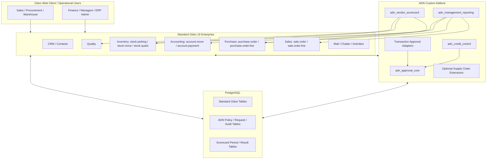
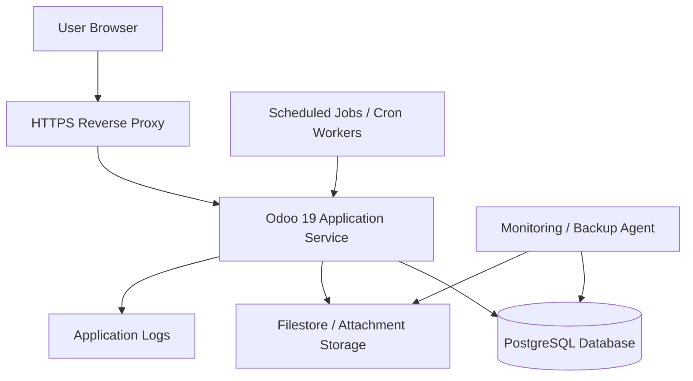
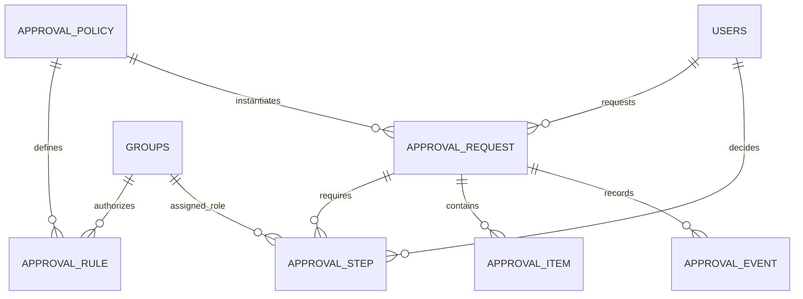
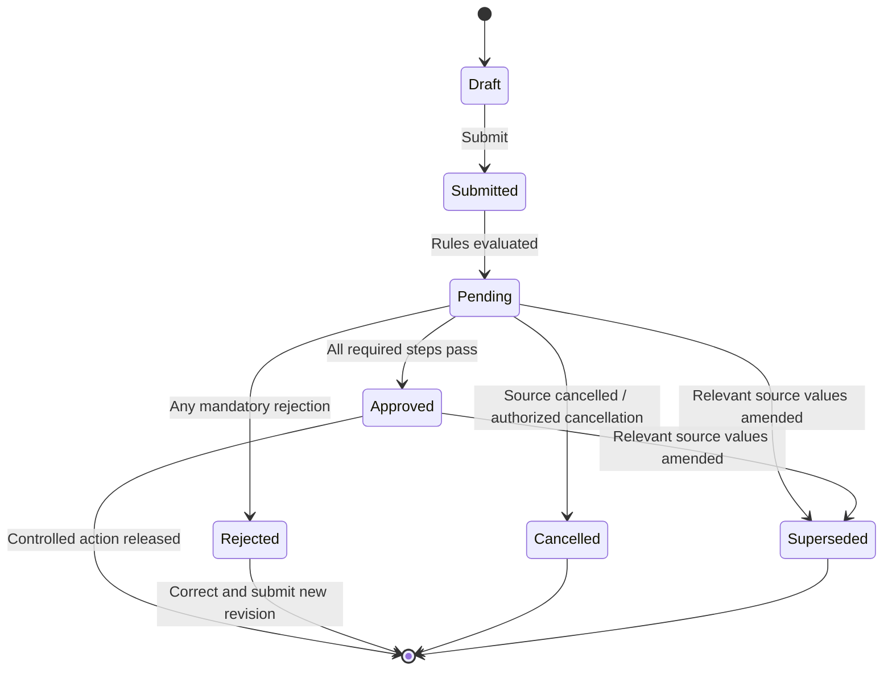
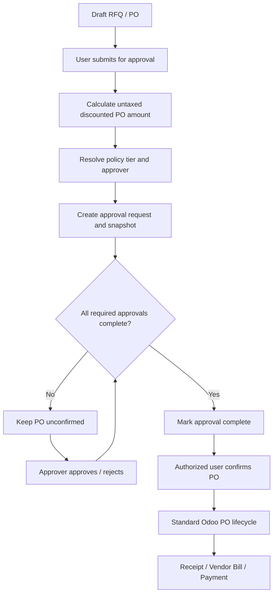

# TECHNICAL DESIGN DOCUMENT (TDD)
## Odoo 19 Enterprise — Advanced Wholesale Distribution & Supply Chain ERP

**Company:** PT Arunika Distribusi Nusantara  
**Project ID:** ADN-ERP-2026-001  
**Document ID:** ADN-TDD-001  
**Version:** 1.0  
**Date:** 18 November 2026  
**Status:** Approved Technical Review — Not Approved for Production Build  
**ERP Platform:** Odoo 19 Enterprise  
**Deployment Target:** On-Premise | Ubuntu Linux | PostgreSQL  
**Primary Currency:** IDR  
**Source Baselines:** ADN-FSD-001 v1.0; ADN-FGA-001 v1.0; ADN-BPM-001 v1.0; ADN-SOW-001 v1.0  
**Classification:** Portfolio / Fictional Business Case

> **Portfolio disclaimer:** PT Arunika Distribusi Nusantara, its stakeholders, data volumes, approval thresholds, policies, and implementation scenario are fictional. This document is a proposed technical design derived from the written FSD and preliminary Fit-Gap Analysis. It is not evidence of a live Odoo 19 environment, validated APIs, stakeholder approval, or a production implementation.

---

# 1. Document Purpose and Control

## 1.1 Purpose

This Technical Design Document translates the functional requirements and preliminary fit-gap outcomes into an implementable Odoo extension architecture. It defines:

- Custom addon boundaries, dependencies, and installation order.
- Technical architecture and integration points with standard Odoo records.
- Data models, relationships, fields, and lifecycle states.
- A reusable approval engine and transaction-specific approval adapters.
- Credit exposure calculation and order hold behavior.
- Vendor scorecard calculation and scheduled processing.
- Security groups, access control lists, record rules, and segregation of duties.
- Server-side validation, auditability, exception handling, and technical workflows.
- Test strategy, deployment, upgrade, monitoring, and rollback controls.

The design follows the FSD/FGA principle that standard Odoo remains the system of record. Custom addons must extend standard transactions; they must not create parallel sales, purchase, stock, or accounting ledgers.

## 1.2 Source Baselines

| Source | Reference | Version | TDD Usage |
|---|---|---:|---|
| Functional Specification Document | ADN-FSD-001 | 1.0 | Functional behavior, rules, statuses, approval matrices, acceptance criteria |
| Fit-Gap Analysis | ADN-FGA-001 | 1.0 | Preliminary customization backlog, configuration-first decisions, open design constraints |
| Business Process Mapping | ADN-BPM-001 | 1.0 | End-to-end transaction context |
| Scope of Work | ADN-SOW-001 | 1.0 | Scope boundaries, technical deliverables, deployment context |

## 1.3 Design Status and Evidence Limitation

The FGA is an E0 desk assessment based on written requirements. No E1 environment inspection, E2 prototype, E3 technical/functional test, or E4 business sign-off is claimed.

Before implementation, the technical lead must inspect the actual Odoo 19 Enterprise build, installed applications, localization, model fields, method signatures, security groups, and relevant stock/accounting workflows. Exact extension hooks must be verified against that target source code and a representative database. This TDD intentionally avoids claiming unverified method names or edition-specific behavior as facts.

## 1.4 Design Principles

1. Standard Odoo transaction models remain authoritative.
2. Configuration is preferred over custom code.
3. Custom modules are limited to approved gaps.
4. Business policy thresholds are data-driven, versioned, and auditable.
5. Critical controls are enforced server-side, not only by hiding buttons.
6. The same rule applies to UI, import, RPC/API, automated actions, and scheduled jobs.
7. Approval history is immutable after a decision; corrections create new events or a new request version.
8. Multi-company and warehouse boundaries must be respected even though the initial baseline is one legal entity and three warehouses.
9. No custom code may bypass standard stock valuation, accounting posting, reconciliation, or document lifecycle controls.
10. Tax assumptions remain illustrative until Finance and qualified tax reviewers validate the localization.

## 1.5 Approval Status

| Role | Review Responsibility | Status |
|---|---|---|
| ERP Technical Lead | Architecture, Odoo API compatibility, code quality | Pending |
| ERP Functional Lead | FSD/FGA traceability and configuration boundary | Pending |
| Finance Manager | Credit, refund, valuation, landed cost, accounting controls | Pending |
| Procurement Manager | Purchase approval and vendor scorecard policy | Pending |
| Sales Manager | Discount approval and customer segmentation | Pending |
| Operations Manager | Inventory adjustment, shelf-life, quality, warehouse controls | Pending |
| ERP Project Manager | Scope, decisions, change control | Pending |

---

# 2. Scope and Technical Work Packages

## 2.1 In-Scope Customization Candidates

| Backlog ID | Technical Capability | Preliminary Treatment | Priority | Primary FSD Reference |
|---|---|---|---|---|
| CUS-001 | Reusable approval framework | Shared addon | Must | FSD Sections 5.2, 5.3, 6.16 |
| CUS-002 | Purchase order approval | Adapter on `purchase.order` | Must | FSD-PUR-006–008 |
| CUS-003 | Sales discount approval per line | Adapter on `sale.order` / `sale.order.line` | Must | FSD-SAL-003–004 |
| CUS-004 | Customer credit exposure and hold | Credit service + Sales adapter | Must | FSD-CRD |
| CUS-005 | Inventory adjustment approval | Adapter on standard inventory adjustment flow | Must | FSD-INV-009 |
| CUS-006 | Refund approval | Adapter on standard return/credit note/payment flow | Must | FSD-RET |
| CUS-007 | Vendor scorecard | Custom calculation and reporting layer | Must | FSD-VPM |
| CUS-008 | Consolidated management dashboards | Reporting extension, subject to KPI sign-off | Should | FSD-RPT |
| CUS-009 | Customer/order shelf-life validation | Extension only if standard configuration is insufficient | Should | FSD-INV / FSD-WH |
| CUS-010 | Quality sampling enhancement | Extension only if approved manual/standard process is insufficient | Should | FSD-QUA |
| CUS-011 | Delivery discrepancy fields | Extension only if standard fields are insufficient | Should | FSD-LOG |
| CUS-012 | Stock aging enhancement | Extension only if standard reports cannot satisfy approved date basis | Should | FSD-INV / FSD-RPT |

## 2.2 Configuration-First Areas (Not Custom Addons by Default)

The following are configuration workstreams, not automatic development scope:

- Company, currency, fiscal settings, journals, chart of accounts, taxes, and localization.
- Product categories and costing methods: CAT-001 FIFO, CAT-002 AVCO, CAT-003 FIFO, CAT-004 AVCO, CAT-005 AVCO; automated valuation.
- Warehouses WH-JKT, WH-BDG, WH-SBY and internal location hierarchy.
- Lot/serial tracking, expiration dates, FEFO removal strategy, reservation rules, putaway, and transit locations.
- Reordering rules, replenishment routes, vendor lead times, and internal transfers.
- Quality control points, standard checks, quarantine locations, and standard operational procedures.
- Sales pricelists, payment terms, purchase controls, standard invoices, credit notes, payments, and reconciliation.
- Users, groups, standard ACLs, and warehouse access restrictions.
- Standard reports and list/pivot/graph views.

Every configuration item must be proven in the target Odoo 19 environment before a custom alternative is approved.

## 2.3 Explicitly Out of Scope

Unless approved through formal change control:

- Manufacturing/MRP, HR, payroll, and employee lifecycle.
- Full Transportation Management System, fleet management, route optimization, and live vehicle tracking.
- Marketplace, bank, carrier, payment gateway, or customs system integrations.
- Customer-facing mobile applications and warehouse robotics.
- AI forecasting.
- Legal/tax advisory or statutory tax certification.
- Replacing standard Odoo sales, purchase, stock, or accounting documents with custom ledgers.

---

# 3. Solution Architecture

## 3.1 Logical Architecture



## 3.2 Deployment Topology

Target deployment is on-premise Ubuntu Linux with PostgreSQL, as defined by the FSD. The exact Ubuntu, Python, PostgreSQL, reverse proxy, worker, and Odoo build versions must be pinned in the environment specification after compatibility verification.



Deployment requirements:

- Separate development, test/UAT, staging, and production environments.
- Custom addons stored in version control and deployed as a controlled release.
- Secrets supplied through protected environment/configuration mechanisms; never committed to source control.
- Database and filestore backups must be coordinated.
- Restore rehearsals must verify both database and filestore consistency.
- Production shell access and technical administration must be restricted.
- External interfaces are not assumed.

## 3.3 Addon Repository Layout

Recommended repository:

```text
adn-odoo-addons/
├── adn_approval_core/
│   ├── __init__.py
│   ├── __manifest__.py
│   ├── models/
│   │   ├── approval_policy.py
│   │   ├── approval_rule.py
│   │   ├── approval_request.py
│   │   ├── approval_step.py
│   │   ├── approval_item.py
│   │   └── approval_event.py
│   ├── security/
│   │   ├── security.xml
│   │   └── ir.model.access.csv
│   ├── views/
│   ├── data/
│   ├── wizards/
│   └── tests/
├── adn_purchase_approval/
├── adn_sale_discount_approval/
├── adn_credit_control/
├── adn_inventory_adjustment_approval/
├── adn_refund_approval/
├── adn_vendor_scorecard/
├── adn_supply_chain_extensions/
└── adn_management_reporting/
```

The repository may be split into multiple repositories if the delivery organization requires independent release cycles. Dependency and version compatibility must remain explicit.

## 3.4 Addon Dependency Matrix

| Addon | Depends On (Conceptual) | Standard Models Extended / Read |
|---|---|---|
| `adn_approval_core` | `base`, `mail` | `res.users`, `res.groups`, `ir.model`, mail/chatter facilities |
| `adn_purchase_approval` | `adn_approval_core`, `purchase` | `purchase.order`, `purchase.order.line` |
| `adn_sale_discount_approval` | `adn_approval_core`, installed Sales dependency | `sale.order`, `sale.order.line`, pricelist records |
| `adn_credit_control` | `adn_approval_core`, Sales, `account` | `res.partner`, `sale.order`, `account.move`, receivable lines |
| `adn_inventory_adjustment_approval` | `adn_approval_core`, `stock`, `account` | Standard inventory adjustment/quant/move flow; exact hook to verify |
| `adn_refund_approval` | `adn_approval_core`, `account`, `stock`, Sales | Return pickings, `account.move`, payment/refund execution |
| `adn_vendor_scorecard` | `purchase`, `stock`, `quality`, `mail` | Purchase orders/lines, receipts/moves, quality checks |
| `adn_supply_chain_extensions` | `stock`, Sales, `quality` | Lot/serial, delivery, quality, stock move lines |
| `adn_management_reporting` | Relevant installed standard apps + approved ADN addons | Read-only reporting models and views |

**Dependency note:** Exact technical addon names and dependencies must be reconciled with the installed Odoo 19 Enterprise manifest graph. Do not declare an optional module as a hard dependency unless the relevant feature is approved and licensed.

## 3.5 Manifest Conventions

Illustrative manifest for the shared approval addon:

```python
{
    "name": "ADN Approval Core",
    "version": "19.0.1.0.0",
    "category": "Administration",
    "summary": "Reusable, auditable approval framework for ADN workflows",
    "depends": ["base", "mail"],
    "data": [
        "security/security.xml",
        "security/ir.model.access.csv",
        "data/approval_policy_data.xml",
        "views/approval_policy_views.xml",
        "views/approval_request_views.xml",
        "views/approval_menus.xml",
    ],
    "installable": True,
    "application": False,
    "license": "LGPL-3",
}
```

This is a starting template, not a final manifest. The actual dependency list, license declaration, data load order, and version string must follow the project's source governance and installed Odoo modules.

---

# 4. Shared Approval Engine — `adn_approval_core`

## 4.1 Design Objective

Provide one configurable engine for business approvals without duplicating routing, audit, self-approval, and amendment logic in each transaction addon.

The engine owns policy definitions, request lifecycle, approval steps, approval items, decision events, and generic validation services. Transaction-specific addons own source-document fields, policy input calculation, and server-side action guards.

## 4.2 Core Data Model

### 4.2.1 `adn.approval.policy`

Purpose: identify a controlled approval policy.

| Field | Type | Required | Description |
|---|---|---:|---|
| `name` | Char | Yes | Human-readable policy name |
| `code` | Char | Yes | Unique technical/business code |
| `active` | Boolean | Yes | Policy availability |
| `company_id` | Many2one `res.company` | Conditional | Company scope; allow global policy only if approved |
| `source_model_id` | Many2one `ir.model` | Yes | Model controlled by the policy |
| `policy_version` | Integer | Yes | Incremented version; copied into each request |
| `currency_id` | Many2one `res.currency` | Conditional | Currency for amount thresholds |
| `approval_mode` | Selection | Yes | `all_required`, `any_required`, or `sequential` |
| `effective_from` | Date | Yes | Start date |
| `effective_to` | Date | No | End date |
| `notes` | Text | No | Policy explanation |

Constraints:
- `code` must be unique within the agreed company/global scope.
- Effective date ranges for the same policy code must not overlap unless precedence is explicitly designed.
- An active policy must have at least one valid rule.
- Existing requests retain their policy version snapshot after policy changes.

### 4.2.2 `adn.approval.rule`

Purpose: determine which approval tier and approver role(s) apply.

| Field | Type | Required | Description |
|---|---|---:|---|
| `policy_id` | Many2one `adn.approval.policy` | Yes | Parent policy |
| `sequence` | Integer | Yes | Evaluation order |
| `min_amount` | Monetary | No | Inclusive lower bound |
| `max_amount` | Monetary | No | Inclusive upper bound; empty means no upper limit |
| `min_operator` | Selection | Yes | Inclusive/exclusive lower boundary |
| `max_operator` | Selection | Yes | Inclusive/exclusive upper boundary |
| `tier_code` | Char | Yes | Stable tier identifier |
| `approver_group_ids` | Many2many `res.groups` | Yes | Required approver groups |
| `required_approvals` | Integer | Yes | Number of distinct approvals required |
| `sequence_mode` | Selection | Yes | Parallel or ordered approval |
| `requester_group_exclusions` | Many2many `res.groups` | No | Groups excluded from approval where policy requires |
| `active` | Boolean | Yes | Rule availability |

Implementation note: exact amount/percentage rules may need a typed evaluator rather than a generic expression field. Do not evaluate arbitrary Python expressions stored in the database.

### 4.2.3 `adn.approval.request`

Purpose: represent one approval lifecycle tied to a source transaction.

| Field | Type | Required | Description |
|---|---|---:|---|
| `name` | Char | Yes | Sequence-generated request reference |
| `policy_id` | Many2one `adn.approval.policy` | Yes | Policy used |
| `policy_version` | Integer | Yes | Immutable version snapshot |
| `company_id` | Many2one `res.company` | Yes | Company scope |
| `source_model` | Char | Yes | Technical source model name |
| `source_res_id` | Integer | Yes | Source record ID |
| `source_display_name` | Char | Yes | Stored display snapshot |
| `requester_id` | Many2one `res.users` | Yes | User submitting request |
| `requested_at` | Datetime | Yes | Submission timestamp |
| `reason` | Text | Conditional | Business justification |
| `currency_id` | Many2one `res.currency` | Conditional | Request currency |
| `amount_basis` | Monetary | Conditional | Amount used for tier calculation |
| `tier_code` | Char | Yes | Selected tier |
| `state` | Selection | Yes | Lifecycle state |
| `source_fingerprint` | Char | Yes | Hash/version fingerprint of approval-relevant values |
| `source_snapshot` | Json/Text | Yes | Immutable normalized snapshot of relevant values |
| `valid_until` | Datetime | No | Exception expiry, only if policy defines it |
| `submitted_by_id` | Many2one `res.users` | Yes | Actual submitter |
| `completed_at` | Datetime | No | Completion timestamp |
| `cancelled_at` | Datetime | No | Cancellation timestamp |

Suggested states:

`draft → submitted → pending → approved / rejected / cancelled / superseded`

A rejected request may be resubmitted only through a controlled new revision or new request. A completed request must not be silently reopened.

### 4.2.4 `adn.approval.step`

Purpose: capture each required approval action.

| Field | Type | Required | Description |
|---|---|---:|---|
| `request_id` | Many2one `adn.approval.request` | Yes | Parent request |
| `sequence` | Integer | Yes | Approval order |
| `approver_group_id` | Many2one `res.groups` | Yes | Required role |
| `approver_id` | Many2one `res.users` | No | Assigned user, if individually assigned |
| `decision` | Selection | Yes | `pending`, `approved`, `rejected`, `skipped` |
| `decided_by_id` | Many2one `res.users` | No | Actual decision-maker |
| `decided_at` | Datetime | No | Decision timestamp |
| `comment` | Text | Conditional | Required for rejection; optional for approval |
| `delegated_from_id` | Many2one `res.users` | No | Original approver, only if delegation is approved |
| `delegation_reference` | Char | No | Approved delegation reference |

A group membership check is performed at decision time. A user who no longer holds the required group must not approve a pending step.

### 4.2.5 `adn.approval.item`

Purpose: represent an individually controlled line or sub-object, especially sales order lines with different discount tiers.

| Field | Type | Required | Description |
|---|---|---:|---|
| `request_id` | Many2one `adn.approval.request` | Yes | Parent request |
| `source_line_model` | Char | No | Source line model |
| `source_line_res_id` | Integer | No | Source line ID |
| `item_reference` | Char | Yes | Human-readable line reference |
| `basis_value` | Monetary | No | Item amount or other policy basis |
| `basis_percentage` | Float | No | Discount percentage or ratio |
| `tier_code` | Char | Yes | Item tier |
| `state` | Selection | Yes | `pending`, `approved`, `rejected`, `not_required` |
| `snapshot` | Json/Text | Yes | Relevant source line values at submission |

### 4.2.6 `adn.approval.event`

Purpose: append-only audit events.

| Field | Type | Required | Description |
|---|---|---:|---|
| `request_id` | Many2one `adn.approval.request` | Yes | Related request |
| `event_type` | Selection | Yes | Submit, approve, reject, cancel, amend, supersede, release, expire |
| `event_at` | Datetime | Yes | Event time |
| `actor_id` | Many2one `res.users` | Yes | Acting user |
| `previous_state` | Char | No | State before event |
| `new_state` | Char | No | State after event |
| `comment` | Text | No | Event note |
| `payload_snapshot` | Json/Text | No | Before/after or relevant event details |

Audit events must not be editable/deletable by normal business users. Retention and any lawful deletion process must be governed separately.

## 4.3 Relationship Diagram



The source document link is represented by `source_model` + `source_res_id`, with a stored display label and snapshot. Because a generic model/ID pair does not create a PostgreSQL foreign key to every possible source table, transaction adapters must validate that the source record exists and remains accessible. Each adapter should also hold a normal Many2one to `adn.approval.request` on its source transaction where practical.

## 4.4 Approval Engine Lifecycle



Technical rules:

1. Submission calculates policy tier(s) from server-side source values.
2. The engine snapshots the source values and selected policy version.
3. Required approval steps are materialized at submission; later policy edits do not rewrite an in-flight request.
4. Each approval decision validates user identity, group membership, company scope, requester separation, current request state, and source fingerprint.
5. The request is approved only when every mandatory step/item is satisfied.
6. The controlled transaction action rechecks the request state and source fingerprint immediately before execution.
7. A source amendment that changes a policy-relevant value supersedes the previous request and creates a new approval cycle.
8. Cancellation preserves historical approval records.
9. A pending request cannot be approved after its source transaction is cancelled or otherwise invalidated.
10. The engine does not execute the source transaction by itself; the transaction adapter controls release.

## 4.5 Engine Service Interface

Illustrative service contract (method names are design-level, not a claim about existing Odoo APIs):

```python
class ApprovalService:
    def evaluate_policy(self, policy_code, source_record, context_data):
        # Return normalized tier and required approver steps.

    def submit_request(self, policy_code, source_record, requester, reason=None):
        # Create request, items, steps, immutable snapshot, and audit event.

    def approve_step(self, step, actor, comment=None):
        # Validate authorization and record a decision.

    def reject_step(self, step, actor, reason):
        # Reject request and preserve decision history.

    def assert_released(self, source_record, policy_code):
        # Raise a business validation error unless a valid approval exists.

    def supersede_if_changed(self, source_record, old_fingerprint):
        # Invalidate prior approval when controlled values change.
```

Implementation requirements:

- Use ORM operations and explicit access checks.
- Do not use raw SQL for normal business writes.
- Do not use `sudo()` as a substitute for security; if privileged access is technically necessary, isolate it, validate the caller first, and document the exact elevated operation.
- Avoid accepting caller-supplied `actor_id`; use the authenticated environment user.
- Use database transactions so decision state, event creation, and source release remain consistent.
- Use row-level locking or an equivalent concurrency-safe strategy where simultaneous approval/release is possible.
- Add uniqueness/idempotency constraints to prevent duplicate active requests for the same source, policy, and source fingerprint.

## 4.6 Approval Policy Configuration

Policy data must be editable only by the designated Approval Policy Administrator / ERP Manager role, with business-owner approval for material threshold changes.

The following matrices are copied from FSD and are implementation inputs, not evidence of approval by real stakeholders.

### Purchase Order Approval

Basis: untaxed PO total after line discounts.

| PO Value | Required Role |
|---|---|
| IDR 0–10,000,000 | Procurement Supervisor |
| Above IDR 10,000,000–50,000,000 | Procurement Manager |
| Above IDR 50,000,000–150,000,000 | Operations Manager |
| Above IDR 150,000,000 | Managing Director |

### Sales Discount Approval — Per Order Line

| Line Discount | Required Role |
|---|---|
| 0%–5% | Sales Representative authority |
| Above 5%–10% | Sales Supervisor |
| Above 10%–15% | Sales Manager |
| Above 15% | Sales Manager and Managing Director |

For lines within the Sales Representative authority band, the adapter may record that no elevated approval is required. For lines above the band, a request item is created for each affected line. The request cannot release the order until all controlled line items and required approval steps are complete.

### Inventory Adjustment Approval

Basis: absolute valuation difference using inventory valuation cost, not sales price.

| Absolute Difference | Required Role |
|---|---|
| Up to IDR 1,000,000 | Warehouse Supervisor |
| Above IDR 1,000,000–10,000,000 | Warehouse Manager |
| Above IDR 10,000,000–50,000,000 | Operations Manager and Finance Manager |
| Above IDR 50,000,000 | Managing Director and Finance Manager |

### Customer Refund Approval

| Refund Value | Required Approval / Review |
|---|---|
| Up to IDR 5,000,000 | Customer Service Supervisor and Finance review |
| Above IDR 5,000,000–25,000,000 | Finance Manager |
| Above IDR 25,000,000–100,000,000 | Finance Manager and Operations Manager |
| Above IDR 100,000,000 | Managing Director and Finance Manager |

The FSD does not fully define whether “Finance review” is a formal approval step or a review acknowledgment, nor whether the controlled action is credit-note posting, payment/refund registration, or both. This must be resolved under DEC-011 before finalizing the adapter hook.

### Credit Exception Approval

| Condition | Required Approval |
|---|---|
| Over limit by up to IDR 25,000,000 | Finance Manager |
| Over limit by more than IDR 25,000,000 | Finance Manager and Managing Director |
| Invoice overdue more than 30 days | Finance Manager |
| Credit limit change | Finance Manager |
| Credit limit increase above IDR 100,000,000 | Finance Manager and Managing Director |

## 4.7 Mandatory Open Approval Decisions

| Decision | Unresolved Design Point | Required Owner |
|---|---|---|
| DEC-001 | Approver routing, delegation, substitution, amendment behavior, PO split detection | Procurement Manager |
| DEC-002 | Discount reference price, rounding, cumulative discounts, and reapproval scope | Sales Manager |
| DEC-003 | Adjustment aggregation across products, valuation timing, rounding, and tier calculation | Operations + Finance |
| DEC-006 | Credit trigger point, exception expiry, concurrent orders, and order/invoice overlap | Finance Manager |
| DEC-011 | Gross/net refund basis, credit note vs cash refund, Finance review meaning, execution gate | Finance Manager / Customer Service |
| Additional | Whether approvals are sequential or parallel when multiple roles are required | Relevant policy owner |

The engine supports sequential and parallel approval modes, but the actual mode must be configured only after the business owner confirms the policy.

---

# 5. Transaction-Specific Technical Design

## 5.1 Purchase Order Approval — `adn_purchase_approval`

### 5.1.1 Standard Model Extension

Extend standard `purchase.order`; do not create a custom purchase order model.

Proposed fields:

| Field | Type | Purpose |
|---|---|---|
| `adn_approval_state` | Selection | Display workflow state on PO |
| `adn_approval_request_id` | Many2one `adn.approval.request` | Current approval request |
| `adn_approval_tier` | Char | Calculated tier snapshot |
| `adn_approval_amount` | Monetary | Untaxed total after line discounts |
| `adn_approval_fingerprint` | Char | Detect approval-relevant amendments |
| `adn_submitted_at` | Datetime | Submission time |
| `adn_last_approval_at` | Datetime | Last completed approval time |

Do not duplicate standard PO state. The ADN approval state is an additional control state.

### 5.1.2 Calculation

Approval amount:

`PO Approval Amount = Untaxed Purchase Order Total After Line Discounts`

Taxes are excluded. Ancillary costs are excluded unless policy is changed and approved.

Use Odoo's computed line/subtotal values after verifying the exact semantics in the installed Odoo 19 version. Do not independently recalculate tax-inclusive totals or duplicate discount logic in custom code.

### 5.1.3 Workflow



Technical controls:

- Intercept the server-side standard PO confirmation action after verifying its exact Odoo 19 implementation.
- If the PO requires approval and no valid current request exists, prevent confirmation and instruct the user to submit it.
- If pending or rejected, block confirmation.
- If approved but the source fingerprint changed, supersede and require a new approval.
- If a PO amendment changes quantity, unit price, discount, currency, or another approved value driver, trigger re-evaluation.
- A requester must not approve their own PO.
- Preserve the approval request when a PO is cancelled.

### 5.1.4 Split-Order Monitoring

The FSD prohibits splitting orders to avoid approval thresholds but does not define detection criteria. Do not implement an arbitrary time window or vendor/product matching heuristic as a hard block.

Proposed technical treatment pending DEC-001:
- Create a report candidate grouping POs by vendor, requester, company, currency, product/category, and configurable time window.
- Flag suspicious patterns for Procurement Manager review.
- Convert to an automated preventive control only after matching keys, time window, false-positive handling, and exception policy are approved.

## 5.2 Sales Discount Approval — `adn_sale_discount_approval`

### 5.2.1 Standard Model Extension

Extend `sale.order` and `sale.order.line`.

Proposed `sale.order` fields:
- `adn_discount_approval_state`
- `adn_discount_approval_request_id`
- `adn_discount_approval_fingerprint`

Proposed `sale.order.line` fields:
- `adn_discount_reference_price`
- `adn_discount_percentage`
- `adn_discount_tier`
- `adn_discount_approval_state`
- `adn_discount_approval_item_id`

The reference price field is a stored snapshot only after DEC-002 defines its source. Until then, the system must not silently assume list price, contract price, or another basis.

### 5.2.2 Per-Line Evaluation

- Evaluate each order line independently.
- Calculate the discount percentage against the approved reference price.
- Record line-level tier and reason when an exception is required.
- Group affected lines into an approval request where practical, retaining individual approval items.
- The request is releasable only when all controlled line items are approved.
- A multi-line order can contain several different approval tiers.
- Re-evaluate when quantity, unit price, discount, pricelist, customer terms, or the approved reference price changes.
- Prevent sales order confirmation server-side while any required approval is pending/rejected/superseded.

### 5.2.3 Required Tests

5%, 5.01%, 10%, 10.01%, 15%, and 15.01%; multi-line mixed tiers; changed reference price; amendment after approval; unauthorized approval; confirmation through UI, import, and RPC/API.

## 5.3 Customer Credit Control — `adn_credit_control`

### 5.3.1 Standard Data Sources

Use standard Odoo accounting and sales records as sources:

- Customer credit limit and approved status on `res.partner` or a dedicated ADN extension of the partner model.
- Posted receivable balances from posted customer invoices and relevant receivable journal items.
- Open confirmed sales orders not yet invoiced.
- Invoice due dates and residual amounts from standard accounting records.

Do not store a second receivable ledger or manually maintain a duplicate outstanding balance.

### 5.3.2 Proposed Partner Fields

| Field | Type | Purpose |
|---|---|---|
| `adn_credit_limit` | Monetary | Approved customer credit limit |
| `adn_credit_status` | Selection | Normal / Warning / Hold / Blocked |
| `adn_credit_limit_approved_by` | Many2one `res.users` | Audit reference for limit approval |
| `adn_credit_limit_approval_request_id` | Many2one approval request | Limit change approval reference |
| `adn_credit_review_date` | Date | Next review date if policy defines it |

### 5.3.3 Exposure Service

FSD formula:

`Credit Exposure = Posted Outstanding Receivables + Open Confirmed Sales Orders Not Yet Invoiced`

`Available Credit = Approved Credit Limit − Credit Exposure`

Include:
- Posted unpaid customer invoices.
- Remaining balance of partially paid invoices.
- Open confirmed sales orders not yet invoiced.

Exclude:
- Draft quotations.
- Cancelled orders.
- Fully paid invoices.
- Unallocated customer credit notes until reconciled or allocated.

Avoid double counting: once an order is invoiced, the corresponding order commitment must no longer be included if the invoice receivable represents the same obligation.

### 5.3.4 Proposed Technical Models

`adn.credit.evaluation` — an auditable evaluation record:
- `partner_id`
- `sale_order_id`
- `company_id`
- `evaluated_at`
- `credit_limit`
- `posted_ar_amount`
- `uninvoiced_order_amount`
- `overdue_amount`
- `exposure_amount`
- `available_credit`
- `utilization_percentage`
- `decision` (normal, warning, hold, blocked)
- `source_fingerprint`
- `approval_request_id`
- `released_at`
- `released_by_id`

Evaluation records are snapshots, not a substitute for live accounting data. Recalculate before release.

### 5.3.5 Decision Rules

| Condition | System Result |
|---|---|
| Exposure ≤ 80% of limit | Normal processing |
| Exposure > 80% and ≤ 100% | Warning |
| Exposure > 100% | Credit hold and exception approval |
| Invoice overdue 1–30 calendar days | Warning and Finance review |
| Invoice overdue >30 calendar days | Credit hold |
| Customer blocked by Finance | No new credit order confirmation |

### 5.3.6 Concurrency and Stale Approval

A customer may submit multiple orders concurrently. An approval must not release an order using a stale exposure snapshot.

Before release:
1. Re-read the customer's current approved credit limit.
2. Recalculate posted AR and eligible uninvoiced commitments.
3. Re-evaluate overdue invoices and blocked status.
4. Recalculate the transaction's incremental exposure without double counting.
5. Compare against the approved exception scope and validity.
6. Reject release if the current state exceeds the approved exception.

A concurrency-safe transaction strategy is required to prevent two simultaneous confirmations from both consuming the same available credit. The technical lead must select and test a PostgreSQL/Odoo ORM-compatible locking or reservation approach; do not rely on a UI warning.

### 5.3.7 Credit Limit Change

A credit limit change is a separate controlled action, not an incidental partner edit. Apply Finance Manager approval, and Finance Manager plus Managing Director for an increase above IDR 100,000,000. The policy must define whether the threshold is the new limit or the amount of increase; the source FSD currently states “increase above IDR 100,000,000” and requires clarification before coding.

## 5.4 Inventory Adjustment Approval — `adn_inventory_adjustment_approval`

### 5.4.1 Design Boundary

Use standard Odoo inventory count/adjustment and stock valuation processes. The addon adds an approval gate and audit snapshot; it does not create a parallel adjustment ledger.

The exact Odoo 19 inventory adjustment model and server-side validation entry point must be inspected in the target build. The implementation must guard the action that applies/validates the count, not merely the user-interface button.

### 5.4.2 Proposed Data

Extend the relevant standard adjustment record or introduce a thin ADN request object linked to the standard source:

- `adn_approval_state`
- `adn_approval_request_id`
- `adn_difference_value`
- `adn_valuation_basis`
- `adn_adjustment_fingerprint`
- `adn_count_evidence_attachment_ids`
- `adn_adjustment_reason_id`

If standard inventory adjustment is represented through quant/count lines in the installed version, use the supported extension point and preserve standard stock move/valuation creation. Do not assume a particular internal model until verified.

### 5.4.3 Valuation Basis

Approval is based on the absolute valuation difference using inventory valuation cost, not sales price.

Open DEC-003 must define:
- Whether multiple products are aggregated into one approval amount.
- Whether absolute line differences are summed or net differences are aggregated.
- Currency rounding.
- Cost snapshot timing.
- Handling of negative and positive adjustments.
- Whether different warehouses or product categories require separate approval requests.

### 5.4.4 Workflow

Count → calculate difference → calculate valuation snapshot → submit → route tier → approve → authorized validation of standard adjustment → standard stock/valuation update → audit.

While pending, the standard apply/validate action must be blocked through the server-side guard. On approval, recheck that count quantities and valuation fingerprint have not changed.

## 5.5 Refund Approval — `adn_refund_approval`

### 5.5.1 Standard Record Boundary

Physical return and financial refund are separate processes:
- Physical customer return uses standard return stock operations and quality disposition.
- Financial credit note/refund uses standard Accounting records.
- Cash/bank refund or payment reconciliation uses standard accounting/payment flow.

The addon links the approval request to the standard credit note and/or refund execution record. It must not create a separate financial ledger.

### 5.5.2 Proposed Fields / Model

Extend the relevant standard customer credit note (`account.move` with the appropriate refund move type after Odoo 19 verification), or use `adn.refund.request` linked to it:

- `source_return_picking_id`
- `source_invoice_id`
- `credit_note_id`
- `refund_amount`
- `refund_currency_id`
- `refund_basis`
- `approval_request_id`
- `execution_state`
- `executed_at`
- `executed_by_id`

### 5.5.3 Execution Gate

DEC-011 must identify which action is controlled:
- Credit-note posting;
- Cash refund/payment registration;
- Both, with distinct approval/evidence stages.

Until that decision is approved, implement the adapter with an explicit configurable gate and do not assume that receiving physical returned goods requires refund approval. The physical return and inspection may proceed while financial refund execution remains pending.

## 5.6 Vendor Performance Scorecard — `adn_vendor_scorecard`

### 5.6.1 Design Objective

Calculate supplier KPIs from standard purchase, receipt, and quality source records. Retain formula version, period, source traceability, refresh timestamp, and an insufficient-data state.

### 5.6.2 KPI Formulas from FSD

| KPI | Formula |
|---|---|
| On-Time Delivery | On-time eligible receipts ÷ total eligible receipts × 100 |
| Order Fulfillment | Accepted quantity received ÷ quantity due in period × 100 |
| Quality Acceptance | Accepted quantity ÷ inspected quantity × 100 |
| Lead Time Reliability | Receipts within lead-time tolerance ÷ eligible receipts × 100 |
| Purchase Price Variance | (Actual unit price − reference unit price) ÷ reference unit price × 100 |

Weighted score:

`Vendor Score = (OTD × 30%) + (Fulfillment × 25%) + (Quality Acceptance × 30%) + (Lead Time Reliability × 15%)`

Classification:
- 95%–100%: Excellent.
- 90%–94.99%: Good.
- 80%–89.99%: Needs Improvement.
- Below 80%: Poor.
- Fewer than five eligible receipts: `Insufficient Data`, with no definitive classification.

Purchase Price Variance is displayed separately and is not part of the weighted score.

### 5.6.3 Proposed Models

`adn.vendor.scorecard.period`
- Vendor, company, period start/end, calculation timestamp.
- Formula version and calculation status.
- Eligible receipt count.
- KPI values, weighted score, classification.
- Error/warning summary and source data fingerprint.

`adn.vendor.scorecard.line`
- Parent period.
- Purchase order and purchase order line.
- Receipt/picking and stock move line references.
- Quality check/inspection reference.
- Ordered/due/accepted/rejected quantities.
- Promised date, actual receipt date, lead time.
- Actual unit price and reference unit price.
- Eligibility flags and exclusion reason.

### 5.6.4 Calculation Architecture

- Scheduled refresh creates or updates a period snapshot through an idempotent job.
- Calculation reads source records in bounded batches.
- Source links are retained for drill-down.
- A formula version is stored with every result.
- Re-running a period must be deterministic for the same source data and formula version.
- If source data changes after a period is finalized, mark the period as stale or require an authorized recalculation; do not silently rewrite a signed-off historical report.
- Fewer than five eligible receipts returns `Insufficient Data`.
- Missing or inconsistent source data returns a visible incomplete status, not a fabricated percentage.

### 5.6.5 Open Decisions (DEC-008)

Procurement must define:
- Period cut-off and calendar basis.
- Treatment of amended promised dates.
- Eligible receipt definition.
- Due quantity basis for partial receipts.
- Reference price source and effective date.
- Lead-time tolerance.
- Whether rejected quantities affect fulfillment and quality denominators.

## 5.7 Optional Supply Chain Extensions

These items remain conditional on proof that standard configuration and SOPs are insufficient.

### 5.7.1 Shelf-Life Validation — CUS-009

Potential design:
- Customer/product shelf-life policy record with effective dates and minimum remaining days.
- Order/stock allocation validation against lot expiration date and planned dispatch date.
- Server-side validation before delivery validation.
- Exception path only if approved by business policy.

FSD baseline: designated products require at least 90 days remaining shelf life at dispatch unless customer contract is stricter. Expired stock is blocked; 1–30 days is critical; 31–60 days warning; 61–90 days attention; more than 90 days normal.

DEC required: scope by product/customer, date basis, override authority, and whether the control blocks reservation or dispatch.

### 5.7.2 Quality Sampling — CUS-010

FSD sampling assumption:
- Up to 100 units: inspect at least 5.
- 101–1,000 units: inspect at least 10.
- Above 1,000 units: inspect at least 20.
- Quantity and packaging checks apply to full shipment where operationally possible.
- Any critical sample defect places affected lot on hold.

First validate standard Quality configuration and a controlled manual SOP. Automate only if the business confirms sample calculation, checklist representation, and defect handling requirements.

### 5.7.3 Delivery Discrepancy — CUS-011

Potential fields on standard delivery/picking:
- Actual delivery date, if different from validation date.
- Discrepancy reason.
- Discrepancy quantity.
- POD reference/attachment.
- Resolution state and responsible user.

Do not implement a full TMS, carrier integration, route optimization, or fleet tracking.

### 5.7.4 Stock Aging — CUS-012

The FSD/FGA require a stock aging measure but the date basis is open. Before development, confirm whether age is based on receipt date, stock move date, valuation layer date, or another approved method. Report must reconcile to stock balances and must not imply lot-level cost attribution where source records do not support it.

---

# 6. Data Model and Naming Standards

## 6.1 Naming Conventions

| Object | Convention | Example |
|---|---|---|
| Addon | `adn_<capability>` | `adn_approval_core` |
| Model | `adn.<domain>.<object>` | `adn.approval.request` |
| Field | `adn_<name>` for extensions | `adn_approval_state` |
| XML ID | `adn_<module>_<record>` | `adn_approval_core_group_approver` |
| Security group | `group_adn_<role>` | `group_adn_approval_approver` |
| Sequence code | `adn.<object>` | `adn.approval.request` |
| Cron XML ID | `ir_cron_adn_<job>` | `ir_cron_adn_vendor_scorecard` |

## 6.2 Data Ownership

| Data | System of Record | Custom Layer Responsibility |
|---|---|---|
| Sales orders and lines | Standard Odoo Sales | Approval state/reference only |
| Purchase orders and lines | Standard Odoo Purchase | Approval state/reference only |
| Stock movements and quantities | Standard Odoo Inventory | Approval gate and optional eligibility checks |
| Accounting invoices/credit notes/payments | Standard Odoo Accounting | Approval reference/gate only |
| Customer credit limit | Approved partner credit attributes | Change approval and evaluation snapshots |
| Approval policies and requests | ADN approval addon | Policy configuration, request lifecycle, audit |
| Vendor KPI snapshots | ADN scorecard addon | Derived values and source references |
| Quality checks | Standard Odoo Quality where configured | Optional sampling metadata only |

## 6.3 Data Integrity Rules

- Use Many2one/One2many/Many2many relations where a stable model relationship exists.
- Generic source references (`source_model`, `source_res_id`) require adapter validation because they do not create a foreign key to every source model.
- Use `ondelete` behavior intentionally; approval history should not be deleted when a source document is cancelled.
- Avoid deleting standard transaction records that have downstream references.
- Add SQL constraints for stable uniqueness and database-level invariants.
- Add Python constraints for business rules that depend on related records.
- Monetary values must use the correct currency and currency rounding.
- Date/time values must be stored using Odoo's UTC conventions and displayed in user timezone.
- Use company checks and `check_company` where supported and applicable.
- Avoid stored computed fields for volatile exposure unless invalidation dependencies are complete; prefer explicit evaluation snapshots for audit.
- Do not store passwords, tokens, or secrets in business models.

## 6.4 Data Volume and Indexing

Planning baseline:
- 500 SKUs.
- 250 customers.
- 40 vendors.
- 3 warehouses.
- 30+ internal locations.
- 20 user-role staging records.

Index candidates, subject to query profiling:
- Approval request: `(company_id, state, requested_at)`.
- Approval request source lookup: `(source_model, source_res_id, policy_id)`.
- Approval step: `(request_id, decision, approver_group_id)`.
- Approval event: `(request_id, event_at)`.
- Credit evaluation: `(partner_id, company_id, evaluated_at)`.
- Scorecard period: `(vendor_id, company_id, date_from, date_to, formula_version)`.

Avoid redundant indexes. Confirm PostgreSQL query plans against representative data before adding indexes to high-write tables.

---

# 7. Security Architecture

## 7.1 Security Principles

- Least privilege.
- Role-based access using Odoo groups and ACLs.
- Record rules for company/warehouse/data boundaries.
- No self-approval where the FSD prohibits it.
- Server-side authorization on every decision and release action.
- Separation between policy administration, request submission, approval, execution, and technical administration.
- No reliance on UI visibility as the only control.
- Negative access tests for UI, import, RPC/API, and automated execution.

## 7.2 Proposed Custom Groups

| Group | Intended Users | Main Permission |
|---|---|---|
| `group_adn_approval_user` | Business requesters | Submit and read own/permitted approval requests |
| `group_adn_approval_approver` | Authorized approvers | Decide assigned approval steps |
| `group_adn_approval_policy_admin` | ERP Manager / delegated administrator | Maintain policies and rules |
| `group_adn_approval_auditor` | Internal control / authorized reviewer | Read approval history and audit events |
| `group_adn_credit_manager` | Finance Manager | Credit evaluation, hold, credit exception and limit review |
| `group_adn_vendor_scorecard_user` | Procurement users | Read vendor scorecards |
| `group_adn_vendor_scorecard_admin` | Procurement Manager / authorized analyst | Recalculate and manage scorecard periods |
| `group_adn_supply_chain_admin` | Operations / ERP delegated admin | Maintain optional supply-chain rules |

These groups supplement standard Odoo business groups. They do not replace standard Sales, Purchase, Inventory, Quality, or Accounting permissions.

## 7.3 Role-to-Capability Matrix

| Business Role | Submit Requests | Approve | Policy Admin | Execute Source Action | Audit Read |
|---|---:|---:|---:|---:|---:|
| Sales Representative | Yes (sales) | Only own-authority band if approved | No | Standard sales actions subject to gate | Own/permitted |
| Sales Supervisor | Yes | Sales discount tier | No | Authorized sales action | Sales scope |
| Sales Manager | Yes | Sales discount tier | No | Authorized sales action | Sales scope |
| Procurement Supervisor | Yes | PO first tier | No | PO confirmation only if otherwise authorized | Purchase scope |
| Procurement Manager | Yes | PO tier / vendor scorecard oversight | No | Purchase scope | Purchase scope |
| Warehouse Supervisor | Yes | Adjustment first tier | No | Standard stock action after approval | Warehouse scope |
| Warehouse Manager | Yes | Adjustment second tier | No | Standard stock action after approval | Warehouse scope |
| Operations Manager | Yes | Relevant PO / adjustment / refund tier | No | Operational action after approval | Operations scope |
| Finance Manager | Yes | Credit / adjustment / refund / finance review | No | Finance action subject to approval | Finance scope |
| Managing Director | Yes | Highest approval tiers | No | Only if separately authorized | Executive scope |
| ERP Manager | Technical/configuration duties | Not automatically | Delegated policy admin | No business approval by default | Technical audit scope |

Final role mapping must be reconciled to the FSD role matrix and approved by process owners.

## 7.4 ACL and Record Rule Design

Recommended baseline:

- Requesters: create/read requests in their permitted business scope; no write access to decision fields.
- Approvers: read requests assigned to their group; write only through controlled decision methods.
- Policy administrators: create/write policy configuration; cannot alter completed request history.
- Auditors: read-only access to requests, steps, events, and policy snapshots.
- Technical administrators: deployment/database administration; business approval rights are not automatically granted.
- Company record rules: restrict records by `company_id`.
- Warehouse rules: restrict source transactions by assigned warehouse where supported and approved.
- Credit records: Finance-only sensitive fields; Sales receives only the warning/hold information needed for operations.
- Scorecards: Procurement read access; edit/recalculate restricted to authorized roles.

Approval decisions must use explicit server-side group membership checks in addition to ACL/record rules. A user cannot approve a request solely because they can open the form.

## 7.5 Segregation of Duties Controls

- Requester cannot approve own transaction where prohibited.
- Policy administrator cannot approve a transaction solely by virtue of policy administration.
- Approver cannot change source values as part of the approval decision.
- Source amendment after approval triggers re-evaluation.
- Finance posting/refund rights remain separate from operational return receipt rights.
- Inventory counter and approver must be separated where required.
- Technical administrator should not be a routine business approver.
- Delegation is disabled until DEC-001 and the relevant policy owner explicitly approve its scope and audit treatment.

## 7.6 Sensitive Data

- No plaintext passwords or credentials in migration files.
- Do not log authentication secrets or payment details.
- Restrict credit exposure detail to Finance and explicitly authorized roles.
- Attachment visibility follows source document security.
- Audit event retention must follow the approved company retention policy; no retention duration is invented in this TDD.

---

# 8. Technical Workflow and Enforcement

## 8.1 Server-Side Enforcement Pattern

For every controlled action:

1. Authenticate the acting user through the Odoo environment.
2. Check access rights and record rules.
3. Check company and source-record consistency.
4. Determine whether the policy applies.
5. Calculate the current policy basis from server-side values.
6. Validate the current approval request, state, policy version, source fingerprint, and validity.
7. Recalculate any dynamic risk value (especially credit exposure).
8. Execute the original standard Odoo action only if every gate passes.
9. Record a release event and source execution reference.
10. Commit the source action and audit state atomically where technically possible.

A button invisibility rule is only a user-experience control. The underlying public business action must enforce the same rule.

## 8.2 Source Amendment Handling

Policy-relevant fields must be enumerated for each adapter.

| Adapter | Approval-Relevant Values |
|---|---|
| Purchase | Vendor, currency, line product, quantity, unit price, discount, untaxed total, company |
| Sales Discount | Customer, product, quantity, unit price, reference price, discount, pricelist, company |
| Credit | Credit limit, posted AR, open uninvoiced orders, overdue status, order amount, customer block status |
| Inventory Adjustment | Counted quantity, recorded quantity, product, lot/location, valuation basis, company |
| Refund | Source invoice/return, refund amount, currency, refund basis, execution action |
| Vendor Scorecard | Period, promised/actual dates, quantities, accepted/rejected quantities, quality results, reference price, formula version |

On change:
- Compare normalized fingerprint before and after write.
- If no policy-relevant value changed, retain current approval.
- If a relevant value changed, supersede the current request and clear the active approval link.
- Recalculate the tier at the next submission.
- Preserve previous request, snapshot, and event history.

Do not allow a user to directly write `adn_approval_state = approved`.

## 8.3 Transactional Consistency

- Approval decision, event creation, and request state update must be in one database transaction.
- Source release and release-event creation must be atomic where technically possible.
- Use savepoints only for recoverable sub-operations with explicit handling.
- Do not swallow exceptions that should roll back a source transaction.
- Idempotency keys or uniqueness constraints must prevent duplicate approval requests after retries.
- Scheduled jobs must be safe to rerun.
- Concurrency tests are mandatory for credit release and simultaneous approval decisions.

## 8.4 Notifications

Use Odoo mail/activity facilities where available and validated:

- Notify approver group/user when a request is submitted.
- Notify requester when approved/rejected.
- Notify the next approver when sequential approval is configured.
- Notify policy owner when a request is stale, expired, or requires attention.
- Avoid sending sensitive credit details to users without Finance permission.
- Notification failure must not silently approve or release a transaction.
- Notification retry behavior and templates must be tested.

---

# 9. Scheduled Jobs and Background Processing

## 9.1 Job Catalogue

| Job ID | Job | Proposed Frequency | Owner | Failure Handling |
|---|---|---|---|---|
| JOB-001 | Vendor scorecard refresh | Monthly and on-demand; final schedule TBD | Procurement / ERP Technical | Log, notify owner, controlled rerun |
| JOB-002 | Vendor scorecard stale-source check | Daily or before report access; confirm load | ERP Technical | Mark stale, do not publish as current |
| JOB-003 | Expiration status notification | Daily; recipients/schedule TBD | Inventory Controller | Log failed recipients, retry |
| JOB-004 | Approval expiry check | Periodic; only if policy defines expiry | ERP Technical | Mark expired, notify requester |
| JOB-005 | KPI/dashboard refresh | Schedule after KPI sign-off | Reporting Owner | Publish last successful timestamp and failure state |
| JOB-006 | Suspicious PO split report | Schedule TBD after DEC-001 | Procurement Manager | Report flags; no automatic block until policy approval |

## 9.2 Job Design Requirements

- Each job has a stable XML ID and clear owner.
- Process records in bounded batches.
- Use deterministic period keys and idempotent upsert behavior.
- Store last successful run, duration, result count, and error summary.
- Avoid long-running transactions over large source sets.
- Do not send duplicate notifications on every retry.
- Failed KPI refresh must not overwrite a valid prior result with zero or partial results.
- Manual rerun must be permission-controlled and auditable.
- Job frequency is a design proposal; exact schedules require operational agreement.

---

# 10. Error Handling and Audit

## 10.1 User-Facing Error Categories

| Category | Example | Expected Handling |
|---|---|---|
| Validation | Missing reason, invalid tier input | Clear validation message; no state change |
| Authorization | User not in required approver group | Access denied; audit attempt where appropriate |
| Workflow | Confirmation while approval pending | Block action and explain next step |
| Stale approval | Source changed after approval | Supersede request; require resubmission |
| Credit concurrency | Exposure changed during release | Recalculate and hold if policy breached |
| Source inconsistency | Approval source no longer exists | Prevent action; log integrity issue |
| Scheduled job | Scorecard calculation failed | Keep prior successful result; mark current run failed |
| Configuration | No active policy for controlled action | Fail closed for mandatory controls; notify ERP admin |

## 10.2 Audit Requirements

Retain:
- Who submitted the request and when.
- Policy code/version and selected tier.
- Basis amount/percentage and source snapshot.
- Approver group, assigned approver, actual decision-maker.
- Decision, timestamp, comments, and rejection reason.
- Re-submission, amendment, supersession, cancellation, expiry, and release events.
- Source transaction reference and final execution reference.
- Scorecard formula version, period, calculation timestamp, and source traceability.

Completed audit events must be read-only for ordinary users. Any technical correction must be separately logged and governed.

---

# 11. Reporting and Technical Data Lineage

## 11.1 Approval Reporting

Required views:
- Pending approvals by group, user, age, and policy.
- Approved/rejected requests by period and source model.
- Requests superseded after amendment.
- Transactions blocked by approval.
- Approval turnaround time, only where timestamps are reliable.
- Self-approval and unauthorized-attempt monitoring where audit capture is enabled.

## 11.2 Credit Reporting

Required values:
- Approved limit.
- Posted outstanding receivables.
- Open confirmed uninvoiced order commitments.
- Overdue amount and aging.
- Total exposure and available credit.
- Warning/hold status.
- Active transaction-specific exceptions.
- Last evaluation timestamp.

All values must drill down to standard AR and Sales records.

## 11.3 Vendor Scorecard Reporting

- Vendor, company, evaluation period.
- Eligible receipt count.
- OTD, fulfillment, quality acceptance, lead-time reliability.
- Weighted score and classification.
- Purchase Price Variance displayed separately.
- `Insufficient Data` for fewer than five eligible receipts.
- Formula version, refresh timestamp, and source links.
- Data completeness / stale status.

## 11.4 KPI Governance

Before dashboard implementation, every KPI must have:
- Formula and numerator/denominator.
- Source model and record states.
- Date basis and period cut-off.
- Inclusion/exclusion rules.
- Warehouse/company scope.
- Rounding rule.
- Refresh frequency.
- Drill-down path.
- Owner and sign-off.
- Incomplete-data behavior.

Do not label picking/packing productivity as units per hour unless time data is captured. Do not present unverified or incomplete measures as actual.

---

# 12. Technical Test Strategy

## 12.1 Test Levels

1. Python model/unit tests.
2. Policy evaluator tests.
3. ORM integration tests against standard Odoo records.
4. Transaction lifecycle tests.
5. Security/ACL/record-rule tests.
6. Negative and boundary tests.
7. Concurrency and idempotency tests.
8. Scheduled job retry/failure tests.
9. Regression tests for standard Sales, Purchase, Inventory, Quality, and Accounting flows.
10. Installation, upgrade, and migration tests.
11. Performance tests under a documented hardware/data/concurrency profile.
12. Backup/restore and deployment smoke tests.

## 12.2 Minimum Approval Engine Tests

| Test ID | Scenario | Expected Result |
|---|---|---|
| TDD-APR-001 | Submit valid request | Request, steps, items, snapshot, and event created |
| TDD-APR-002 | No active policy | Mandatory transaction gate fails closed |
| TDD-APR-003 | Unauthorized user approves | Denied; no approval state change |
| TDD-APR-004 | Requester attempts self-approval | Denied where SoD applies |
| TDD-APR-005 | Approver removed from group while pending | Cannot decide |
| TDD-APR-006 | Required multi-role approvals incomplete | Request remains pending |
| TDD-APR-007 | One mandatory approver rejects | Request rejected |
| TDD-APR-008 | Source values changed after approval | Old request superseded |
| TDD-APR-009 | Source cancelled while pending | Request cancelled; history retained |
| TDD-APR-010 | Duplicate submit / retry | No duplicate active request |
| TDD-APR-011 | Attempt direct state write | Denied |
| TDD-APR-012 | API/import tries to bypass gate | Source action blocked |
| TDD-APR-013 | Policy updated after submission | In-flight request retains policy snapshot |
| TDD-APR-014 | Multi-company source mismatch | Access/action denied |
| TDD-APR-015 | Parallel approval race | Exactly one valid decision per step |

## 12.3 Purchase Approval Tests

- IDR 10,000,000 exactly.
- Above IDR 10,000,000 through IDR 50,000,000.
- Above IDR 50,000,000 through IDR 150,000,000.
- Above IDR 150,000,000.
- Taxes excluded.
- Line discounts included.
- Amendment into a higher tier.
- Self-approval blocked.
- Cancelled PO retains approval history.
- Standard receipt and bill flows unaffected after approval.

## 12.4 Sales Discount Tests

- 5%, 5.01%, 10%, 10.01%, 15%, 15.01%.
- Multiple lines with different tiers.
- Missing or zero reference price.
- Rounding and cumulative discount after DEC-002.
- Pricelist change after approval.
- Confirmation blocked while any controlled line remains pending.
- Partial line changes supersede affected request as designed.

## 12.5 Credit Tests

- Exposure at 80%, above 80% through 100%, and above 100%.
- Invoice overdue exactly 30 days vs more than 30 days.
- Partially paid invoice.
- Fully paid invoice excluded.
- Draft quotation excluded.
- Cancelled order excluded.
- Order commitment removed from exposure after invoice posting.
- Unallocated credit note treatment follows FSD.
- Two concurrent orders cannot both bypass the same remaining limit.
- Exception release recalculates current exposure.
- Credit limit change requires the appropriate approval.

## 12.6 Inventory Adjustment Tests

- Difference up to IDR 1,000,000.
- Above IDR 1,000,000 through IDR 10,000,000.
- Above IDR 10,000,000 through IDR 50,000,000.
- Above IDR 50,000,000.
- Positive and negative difference.
- Multi-product aggregation after DEC-003.
- Valuation snapshot changed after approval.
- Standard stock valuation and GL entries remain correct.
- Pending approval blocks apply/validate action.

## 12.7 Refund Tests

- Up to IDR 5,000,000.
- Above IDR 5,000,000 through IDR 25,000,000.
- Above IDR 25,000,000 through IDR 100,000,000.
- Above IDR 100,000,000.
- Credit note posting vs cash refund action after DEC-011.
- Physical return may proceed independently where policy allows.
- Duplicate refund execution blocked.
- Standard accounting entries and reconciliation remain correct.

## 12.8 Vendor Scorecard Tests

- Fewer than five eligible receipts → `Insufficient Data`.
- Exactly five eligible receipts → calculate if all required data is complete.
- Boundary classifications: 80%, 90%, 95%, 100%.
- Partial receipt and rejected quantities.
- Late receipt and promised-date amendment.
- Missing quality data.
- Reference price changes and effective dates.
- Formula version change.
- Period rerun idempotency.
- Source changes after period finalization.
- Monthly and rolling-three-month totals reconcile to transaction detail once period policy is confirmed.

## 12.9 Regression and Non-Functional Tests

- O2C quotation, order, delivery, invoice, payment, reconciliation.
- P2P RFQ, PO, receipt, vendor bill, payment, reconciliation.
- Lot/serial traceability, FEFO, expiry, quality quarantine.
- FIFO/AVCO and automated valuation reconciliation.
- Landed cost allocation and valuation.
- Return, credit note, and refund flow.
- Three warehouses and warehouse-specific record rules.
- Approximate 3-second form response target under the defined FSD test profile; record hardware, data volume, concurrency, and measurement method.
- Backup/restore rehearsal.
- Custom cron failure, retry, and notification.

---

# 13. Installation, Upgrade, and Release Strategy

## 13.1 Installation Order

Recommended order, subject to verified manifest dependencies:

1. Standard Odoo 19 Enterprise applications and localization baseline.
2. `adn_approval_core`.
3. `adn_purchase_approval`.
4. `adn_sale_discount_approval`.
5. `adn_credit_control`.
6. `adn_inventory_adjustment_approval`.
7. `adn_refund_approval`.
8. `adn_vendor_scorecard`.
9. Optional supply-chain extensions after approval.
10. Management reporting after KPI definitions and source data are validated.

## 13.2 Release Pipeline


Release gates:
- Traceability to FSD/FGA.
- Approved customization scope.
- Code review and static checks.
- Automated tests passing.
- No critical/high security defect.
- Migration and upgrade rehearsal complete.
- Backup verified.
- UAT evidence and owner sign-off.
- Deployment/rollback steps reviewed.

## 13.3 Upgrade Strategy

- Pin addon versions in the release record.
- Use migration scripts only when schema/data changes require them.
- Back up database and filestore before upgrade.
- Test upgrade on a production-like copy.
- Verify policy records, approval requests, audit history, and source links after upgrade.
- Do not rewrite historical approval snapshots during upgrade.
- Re-run regression suite.
- Keep rollback artifacts and database restore point.

## 13.4 Rollback Strategy

If a release causes a critical business control or transaction failure:

1. Stop further deployment and suspend affected scheduled jobs.
2. Prevent new affected transactions from entering an inconsistent state.
3. Capture logs and failure evidence.
4. Restore the last verified database and filestore backup if data integrity is at risk.
5. Revert addon code to the last known-good release.
6. Verify standard Odoo transaction integrity and approval/source links.
7. Reconcile any transactions processed during the incident.
8. Obtain technical and business approval before resuming operations.

A code rollback alone is not sufficient if the release changed database schema or transaction data.

---

# 14. Monitoring and Operational Support

## 14.1 Monitoring Signals

- Odoo service availability and worker health.
- Database availability, storage, locks, and query performance.
- Filestore capacity and access.
- Failed scheduled jobs and repeated retries.
- Approval requests pending beyond an agreed SLA (SLA value TBD).
- Approval requests superseded due to frequent source amendments.
- Credit release failures due to stale exposure.
- Vendor scorecard calculation status and last successful refresh.
- Error rate and latency of controlled transaction actions.
- Backup completion and restore test status.

## 14.2 Operational Runbooks

Runbooks required before go-live:
- Approval policy maintenance and versioning.
- Stuck/pending approval investigation.
- Rejected request correction and resubmission.
- Credit hold review and transaction-specific release.
- Vendor scorecard refresh and reconciliation.
- Failed cron retry.
- Database/filestore backup and restore.
- Addon upgrade and rollback.
- User/group provisioning and access review.

---

# 15. Open Decisions, Dependencies, and Risks

## 15.1 Source Decisions Carried Forward

| Decision ID | Topic | Required Closure | Design Impact |
|---|---|---|---|
| DEC-001 | Purchase Approval | Routing, delegation, substitution, amendment behavior, split-order detection | Approval policy and PO adapter |
| DEC-002 | Sales Discount | Reference price, rounding, cumulative discounts, line/order scope | Discount evaluator |
| DEC-003 | Inventory Adjustment | Valuation timing, aggregation, rounding, multi-product basis | Adjustment evaluator |
| DEC-004 | Costing | FIFO/AVCO, automated valuation, accounts, restrictions | Configuration and regression |
| DEC-005 | Indonesian Tax | Localization, tax mapping, rates, reporting, Finance/tax review | Accounting configuration |
| DEC-006 | Credit Management | Exposure overlap, trigger, concurrent orders, exception expiry | Credit service |
| DEC-007 | Quality | Checklist, sampling, defect severity, disposition authority | Quality configuration/optional extension |
| DEC-008 | Vendor Performance | Period, promised date, due quantity, reference price, sample rule | Scorecard formulas |
| DEC-009 | Reporting | KPI date basis, model, refresh, reconciliation, audience | Reporting layer |
| DEC-010 | Data Migration | Import templates, opening balances, historical data, cut-off | Migration scripts and reconciliation |
| DEC-011 | Refund Approval | Gross/net, credit note vs cash refund, Finance review | Refund execution gate |
| DEC-012 | Landed Cost | Eligibility, allocation, sold quantities, closed periods | Finance configuration/extension |

## 15.2 Additional Technical Decisions

| ID | Decision | Owner |
|---|---|---|
| TDEC-001 | Exact Odoo 19 build, installed Enterprise apps, localization, and module entitlement | ERP Technical Lead |
| TDEC-002 | Exact standard model/method hooks for PO, SO, inventory adjustment, credit note, and payment actions | ERP Technical Lead |
| TDEC-003 | Approval routing mode: sequential vs parallel; delegation policy | Business owners |
| TDEC-004 | Credit concurrency strategy and locking behavior | ERP Technical Lead / Finance |
| TDEC-005 | Attachment and audit retention policy | ERP Manager |
| TDEC-006 | Cron schedule, notification channel, and operational owner | ERP Technical Lead |
| TDEC-007 | KPI period finalization and historical recalculation policy | Procurement / Reporting Owner |
| TDEC-008 | Infrastructure versions, worker topology, backup RPO/RTO, monitoring | Infrastructure Lead |
| TDEC-009 | Whether optional shelf-life, sampling, delivery discrepancy, and stock aging extensions are approved | Operations Manager |

## 15.3 Key Risks

| Risk | Impact | Mitigation |
|---|---|---|
| Odoo 19 API/model mismatch | Addon fails or bypasses standard workflow | Inspect exact source/build; prototype and test hooks |
| Approval bypass through API/import | Unauthorized transaction execution | Server-side guards and negative tests |
| Policy ambiguity | Incorrect approval or credit decision | Close DEC items before policy activation |
| Stale approval after amendment | Incorrect transaction release | Fingerprints, supersession, re-evaluation |
| Credit race condition | Multiple orders exceed limit | Concurrency-safe release and tests |
| Incorrect valuation basis | Wrong adjustment tier | Finance-approved valuation calculation |
| Incorrect refund gate | Premature credit note/payment | Close DEC-011 and test accounting lifecycle |
| Scorecard formula ambiguity | Misleading vendor rating | KPI sign-off, formula version, source drill-down |
| Excessive customization | Upgrade and maintenance burden | Configuration-first and scope gate |
| Security misconfiguration | Unauthorized data/action access | ACL, record-rule, group, and negative tests |
| Incomplete backup | Recovery failure | Coordinated database/filestore backup and restore rehearsal |

---

# 16. Requirements Traceability Matrix

| FSD / FGA Reference | Capability | Technical Component | Main Models / Data | Test Evidence |
|---|---|---|---|---|
| FSD-PUR-006–008; GAP-PUR-002; CUS-001/002 | PO approval | `adn_approval_core`, `adn_purchase_approval` | `purchase.order`, approval request/step/item/event | PO boundary, amendment, self-approval, confirmation lock |
| FSD-SAL-003/004; GAP-SAL-002; CUS-001/003 | Discount approval | `adn_approval_core`, `adn_sale_discount_approval` | `sale.order`, `sale.order.line`, approval item | Discount boundaries, multi-line, reference-price decision |
| FSD-CRD; GAP-CRD-001; CUS-004 | Credit exposure/hold | `adn_credit_control` | `res.partner`, `sale.order`, `account.move`, credit evaluation | AR reconciliation, overdue, concurrency, exception release |
| FSD-INV-009; GAP-INV-004; CUS-001/005 | Inventory adjustment approval | `adn_inventory_adjustment_approval` | Standard inventory adjustment/stock models, approval request | Value boundaries, valuation, action lock |
| FSD-RET; GAP-RET-002; CUS-001/006 | Refund approval | `adn_refund_approval` | Return picking, `account.move`, payment/refund records | Refund tier, execution gate, accounting regression |
| FSD-VPM; GAP-VPM-001; CUS-007 | Vendor scorecard | `adn_vendor_scorecard` | PO, receipt, quality source links, scorecard period/line | Formula, period, insufficient data, refresh |
| FSD-INV / FSD-WH; GAP-INV-003; CUS-009 | Shelf-life validation | Optional `adn_supply_chain_extensions` | Product/partner policy, lot/serial, delivery | 90-day boundary, override, FEFO |
| FSD-QUA; GAP-QUA-002; CUS-010 | Quality sampling | Optional `adn_supply_chain_extensions` | Quality checks, receipt, lot | Sample quantity, critical defect hold |
| FSD-LOG; GAP-LOG-002; CUS-011 | Delivery discrepancy | Optional `adn_supply_chain_extensions` | `stock.picking`, attachments | POD, discrepancy and KPI |
| FSD-RPT; GAP-RPT-001; CUS-008/012 | Management reporting / aging | `adn_management_reporting` | Standard source models and KPI views | KPI reconciliation, role access, date basis |

---

# 17. Build Readiness and Handover Checklist

A custom addon is ready for build only when:

- [ ] The related FSD requirement and FGA gap are identified.
- [ ] Business owner approves the functional behavior and policy.
- [ ] Related DEC item is closed or explicitly accepted as a design assumption.
- [ ] Standard Odoo configuration has been demonstrated and found insufficient.
- [ ] Target Odoo 19 build and required apps are confirmed.
- [ ] Exact model fields and extension hooks have been inspected.
- [ ] Data model and migration impact are reviewed.
- [ ] Security groups, ACLs, record rules, and SoD are approved.
- [ ] Positive, negative, boundary, concurrency, and regression tests are defined.
- [ ] Logging, monitoring, scheduled jobs, and failure handling are defined.
- [ ] Installation, upgrade, and rollback steps are documented.
- [ ] Technical lead and process owner approve the build baseline.

## 17.1 Recommended Build Sequence

1. Environment inspection and Odoo 19 API spike.
2. Standard configuration prototype for Sales, Purchase, Inventory, Quality, and Accounting.
3. Approval core models, policy evaluator, lifecycle, security, and tests.
4. PO and Sales Discount adapters.
5. Credit exposure service and concurrency-safe hold/release.
6. Inventory adjustment adapter.
7. Refund adapter after DEC-011.
8. Vendor scorecard after DEC-008.
9. Optional supply-chain extensions after proof of gap.
10. Management reporting after KPI governance.
11. End-to-end regression, UAT, performance, backup/restore, and deployment rehearsal.

## 17.2 Definition of Done

A custom feature is complete when:
- Functional acceptance criteria pass.
- Server-side controls cannot be bypassed through alternate entry points.
- ACL and record-rule tests pass.
- Approval history and source traceability are complete.
- Standard Odoo transaction and accounting behavior remains intact.
- Scheduled jobs are idempotent and observable.
- Automated tests pass in the target Odoo 19 build.
- Documentation, installation, upgrade, and rollback instructions are delivered.
- Business owner accepts the demonstrated behavior.

---

# 18. Glossary

| Term | Definition |
|---|---|
| ACL | Access Control List |
| API | Application Programming Interface |
| AVCO | Average Cost |
| BPM | Business Process Mapping |
| COGS | Cost of Goods Sold |
| FGA | Fit-Gap Analysis |
| FSD | Functional Specification Document |
| FEFO | First Expired, First Out |
| FIFO | First In, First Out |
| ORM | Object Relational Mapping |
| O2C | Order to Cash |
| P2P | Procure to Pay |
| POD | Proof of Delivery |
| SoD | Segregation of Duties |
| TDD | Technical Design Document |
| UAT | User Acceptance Testing |

---

# 19. TDD Completion and Approval

This TDD is a proposed technical baseline for review. It must not be treated as authorization to deploy or as proof that the proposed extension hooks have been validated in a target Odoo 19 database.

| Role | Responsibility | Status |
|---|---|---|
| ERP Technical Lead | Validate architecture, Odoo API compatibility, security, performance | Pending |
| ERP Functional Lead | Validate FSD/FGA traceability and functional behavior | Pending |
| Procurement Manager | Approve PO and vendor scorecard policy | Pending |
| Sales Manager | Approve discount and customer segmentation policy | Pending |
| Operations Manager | Approve inventory, quality, shelf-life, delivery policy | Pending |
| Finance Manager | Approve credit, valuation, refund, accounting, and landed cost policy | Pending |
| ERP Project Manager | Approve scope, dependencies, release plan | Pending |

**End of Document**
